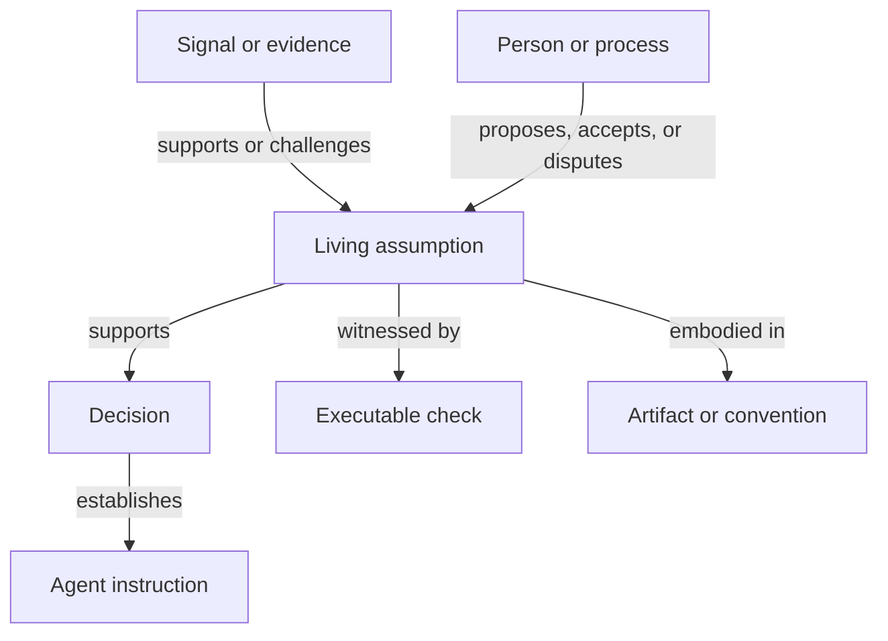

# Deferred Product and Modelling Material

> **Status:** buffer for later triage, not an accepted product specification  
> **Date:** 21 October 2026  
> **Purpose:** preserve product proposals extracted while revising the domain collection.  
> **Audience:** maintainers investigating Cairn’s scope, model, interfaces, and evaluation.

The [domain collection](../domain/README.md) describes situations independently of Cairn. This buffer preserves possible responses without selecting them. The source sections below are historical proposals. Imperative wording in an extract does not establish acceptance or override the [working agreements](../documentation-and-github-working-agreements.md). Placement here is not acceptance.

## Triage map

| Thread | Material preserved | Later question |
| --- | --- | --- |
| Organizing focus | Living project assumptions and their lifecycle | Is this an adequate focus for the chosen product situations, and what alternatives exist? |
| Scope and boundaries | Proposed responsibilities, non-goals, and source-system boundaries | Which problems should Cairn address, and which remain outside its remit? |
| Interfaces | MCP operations, run handles, typed queries, and trace records | Which interfaces support an actual workflow, including the proposed CLI, without fixing the architecture prematurely? |
| Model and provenance | PROV-O reuse, candidate relations, confirmation, and lifecycle proposals | Which distinctions require formal representation, and which standards can be reused? |
| Evaluation | Scenario-derived queries, paired agent experiments, operational effect, epistemic fidelity, and comprehension costs | What observable outcome would justify a capability and its maintenance burden? |
| Process choices | Proposed capture priorities, explicit outcome accounts, confirmation and escalation practices | Which should become project working agreements, if any, and under what authority? |

A later treatment may retain, revise, reject, or defer each proposal. Its outcome should link back to the source and record the rationale. No proposal is converted into a requirement merely by appearing in this buffer.

## Extraction boundaries

The tool report’s product sections are reproduced below with their original wording. Their mixed domain observations are retained here as part of the witness; the maintained domain notes carry independently framed versions of relevant concepts. The agent note’s general principles remain available in its [source edition](../research/source-editions/2026-10-21/llms-and-coding-agents-in-software-project-knowledge.md#10-provisional-principles) for later process design. The debt source’s product framing and conclusions remain available in its [complete source edition](../research/source-editions/2026-10-21/software-project-debt.md).

## Original extracts

### Extract 1: 9. Implications for Cairn's sweet spot

Source: [software-project-knowledge-tools.md](../research/source-editions/2026-10-21/software-project-knowledge-tools.md). Original section wording follows.

### 9. Implications for Cairn's sweet spot

#### 9.1 Candidate native anchor: the living assumption

The landscape has established owners for many project objects: issues own work items, Git owns repository history, pull requests own proposed changes, ADRs own decisions, assurance cases own arguments, tests own predicates, and incident systems own operational events. Research has also produced frameworks and tools for architectural-assumption management, so assumptions are not an unknown concept. They are nevertheless rarely the native anchor of a mainstream, lightweight project workflow.

Industrial research strengthens this distinction. Architects make assumptions frequently, but the term is understood inconsistently; assumptions are context-dependent, change over time, and connect to requirements, decisions, and other artifacts. [Yang and colleagues' industry study](https://research.rug.nl/en/publications/architectural-assumptions-and-their-management-in-industry-an-exp/) shows both the relevance of the concept and the lack of settled ordinary practice around it.

For the present hypothesis, an **assumption** is not a separate kind of sentence. It is a contextual role of a proposition:

> **A living project assumption is a proposition that the project currently
> relies upon for action, within a stated scope, without treating its support as
> final or unconditional.**

The same proposition may begin as a hypothesis, become sufficiently supported to guide a decision, later be challenged, and eventually be reinforced, refuted, or retired. Those are changes in the project's relation to the proposition, not silent edits to the original statement.

The assumption and the instruction must remain distinct. The first describes a qualified project belief; the second directs behavior after a decision. Cairn may derive or render agent-facing guidance from the graph, but improving model compliance must not silently change the assumption's scope, support, standing, or uncertainty.

This anchor gives the surrounding relations an operational purpose. A changed condition asks which assumptions it challenges. A failing check asks what assumption it witnesses. A proposal asks what assumptions it relies on. A retrieved decision asks whether its assumptions still apply. A departure asks which relied-upon assumptions were understood or maintained primarily by the person leaving.

The candidate boundary can therefore be stated more narrowly:

> **Cairn should preserve and query the lifecycle of living project assumptions
> and their typed, historical relationships to situations, people, processes,
> decisions, evidence, executable checks, and source artifacts—while leaving
> those source artifacts in the tools best suited to them.**

For agent-mediated use, a second constraint belongs inside the boundary rather than in a later interface layer: the assumption base must be **agent-actionable and human-auditable by construction**. Machine retrieval and human inspection should operate over the same versioned claims and provenance, even when their presentations differ.

Making an assumption the native anchor does not make every other concept a subtype of assumption, and it does not imply that every useful project relation passes through one. It identifies the smallest promising center for this use case. The scenario queries must now test whether that center is sufficient.

#### 9.2 Candidate responsibilities

The research suggests ten responsibilities worth testing:

1. **Capture before classification.** Accept journal entries, transcript excerpts, links, commit references, and short statements without requiring a complete type structure at creation time.
2. **Formalize progressively and reversibly.** Add types and relations only when they support a real query or action. Preserve the original witness and allow classifications to be corrected.
3. **Model assumption reliance and lifecycle.** Record who or what relies on an assumption, its scope, current standing, challenges, and changes without rewriting its history.
4. **Reference, do not duplicate.** Preserve stable references and selected metadata for source artifacts, with enough provenance to inspect the original witness. Existing ADRs, assurance cases, issues, and checks remain authoritative in their own systems.
5. **Infer, then ask for confirmation.** Use search, repository history, transcripts, and structural analysis to propose links. Keep suggestions distinct from confirmed project knowledge.
6. **Model interacting lifecycles.** Keep reports, processes, decisions, implementations, checks, conventions, and assumptions distinct, then connect their transitions without inventing a single global status.
7. **Join prose to execution.** Link assumptions to tests, policies, fitness functions, benchmarks, alerts, and operational evidence; let relevant failures reopen attention.
8. **Support the read path and uncertainty.** Make scope, provenance, current standing, contradictory evidence, and applicability visible. Allow “rationale unknown,” “candidate relation,” and “migration incomplete.”
9. **Separate belief from instruction.** Keep descriptive assumptions distinct from normative agent guidance. Derive operational projections without deleting qualifications merely to improve compliance.
10. **Expose live, traceable retrieval.** Let agents query applicable current assumptions through a narrow interface such as MCP. Record the versions available, requested, and returned for an explicit run; do not infer attention or reliance from delivery alone.

#### 9.3 Explicit non-goals

To keep the boundary useful, Cairn should not initially attempt to become:

- a source-control system;
- a general issue tracker or project board;
- a code-review interface;
- a chat or meeting platform;
- a document editor or wiki;
- an assurance-case authoring environment;
- a complete live design-rationale mapping environment or meeting facilitator;
- a CI runner, test framework, or observability backend;
- a universal enterprise requirements-management replacement;
- a prompt-optimization store that rewrites project belief solely to steer model behavior;
- an automatic oracle that reconstructs unrecorded human intent.

Integrations with these systems are central; reproducing their mature primary functions is not.

#### 9.4 Scenario-derived acceptance questions

A first model and implementation should be judged by concrete queries rather than by how many entity types it contains:

| Scenario test | Query the system should make answerable |
| --- | --- |
| Assumption dependency | What currently relies on this assumption, directly or through confirmed relations? |
| Assumption challenge | What evidence would weaken or falsify this assumption, and what should reopen if that happens? |
| Recurrence (`S1`) | Which earlier reports may be instances of this defect class, and what previous responses followed? |
| Request and authority (`S2`, `S4`) | Who originated, supported, disputed, and had authority over the relevant assumption or decision? |
| Changed condition (`S5`) | Which active decisions and conventions depend on this assumption, and what evidence supported it? |
| Executable challenge (`S6`) | What assumption does this failing check witness, why was it introduced, and who owns the response? |
| Ambiguous intention (`S7`, `S9`, `S10`) | Is the coexistence of these patterns classified as accretion, unrecorded decision, incomplete migration, or still unknown? Is that classification inferred or confirmed, and from what evidence? |
| Retrieval (`S12`) | Was this approach tried before, why did it stop, and do those conditions apply now? |
| Refutation (`S13`) | Which later choices depended on the premise now shown to have been false? |
| Departure (`S14`) | Which active processes, decisions, assumptions, and components relied on knowledge concentrated in this contributor? |
| Inception (`S15`) | Which provisional choices have hardened through public interfaces, stored data, or accumulating dependents without explicit reconsideration? |
| Agent guidance (`A1`, `A2`) | Which current assumptions and decisions justify this instruction, and were their qualifications preserved in the agent-facing form? |
| Context boundary (`A1`–`A7`) | Which assumption versions were available, requested, returned, cited, and allegedly relied upon during this run? Which of those facts are trace-backed? |
| Agent review (`A7`) | What evidence, context, configuration, or model difference makes this review epistemically independent rather than a repetition of the author's blind spots? |
| Immediate utility | For the same task and project state, does retrieving a small qualified assumption record improve the validity of the agent's result today? |

These tests collectively exercise history, query, provenance, relationship semantics, uncertainty, and integration. They are a better guide to the sweet spot than an attempt to document every kind of software knowledge.

Immediate operational effect and epistemic fidelity are independent acceptance dimensions:

|  | High epistemic fidelity | Low epistemic fidelity |
| --- | --- | --- |
| **High operational effect** | Useful, faithful project knowledge | Effective steering with a corrupted account |
| **Low operational effect** | Faithful but operationally inert | Noise |

The smallest useful experiment is a paired agent task that can be run in an afternoon: hold the repository, task, tools, and model configuration constant; vary whether a compact applicable assumption record is retrieved; compare the validity of the result; and then inspect whether the record and its agent-facing projection preserved scope, evidence, and uncertainty. Behavioral improvement without fidelity is a failed knowledge experiment, even if it is a successful prompting experiment.

#### 9.5 Risk order: capture before staleness

Staleness is serious, but it is not the first risk. It is a problem a system encounters only after people or integrations are producing records. The historical evidence suggests the following order:

1. **No capture.** The observation, uncertainty, rationale, or relationship never leaves a person's head or an inaccessible conversation.
2. **Premature formalization.** The input model demands distinctions the person cannot yet make, so they avoid the system or state false certainty.
3. **Epistemic-to-instruction drift.** A record is made more confident or less nuanced to steer an agent, ceasing to be a faithful account of project belief.
4. **Incorrect inference.** A person or automated process assigns a relation or meaning that the evidence does not justify.
5. **Opaque context and retrieval failure.** Applicable knowledge is not requested or returned, while an incomplete run later appears to have had the project's guidance.
6. **Relationship decay.** Source artifacts evolve while manually maintained links and classifications do not.
7. **Staleness and misapplication.** A preserved record remains confident after its assumptions, evidence, or scope have changed.

Capture is therefore the historically demonstrated adoption risk. Cairn should optimize first for a useful witness being retained, second for structure being added at the right time, and only then for increasingly precise automation and maintenance.

Immediate agent utility is the strongest available lever against the first risk, but it also creates the third. Adoption and fidelity must therefore be measured together rather than optimized in sequence.

The provenance part should reuse rather than reinvent the W3C PROV-O model. PROV-O supplies `Entity`, `Activity`, and `Agent`, with relations including `wasGeneratedBy`, `used`, `wasDerivedFrom`, `wasAssociatedWith`, and `wasAttributedTo`. [The W3C recommendation](https://www.w3.org/TR/prov-o/) therefore provides a strong substrate for expressing that an interpretation was derived from a transcript, an imported witness was generated elsewhere, or an inference activity produced a candidate link.

PROV-O does not itself distinguish observation from interpretation, refutation from supersession, or a detected inconsistency from its resolution. Those are domain semantics layered over provenance. A human confirmation can likewise be modeled as a later activity associated with an agent, without erasing the earlier automatic proposal.

Where source systems expose APIs or repository artifacts, synchronization and consistency checks should be preferred over copying prose. Where interpretation is uncertain, the system should ask a targeted question or retain the ambiguity.

#### 9.6 First integration hypothesis: an MCP assumption service

The smallest implementation suggested by this landscape is not a new authoring suite. It is a versioned assumption store with a narrow MCP boundary that an agent can query during ordinary work. A first server could expose operations such as:

- `begin_run`: create an explicit activity handle with project, task, actor, and toolchain metadata;
- `find_applicable_assumptions`: return candidates for a component, artifact, change, or question;
- `get_assumption`: retrieve the current standing, scope, support, challenges, dependents, and source witnesses for one versioned assumption;
- `get_dependents`: identify decisions, instructions, checks, and artifacts that rely on it;
- `report_challenge`: attach a failing check, contradictory observation, or changed condition without immediately refuting the assumption;
- `propose_assumption`: retain a low-friction statement or inferred candidate for later confirmation.

The service should log the explicit run handle, requested operation, assumption version, and returned result. It should not claim that a model used or believed what it received. If the client cites a record or reports reliance, those are additional events with their own provenance and evidential strength.

This prototype directly tests the proposed economic break. A contributor can add one small qualified assumption, rerun the current task, and observe whether retrieval improves the result. At the same time, a human can inspect whether the retrieved projection remained faithful. If neither effect appears, the model is too costly or too weak; if behavior improves only after qualifications are removed, the interface is optimizing a prompt rather than preserving project knowledge.

### Extract 2: 10. Conclusions

Source: [software-project-knowledge-tools.md](../research/source-editions/2026-10-21/software-project-knowledge-tools.md). Original section wording follows.

### 10. Conclusions

The existing toolchain is not a collection of failed attempts at one problem. It is a set of successful answers to different problems. Git, issues, pull requests, RFCs, ADRs, assurance cases, documentation, journals, executable checks, incident practices, catalogs, search, and lifecycle suites should remain distinct because their native objects, users, and operational requirements differ.

The design-rationale and traceability lineages matter because they attempted more of the connective problem than today's common toolchain. They show that rich representations are possible and can be useful. They also expose the central adoption constraint: manually producing a complete rationale graph is specialized work, and formalizing a thought before it is ready can destroy the very ambiguity the process needs to preserve. The lesson is not that rationale is unrepresentable, but that representation must follow capture and demonstrated need. Grudin's work-benefit disparity identifies the adoption mechanism behind that history: capture is difficult to sustain when its cost is immediate and its benefit is delayed, uncertain, and received by someone else.

Agent-mediated work creates a credible break in those economics. Repository instruction files already receive voluntary maintenance because they improve near-term agent behavior. That evidence is strongest for commands, conventions, and operational guidance; it does not by itself prove that teams will maintain qualified rationale. The next question is therefore empirical: can a small faithful assumption record improve the current agent run quickly enough to pay for its capture?

The remaining vacancy is therefore narrower than a universal project-memory system. No mainstream, lightweight workflow makes the **living project assumption** its native anchor: what the project currently relies upon, in what scope, what rests on it, what supports or challenges it, and how its standing changes. Issues own tasks, ADRs own decision events, tests own executable predicates, and incident systems own operational events; the assumption can connect those objects without replacing them.

That is the credible sweet spot for Cairn: **an assumption-centered connective memory that preserves source witnesses, proposes trace links, records human confirmation and disagreement, and makes applicability visible at retrieval time**. In the agent era, it must also keep descriptive assumptions separate from derived instructions and be agent-actionable and human-auditable by construction.

This boundary should now be tested with the scenario-derived queries in §9.4 and with thin integrations to Git, issues or pull requests, ADRs, transcripts, and CI. The first prototype should be the MCP assumption service described in §9.6, evaluated through same-day paired agent runs for both operational effect and epistemic fidelity. It should optimize for retaining useful witnesses at near-zero cost, then add reversible structure and inferred links only where a query requires them. If the queries demand duplicated source systems, a trained facilitator, or continuous manual graph maintenance, the boundary remains too broad. If a small assumption-centered model answers them through references, events, executable witnesses, and confirmed candidate relations—and improves a current task without corrupting its account—the project has found a defensible center.

### Extract 3: 8.4 MCP as a live project-knowledge boundary

Source: [llms-and-coding-agents-in-software-project-knowledge.md](../research/source-editions/2026-10-21/llms-and-coding-agents-in-software-project-knowledge.md). Original section wording follows.

#### 8.4 MCP as a live project-knowledge boundary

The Model Context Protocol provides a current standard interface for exposing tools, resources, and prompts to AI applications. An assumption base need not be flattened into a static instruction file. An MCP server can expose typed queries over current standing, scope, evidence, challenges, dependencies, and history, then return only the knowledge relevant to a run. [The MCP architecture overview](https://modelcontextprotocol.io/docs/2026-07-28/learn/architecture) defines this client-server exchange of live context.

An initial project-knowledge surface could offer operations such as:

- `begin_run(task_ref, project_state_ref) -> run_id`;
- `find_applicable_assumptions(run_id, artifact_refs, task_ref)`;
- `get_assumption(run_id, assumption_id)`;
- `get_dependents(run_id, assumption_id)`;
- `report_challenge(run_id, assumption_id, evidence_ref)`;
- `propose_assumption(run_id, statement, scope, witness_ref)`.

This interface also helps make the context boundary observable. The service can record which version of an assumption was requested and returned, for which task and run, and when. It cannot establish that the model attended to or relied on the returned material.

That qualification must be designed explicitly. The current MCP specification is stateless and has no protocol-level session concept. Servers normally receive client identity on each request, but a Cairn-style run identity would need an explicit handle or authenticated metadata. The specification recommends explicit handles when state must span calls and logging tool use for audit purposes. [The MCP tools specification](https://modelcontextprotocol.io/specification/2026-07-28/server/tools) therefore supplies the transport and invocation model, not the project's run semantics by itself.

### Extract 4: 9. Questions for later modeling

Source: [llms-and-coding-agents-in-software-project-knowledge.md](../research/source-editions/2026-10-21/llms-and-coding-agents-in-software-project-knowledge.md). Original section wording follows.

### 9. Questions for later modeling

This assessment does not yet prescribe ontology entities or relations. It does identify questions that a candidate model and implementation must answer:

1. How are a model, configured agent, and situated run distinguished?
2. How are delegation, action permission, decision authority, production, review, and acceptance represented without collapsing them into authorship?
3. Which project records were available, requested, and returned to a run, and which records did the agent later claim materially influenced an action?
4. How is the applicability of retrieved knowledge represented at the time of use?
5. How are an epistemic assumption and a derived agent instruction kept distinct while remaining traceable to one another?
6. How are trace-backed observations, generated rationale, inferred rationale, and confirmed rationale kept distinct?
7. How can an agent cite source witnesses without duplicating their content?
8. Which observable run events should trigger a capture or escalation request?
9. How are interacting or parallel runs connected to shared assumptions, decisions, artifacts, and commitment surfaces?
10. How can executable checks witness assumptions without being confused with their explanation?
11. How can derived summaries avoid creating circular evidence when later agents retrieve them?
12. Which agent-produced objects have their own lifecycle, and which are only events in the lifecycle of another project object?
13. How is review independence evaluated when one coding agent reviews another agent's output?
14. What run handle, client identity, and retrieval events must an MCP service preserve without claiming that served knowledge was used?
15. Can a qualified assumption improve an agent run today without strengthening, flattening, or otherwise corrupting its epistemic content?
16. What must a human be able to query before accepting an agent-produced change?

These are competency and stress questions. They should test the eventual model; they should not automatically become sixteen primitive types or relations.

### Extract 5: 13. Implications for Cairn remain a product hypothesis

Source: [software-project-debt.md](../research/source-editions/2026-10-21/software-project-debt.md). Original section wording follows.

### 13. Implications for Cairn remain a product hypothesis

The debt lens strengthens a possible purpose for Cairn:

> **Help maintainers keep project intent, implementation, and shared understanding connected so that they can investigate, assess, and evolve the system at a sustainable cost.**

This complements the tool-landscape note's candidate focus on living project assumptions. Assumptions connect compromises to their conditions of validity, evidence, and review triggers. That remains a hypothesis to test; debt does not automatically become Cairn's native object, nor does this note prescribe entities or storage.

Cairn could help recover relevant context, distinguish observed facts from candidate explanations, expose missing or conflicting knowledge, and reconnect a changed condition to earlier commitments. The CLI can provide inspectable access to that evidence across artifacts and development platforms. Companion agents can guide investigation, challenge interpretations, and help maintainers review what needs attention. In the current intended mode, they guide and review; edits to project files require permission. Responsibility for accepting commitments and explanations remains explicit.

Cairn's contribution should be tested through concrete maintenance situations: reviewing an agent-generated change, recovering an architectural rationale, transferring responsibility, or revising an old compatibility commitment. Useful observations include whether people can identify the relevant evidence, explain the assumptions, assess a change, and act with less repeated reconstruction.

The evaluation must also include Cairn's own burden: capture effort, review time, misleading candidates, duplicated guidance, and ongoing record maintenance. A smaller amount of faithful, retrievable knowledge may be more valuable than a larger corpus. Better agent output alone is insufficient if the supporting account becomes less accurate or the maintainers less able to understand it.
