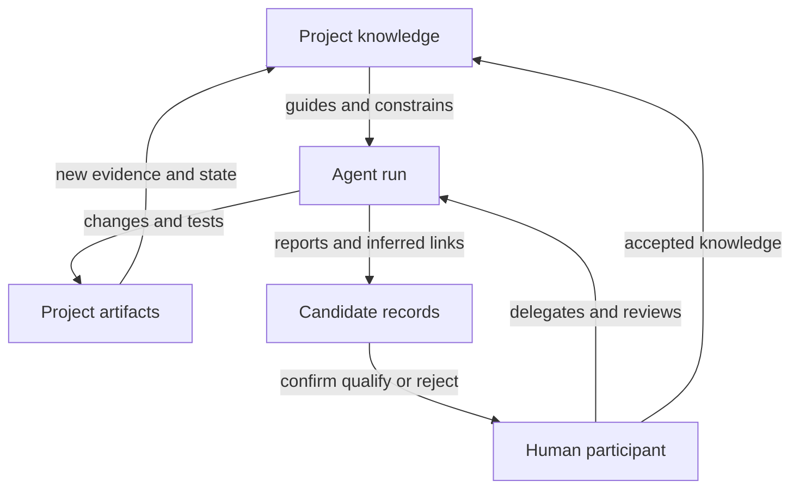
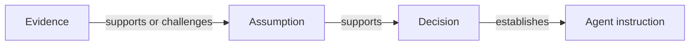

# LLMs and Coding Agents in Software-Project Knowledge

> **Status:** preliminary companion assessment  
> **Date:** 4 September 2026  
> **Purpose:** examine how LLMs and coding agents change the production,
> consumption, validation, and preservation of knowledge in software projects.  
> **Scope:** a cross-cutting framing document, not a product survey, an AI
> governance policy, or a proposed implementation.

This document complements *Observations on Software Design and Development*,
*Software Design Trigger Scenarios*, and *Software-Project Knowledge Tools*.
Those documents describe the conditions of software work, representative
initiating situations, and the capabilities and boundaries of existing tools.
The present document examines a change that cuts across all three: software work
can now be delegated in part to systems that retrieve project knowledge, act on
the project, and produce further candidate knowledge.

Coding agents should not be treated merely as another item in the tool
landscape. They can participate in a bug fix, feature implementation, review,
migration, incident response, documentation process, or retrieval activity.
They therefore modify existing situations rather than occupying one isolated
stage of development.

## Executive assessment

LLMs and coding agents make project knowledge **operational** in a new way.
Documentation is no longer written only so that a future person can understand
the project. Instructions, conventions, decisions, assumptions, examples, and
validation procedures may be retrieved and used directly by a software agent
while it changes the codebase.

The relationship is bidirectional:

- project knowledge guides an agent's interpretation and actions;
- agent activity produces code, tests, observations, uncertainties, and local
  choices that may need to become project knowledge;
- LLMs can help people retrieve, articulate, structure, and connect knowledge;
- people remain responsible for deciding which generated interpretations are
  accepted as shared project knowledge.

The central pressure is a rate asymmetry:

> **Code and candidate explanation can be produced faster than people can
> inspect, understand, and validate them.**

Agent-mediated retrieval also changes the economics of documentation. Grudin's
classic groupware analysis identifies a recurrent disparity: collaborative
systems ask one person to perform work whose benefit arrives elsewhere or
later. Manual rationale capture, trace maintenance, and facilitated dialogue
mapping all exhibit this structure. [Grudin's account of the disparity between
work and benefit](https://www.microsoft.com/en-us/research/wp-content/uploads/2017/01/groupware-and-social-dynamics.pdf)
does not explain every form of staleness or misapplication, but it identifies
the central adoption problem for capture.

When project knowledge is retrieved during the next agent run, that disparity
can partly collapse. The person who records an assumption or convention may
receive a better implementation or review within minutes, on the task currently
in front of them. The benefit becomes local, immediate, and testable rather
than deferred and probabilistic.

`AGENTS.md` is an important existence proof for this changed incentive. Its
project reports adoption in more than 60,000 open-source repositories without a
compliance mandate or trained facilitator. It primarily demonstrates voluntary
maintenance of immediately useful operational guidance—not yet sustained
assumption or rationale capture—but it establishes a consequential design
rule: **project knowledge should be agent-actionable and human-auditable by
construction**. [`AGENTS.md`](https://agents.md/) succeeds because the next run
can pay back the effort of improving it.

This does not make exhaustive documentation desirable. It makes selective,
evidence-linked explanation more important. A reviewer does not need a verbose
reconstruction of every local action. They need to know which assumptions were
relied upon, which constraints were applied, where consequential choices were
made, what evidence was produced, and what remains uncertain.

LLMs can lower the cost of producing that account, but they can also manufacture
plausible rationale that never existed, remove unresolved disagreement from a
summary, or repeatedly amplify stale knowledge. Generated structure must
therefore remain distinguishable from its source witnesses and from later human
confirmation.

## 1. Working distinctions

### 1.1 Model, coding agent, and agent run

An **LLM** is a generative model. By itself it is not a persistent project
participant with a stable task, permissions, tools, or memory.

A **coding agent** is a configured system that combines an LLM with some of the
following:

- task instructions;
- project and repository context;
- retrieval mechanisms;
- tools for reading, editing, searching, testing, and external interaction;
- state or memory;
- permissions and isolation boundaries;
- a control loop that selects and evaluates actions;
- approval or escalation points.

An **agent run** is a situated activity performed by a coding agent for a
particular purpose. It occurs at a time, against a particular project state,
with particular inputs, tools, permissions, and participants. The same configured
agent can produce different results in different runs because those conditions
change.

These distinctions matter for history. A project may need to record that a
human delegated a task, a configured coding agent performed a run, a particular
change resulted, and another human accepted it. Collapsing all four facts into
“generated by the model” loses the process and its distribution of
responsibility.

The term **human participant** is used when the distinction from a software
agent matters. The term **agent** alone may still describe either kind of actor
when the scenario does not depend on that distinction.

### 1.2 Assistance, delegation, and autonomy

Assistance and delegation are not separated by one universal threshold. An LLM
may complete a sentence, propose a patch, edit several files under observation,
implement an issue asynchronously, or operate repeatedly in the background.

Autonomy is therefore better described as a profile across several dimensions:

| Dimension | Questions |
| --- | --- |
| Scope | Is the agent changing one expression, one file, one issue, a subsystem, or several repositories? |
| Action permission | Can it only propose text, or can it edit, execute, commit, merge, deploy, or call external services? |
| Duration | Is the work one interaction, a multi-hour run, or a persistent background process? |
| Approval boundary | Which actions require prior approval, retrospective review, or no human intervention? |
| Concurrency | Is one agent acting, or are several agents producing changes in parallel? |
| Environmental reach | Is the agent confined to a local workspace, or can it affect shared and production systems? |
| Recovery | Can its actions be inspected, reverted, replayed, or repaired? |

Two agents described as “highly autonomous” may therefore create very different
risks. Broad read access with no write permission is unlike narrow production
write access; several parallel repository agents are unlike one supervised
editor session.

### 1.3 Witness, candidate interpretation, and accepted knowledge

Agent-mediated work produces objects with different epistemic status:

- a diff is a witness of the change proposed or made;
- a test result is a witness of an execution under stated conditions;
- a transcript or run log is a partial witness of activity;
- an agent's explanation of why a choice was made is a generated assertion,
  not privileged access to the generative process;
- an inferred relationship between a change and an earlier decision is a
  candidate interpretation;
- a human confirmation is a later event that changes the project's standing
  toward that interpretation.

These objects should not be collapsed. An LLM's explanation is generated after
the fact from the same system that produced the choice. It may accurately
summarize the evidence, but it has no internal marker that reliably distinguishes
an accurate explanation from a plausible reconstruction. A human account is
also fallible, but it is imperfect recollection of a different kind of process;
the two reports should not receive the same evidential interpretation by
default.

A fluent explanation is not made historically true by its fluency. Conversely,
an automatically proposed link or explanation can be useful without first being
treated as established fact.

## 2. The bidirectional knowledge relationship

The project-to-agent direction and the agent-to-project direction form a
feedback loop. Human validation participates in both.

This topology contains at least four paths:

| Path | Useful outcome | Characteristic failure |
| --- | --- | --- |
| Project → agent | The agent acts consistently with current decisions, assumptions, and practices | Relevant knowledge is absent, not retrieved, contradictory, stale, or applied outside its scope |
| Agent → project | Consequential choices, evidence, and uncertainty remain recoverable | The code survives but its local design meaning disappears |
| Human + LLM → project | The LLM lowers the cost of externalizing and connecting human knowledge | Generated structure introduces false certainty or invented rationale |
| Project → human through an LLM | Prior knowledge becomes findable and changes a current decision | The synthesis is incomplete, untrusted, or incorrectly applied |

The four paths interact. Better project knowledge can improve an agent's work;
better reports can improve human review; confirmed conclusions can improve
future retrieval. The same loop can also compound error: an invented summary
may be accepted implicitly, retrieved by a later agent, and repeated as if it
were independent evidence.

## 3. Project knowledge as input to action

Repository-level instruction mechanisms already make this relationship
concrete. Codex reads layered `AGENTS.md` files, and GitHub Copilot supports
repository and path-specific Markdown instructions describing how to understand,
build, test, and validate a project. Agent skills package task-specific
instructions, resources, and optional scripts into reusable workflows.
[Codex custom instructions](https://learn.chatgpt.com/docs/agent-configuration/agents-md),
[GitHub repository instructions](https://docs.github.com/copilot/customizing-copilot/adding-custom-instructions-for-github-copilot),
and [Codex skills](https://learn.chatgpt.com/docs/build-skills) demonstrate that
project knowledge is already being prepared for machine use.

The stronger lesson from `AGENTS.md` is economic rather than merely technical.
It is voluntarily maintained because a contributor can improve a file and see
the effect on the next task. Agent retrieval turns some documentation from a
contribution to an uncertain future reader into an input to current production.
That immediate loop is a plausible answer to Grudin's disparity and a sharp
contrast with rationale practices whose benefit was delayed or delivered mainly
to other participants.

The claim should remain bounded. `AGENTS.md` proves sustained capture of useful
instructions and conventions more directly than it proves capture of evidence,
uncertainty, or design rationale. The next experiment is whether a qualified
assumption record can preserve its epistemic content while improving an agent
run today.

This produces two independent acceptance dimensions:

| Operational effect | Epistemic fidelity | Interpretation |
| --- | --- | --- |
| High | High | Useful and faithful project knowledge |
| High | Low | Effective steering built on corrupted knowledge |
| Low | High | Faithful but operationally inert archive |
| Low | Low | Noise and capture burden |

Several kinds of input should nevertheless remain distinct:

| Input layer | Examples | Function | Principal limitation |
| --- | --- | --- | --- |
| Task intent | Issue, requested outcome, acceptance criteria | States what the current run is meant to accomplish | May compress a need and a proposed solution |
| Semantic guidance | Principles, ADRs, current assumptions, architectural explanations | Helps interpret what an appropriate change means | Applicability and current standing may be unclear |
| Procedural guidance | Build commands, review procedure, migration sequence, reusable skill | Describes how work should be carried out | Following the procedure does not establish that the result is appropriate |
| Executable constraints | Tests, types, linters, policy, architecture rules, schemas | Rejects selected invalid or undesired states | Only expressible predicates are covered; a check may be obsolete or weakened |
| Permission boundaries | Read/write scope, sandbox, approval gates, credentials | Limits which actions are possible | Permission does not establish correctness or authority to decide |

A natural-language instruction is not equivalent to an executable constraint.
A test is not equivalent to the rationale for the property it checks. A
permission is not equivalent to a decision that exercising it is appropriate.
The layers should support one another without being treated as substitutes.

For example, a project may state that domain functions should be pure because
past defects arose from hidden mutation. A static check may enforce part of the
rule. The agent can be instructed to run that check and to escalate rather than
disable it. The explanation supplies meaning, the check supplies a failing
witness, and the permission boundary prevents unilateral weakening.

### 3.1 Assumption and instruction are not the same object

Immediate machine use creates pressure to rewrite project knowledge into
whatever language steers the model most effectively. That pressure makes a
semantic distinction operationally necessary.

An **assumption** is descriptive and epistemic: the project currently relies on
a proposition within a scope, with some support, uncertainty, and standing. An
**instruction** is normative: it directs an agent to perform, avoid, validate,
or escalate an action.

An instruction may follow from an assumption and a decision, but it should not
replace the assumption that justifies it:

The agent-facing projection can be concise and directive. The underlying
assumption must retain its scope, evidence, uncertainty, history, and relation
to the decision. Otherwise the record can drift from “what the project
currently believes” toward “what wording makes the agent comply” without any
explicit change in project knowledge.

### 3.2 Relevance is part of the input problem

Supplying all project documentation to every run is not a satisfactory answer.
The relevant knowledge depends on the task, affected artifacts, current project
state, and decisions or assumptions that govern the touched area.

An agent therefore needs both standing guidance and contextual retrieval:

- standing guidance establishes stable behavioral and procedural defaults;
- contextual retrieval identifies the decisions, assumptions, incidents,
  conventions, and exceptions relevant to this change;
- executable checks validate selected properties after action;
- targeted questions resolve important ambiguity that retrieval cannot settle.

The read path remains fallible. An agent may not search, search with the wrong
terms, retrieve a record without its superseding record, or correctly retrieve
a decision whose original conditions no longer apply. Agentic retrieval scales
access to knowledge; it does not remove the need to judge applicability.

### 3.3 Conflict requires escalation semantics

Project knowledge is often inconsistent. A current convention may conflict with
legacy code, two instructions may govern overlapping directories, or an accepted
decision may conflict with a newer operational constraint.

An agent should not silently manufacture a resolution merely because it must
continue generating actions. The project needs a way to distinguish:

- a precedence rule that mechanically resolves the conflict;
- a documented exception;
- a local interpretation made within delegated authority;
- an unresolved conflict that requires human qualification.

The last case is valuable knowledge. A run that stops with a precise conflict
and its affected artifacts may contribute more than a locally successful change
that hides the inconsistency.

## 4. Agent activity as a source of project knowledge

An agent may make hundreds of mechanically necessary choices during a change.
Recording each one would recreate the capture-cost failure of formal design-
rationale systems at a larger scale. The goal is not exhaustive action logging
but selective preservation of choices that affect validation, future
applicability, or accumulated commitment.

Observable capture signals include:

- a public interface, schema, stored representation, or compatibility promise
  was changed;
- more than one materially different approach was evaluated;
- an external source or earlier project record had to be consulted;
- project instructions or accepted constraints conflicted;
- a check failed, was bypassed, weakened, or reinterpreted;
- the implementation introduced an exception to an existing convention;
- the agent could not validate an assumption on which the change depends;
- the task expanded into a broader architectural or process question;
- the agent requested escalation or made a choice at an explicit approval
  boundary.

These signals are available during the run. They do not ask the agent to predict
which choice people will question several years later.

### 4.1 Prefer an outcome account to an exhaustive reasoning trace

A useful handover should not attempt to preserve every intermediate generated
step. It should report the outcome in relation to project objects and evidence.
The account must separate two halves whose evidential strength differs.

#### Trace-backed observations

These can be derived from the run environment and source systems:

- requested outcome, task reference, and affected scope;
- project state and versions available to the run;
- records requested and returned by retrieval systems;
- tools and commands invoked;
- files, interfaces, schemas, and persistent data affected;
- tests and checks executed, with their observed results and conditions;
- permissions, approval requests, and escalation events;
- deviations, bypasses, and created follow-up artifacts.

Even here the semantics must remain precise. A record returned to the agent was
**served** to the run; that does not establish that the model attended to it or
that it materially influenced the result.

#### Agent assertions and interpretations

These are generated accounts that may be useful but are not directly observed:

- assumptions allegedly relied upon;
- reasons for selecting one alternative;
- alternatives allegedly considered;
- intended consequences;
- perceived uncertainty and known limitations;
- claimed applicability of retrieved knowledge;
- points the agent believes require human acceptance.

The outcome account is therefore a claim-bearing artifact with internally
different statuses. Trace-backed statements should reference the diff, command
result, test, retrieval event, discussion, or source record that witnesses them.
Assertions about rationale or applicability remain candidate explanations until
their standing changes through the project's process.

### 4.2 Authorship and responsibility become layered

Ordinary repository metadata often compresses authorship into an author and a
committer. Agent-mediated work can involve several different roles:

| Role | Example relation to the change |
| --- | --- |
| Requester | Asked for the outcome or initiated the run |
| Delegator | Chose to assign the task to a coding agent and set its authority |
| Coding agent | Performed the run and produced the proposed artifacts |
| Tool or model configuration | Participated in generation under a recorded environment |
| Reviewer | Inspected some properties of the result |
| Decision authority | Accepted a consequential choice or unresolved risk |
| Integrator | Merged, released, or deployed the result |

These roles may be occupied by one person, several people, automated systems, or
a mixture. Their distinction prevents several false implications:

- delegation does not imply detailed authorship of every implementation choice;
- agent production does not imply authority to establish project policy;
- review does not imply that every generated choice was reconstructed;
- approval does not imply agreement with every aspect of the change;
- merging does not imply that all documentation and preventive processes are
  complete.

## 5. LLMs as capture and retrieval assistants

The most promising use of an LLM for project knowledge may not be autonomous
code production. It may be reducing the friction between fluid work and durable,
selectively structured memory.

### 5.1 Capture assistance

During or after human work, an LLM can:

- preserve a raw note, transcript excerpt, issue comment, or agent handover as a
  source witness;
- propose atomic statements from a long conversation;
- separate an observation, hypothesis, assumption, objection, decision, and
  follow-up action;
- detect that a feature request compresses a need and one proposed solution;
- ask whether a voiced objection was withdrawn, accepted as risk, or left
  unresolved;
- identify an assumption that could be expressed through an executable check;
- prepare a concise record for human correction and confirmation.

This is system-assisted formalization: capture can occur before the final type
or relationship is known, and structure can be proposed later when it supports
a real query or action.

### 5.2 Retrieval and candidate-link recovery

An LLM can search across repository history, issues, reviews, ADRs, documents,
transcripts, checks, and incident records to propose that two objects are
related. It can also show the passages or changes on which the proposal rests.

A safe pattern remains:

1. retrieve source witnesses;
2. propose a relationship or interpretation;
3. expose the evidence and uncertainty;
4. request confirmation only when the distinction matters;
5. preserve the proposal, response, and provenance without rewriting the
   sources.

For example, an LLM may suggest that three differently worded defects instantiate
the same class. That suggestion enables investigation. It does not establish the
class until the evidence is evaluated.

### 5.3 Maintenance assistance

LLMs can also help detect possible decay:

- an ADR refers to a dependency version that has changed;
- a convention is contradicted by repeated accepted changes;
- a test linked to an assumption has been disabled;
- a migrated component still contains the source pattern;
- a summary no longer matches its referenced artifact;
- two current records give incompatible guidance.

These should normally produce signals, not silent rewrites. Automatically
editing the prose to match the latest state could erase the historical fact that
the project changed its mind or ceased to satisfy an earlier assumption.

## 6. New failure modes

Agent-mediated work inherits the knowledge failures already identified in
software projects and adds several characteristic forms.

| Failure mode | Mechanism | Consequence |
| --- | --- | --- |
| Documentation laundering | An inferred or generated rationale is stored without its candidate status | Later readers treat a plausible reconstruction as historical fact |
| Synthetic consensus | A summary compresses disagreement, hesitation, or silence into a clean conclusion | Authority and unresolved objections disappear |
| Epistemic-to-instruction drift | A record is rewritten to steer agent behavior rather than represent actual belief, support, and uncertainty | Operationally effective wording silently corrupts project knowledge |
| Unknown context boundary | The run does not preserve which records were available, requested, and returned | Later diagnosis cannot distinguish ignored guidance from guidance the agent never received |
| Context omission | The agent retrieves a rule without its scope, exception, or superseding record | A locally coherent action is wrong for the present situation |
| Stale amplification | Obsolete guidance is applied consistently across many generated changes | Knowledge decay propagates faster than under manual work |
| Distributional reversion | Repeated agent changes replace unusual project conventions with statistically common patterns | Machine-volume accretion erodes intentional structure without an explicit decision event |
| Volume asymmetry | Code, comments, and records are produced faster than people can evaluate them | Review becomes sampling while approval still appears comprehensive |
| Circular evidence | Several generated statements derive from one source but later appear independent | Apparent support increases without new evidence |
| Silent instruction conflict | The agent selects one of several incompatible instructions without surfacing the conflict | A project-level inconsistency becomes an undocumented local choice |
| False completion | The requested artifact is produced while related migration, documentation, prevention, or validation remains open | Local task closure conceals unfinished processes |
| Authority leakage | Permission to act is treated as authority to establish policy or accept risk | Consequential decisions occur outside their intended governance boundary |
| Unreviewable accumulation | Several agents produce interacting changes concurrently | No participant retains a coherent view of their combined assumptions and effects |

These failures should not be answered by requiring more prose from every run.
That would increase the volume asymmetry. The response must combine selective
capture, source references, executable validation, targeted escalation, and
explicit status.

Epistemic-to-instruction drift is the mirror image of immediate operational
benefit. Once a record affects every run, contributors have an incentive to
remove nuance that produces hesitation, strengthen claims that improve
compliance, or omit uncertainty that makes the model hedge. The assumption and
its derived agent instruction must therefore remain distinct, and both
operational usefulness and epistemic fidelity must be tested.

Distributional reversion is also a new form of non-decision. The repeated
pattern is observable, while attribution to a model's training distribution is
an inference rather than recoverable rationale. A repository can gradually move
toward common generated patterns because each local change is convenient, not
because anyone chose a new architectural direction. Unusual conventions need
retrievable examples, explicit scope, and executable protection where possible.

## 7. Agent-mediated scenario set

The identifiers `A1` through `A7` name situations specific to the agent lens.
They do not replace `S1` through `S15`. A coding agent can participate in any of
the original scenarios; the `A` scenarios isolate pressures introduced or
amplified by that participation.

| Identifier | Initiating situation | Principal pressure |
| --- | --- | --- |
| `A1` | A human delegates a bounded implementation to a coding agent | Validate a dense set of generated choices without reconstructing every action |
| `A2` | An agent retrieves project guidance before changing a subsystem | Select and apply relevant knowledge rather than merely finding it |
| `A3` | Retrieved instructions or constraints conflict | Escalate a project inconsistency instead of silently inventing precedence |
| `A4` | An LLM helps a human externalize an active design discussion | Lower capture cost without converting suggestions into accepted history |
| `A5` | An agent finds and trusts a stale but authoritative-looking record | Detect that retrieval succeeded while applicability failed |
| `A6` | Several agents work concurrently on related changes | Preserve a coherent view of cross-run assumptions, decisions, and interference |
| `A7` | A coding agent reviews code produced by a human or another agent | Gain review without sunk or social cost while testing whether the review is epistemically independent |

### A1 — Delegated implementation produces opaque decision density

A human delegates a feature or refactoring task to a coding agent. The task is
bounded by an issue and repository instructions. The agent modifies several
components, introduces an abstraction, adds tests, and returns a passing pull
request.

In the deliberate trajectory, the handover identifies the governing assumptions,
material alternative, affected commitment surfaces, validation evidence, and
one choice that requires explicit acceptance. The reviewer can focus on those
points while still inspecting the diff and tests.

In the abbreviated trajectory, the agent supplies a generic summary and a large
working diff. The reviewer verifies that checks pass and samples the code. The
change is merged, but nobody can later distinguish deliberate architecture from
the agent's locally convenient completion.

Important non-implications:

- Passing checks do not establish that the implementation respects every
  relevant design intention.
- A generated summary does not establish why each consequential choice was
  made.
- Human approval does not establish that the human reconstructed the complete
  implementation process.

### A2 — Retrieved project knowledge guides an agent

Before changing a subsystem, an agent retrieves a current ADR, a coding
convention, an earlier incident, and an assumption linked to an architectural
check. These records redirect the proposed implementation away from an approach
that previously caused operational problems.

This is the positive read-path case: preserved knowledge changes an outcome.
The run should retain which records were requested and returned, which ones the
agent cited, and what observable parts of the change are consistent with them.
A claim that one record materially influenced the result remains an assertion
unless stronger evidence supports it.

In the abbreviated trajectory, the agent does not search because the task
appears routine, or it searches with vocabulary that does not match the earlier
record. The prior failure is repeated.

Important non-implications:

- The existence of relevant knowledge does not establish that the agent will
  retrieve it.
- Retrieval does not establish that the record is current or applicable.
- Following an earlier decision does not establish that present conditions are
  equivalent.

### A3 — Project guidance conflicts during a run

An agent discovers that a repository-level instruction requires one dependency
direction while a subsystem document and the existing implementation require
the opposite. Both records appear current.

In the deliberate trajectory, the agent stops at the affected boundary,
presents the conflicting witnesses, identifies the smallest decision required,
and requests qualification from a person with appropriate authority. The
conflict itself becomes a durable signal.

In the abbreviated trajectory, the agent chooses the instruction closest to the
edited file, follows the dominant code pattern, or combines the two imperfectly.
The task completes while the underlying inconsistency remains invisible.

Important non-implications:

- A more specific instruction is not necessarily more current or authoritative.
- Existing code does not establish intended architecture.
- The agent's ability to continue does not establish that it has authority to
  resolve the conflict.

### A4 — An LLM assists human knowledge capture

Two people and an LLM explore a design problem. The discussion contains an
observation, two alternatives, a provisional assumption, a concern that remains
unresolved, and a decision to run an experiment before committing.

In the deliberate trajectory, the raw conversation remains available. The LLM
proposes a small set of typed statements and links, marks the objection and
assumption as unresolved, and asks targeted questions. Participants correct the
proposal and confirm the resulting record.

In the abbreviated trajectory, the LLM produces polished meeting notes stating
that the group chose one alternative. The summary removes the unresolved concern
and turns the planned experiment into a justification. Future participants see
a decision that never occurred.

Important non-implications:

- Mentioning an alternative does not establish that it was seriously evaluated.
- A proposed summary does not establish participant agreement.
- Linguistic coherence does not establish historical or epistemic accuracy.

### A5 — Correct retrieval leads to incorrect action

An agent proposes an implementation and searches for related decisions. It finds
an ADR that rejected the same approach two years earlier because a dependency
lacked a required capability. The document remains marked “accepted,” so the
agent abandons the proposal.

The retrieval is technically successful, but the dependency gained the missing
capability several releases ago. The old rationale was sound in its original
context and inapplicable now.

In the deliberate trajectory, the agent examines the decision's assumptions and
current evidence, detects the changed condition, and reopens the alternative for
human evaluation. In the abbreviated trajectory, the apparent authority of the
record ends the investigation.

Important non-implications:

- An accepted decision is not timeless instruction.
- Correctly reading a record does not establish that applying it now is correct.
- A changed condition does not retroactively make the earlier decision unsound.

### A6 — Parallel agents create an integration knowledge gap

Several agents work concurrently on related issues in separate workspaces. Each
change is locally coherent and passes its own checks. One agent introduces a new
representation while another extends the representation being replaced; a third
adds a convention based on assumptions that neither of the other runs saw.

In the deliberate trajectory, the runs declare affected assumptions and
commitment surfaces. Integration detects overlap before merge, compares the
assumptions, and redirects or sequences the changes.

In the abbreviated trajectory, merge conflicts are resolved syntactically and
the test suite passes. The project now contains two incompatible directions, but
each pull request retains a locally plausible explanation.

Important non-implications:

- Non-overlapping textual diffs do not establish semantic independence.
- Local test success does not establish compatibility between concurrent
  decisions.
- Successful merge does not establish that the combined system has one coherent
  direction.

### A7 — A coding agent performs review

A coding agent is asked to review a proposed change. The implementation may have
been produced by a human or by another coding agent. The reviewer inspects the
diff, retrieves project guidance, executes checks, and reports correctness,
maintainability, and architectural concerns.

This situation contains a favourable asymmetry. The agent reviewer has no
personal sunk cost in the implementation and no social need to soften an
objection because a contributor spent weeks on the patch. It can raise a
structural concern consistently and without embarrassment. That removes two of
the pressures that abbreviate human review in `S3`.

In the deliberate trajectory, the review preserves its evidence, applicable
instructions, and assumption queries. Independent checks or differently
configured reviewers challenge the implementation from distinct perspectives.
A human can see which concerns are trace-backed, which are generated judgments,
and which require decision authority.

In the abbreviated trajectory, one agent reviews another agent's output using
the same model family, instructions, retrieved context, and statistical habits.
The second run repeats the first run's blind spots and presents agreement as
independent confirmation. No human or external evidence contributes a genuinely
different epistemic input.

Important non-implications:

- A separate agent run does not establish an independent review.
- Absence of sunk cost and social cost does not establish architectural insight.
- Agreement between similarly configured agents does not constitute independent
  evidence.
- An agent review can improve a change without acquiring authority to accept
  project-level risk.

## 8. Relationship to the existing framing

This document should remain separate because agent-mediated work is a lens over
the existing corpus rather than one additional tool or trigger.

### 8.1 Effects on the context observations

The original observations remain valid, but two consequences become more
prominent:

1. **Production and validation can operate at different rates.** Cheap iteration
   can now produce not only more experiments but more apparently complete
   implementations. Human attention becomes the slow feedback loop.
2. **Project knowledge can directly influence production.** A current assumption,
   convention, or decision is not only retrospective explanation; when retrieved
   by an agent, it becomes input to action.

The second consequence raises the cost of stale knowledge. An obsolete record
can be amplified consistently across many changes. It also raises the value of
good knowledge: an earlier incident, rejected alternative, or executable
constraint can prevent repeated work without waiting for a particular person to
remember it.

### 8.2 Effects on the trigger scenarios

Coding agents can participate in every existing scenario:

- triaging and correcting the defect in `S1`;
- implementing or questioning the proposed solution in `S2`;
- producing or performing the review in `S3`;
- synthesizing contributions in `S4`;
- detecting changed assumptions in `S5`;
- reacting to the failed gate in `S6`;
- inferring possible intention in `S7`, `S9`, and `S10`;
- assisting during and after the incident in `S8`;
- performing ecosystem migrations in `S11`;
- retrieving prior knowledge in `S12`;
- tracing consequences of refutation in `S13`;
- helping externalize knowledge before departure in `S14`;
- generating many provisional choices during inception in `S15`.

The `A` scenarios should initially remain a companion set. They can later be
merged into the main corpus only if doing so improves analysis rather than
making every scenario repeat the same agent-specific qualifications.

### 8.3 Effects on the tool landscape

Coding agents are best understood as **connective operators** over existing
tools. They read Git history, issues, reviews, documents, instructions, tests,
and operational signals; they write changes and candidate interpretations back
into those systems. Current products already support end-to-end tasks, parallel
agent work, reusable workflows, and background activities. [The current Codex
overview](https://chatgpt.com/codex/) illustrates this convergence.

The agent is not automatically a source of record. Git remains authoritative
for repository states, the issue tracker for its work items, CI for recorded
executions, and a decision record for an accepted decision. The agent may connect
and interpret these objects, but its output should retain provenance and status.

### 8.4 MCP as a live project-knowledge boundary

The Model Context Protocol provides a current standard interface for exposing
tools, resources, and prompts to AI applications. An assumption base need not be
flattened into a static instruction file. An MCP server can expose typed queries
over current standing, scope, evidence, challenges, dependencies, and history,
then return only the knowledge relevant to a run. [The MCP architecture
overview](https://modelcontextprotocol.io/docs/2026-07-28/learn/architecture)
defines this client-server exchange of live context.

An initial project-knowledge surface could offer operations such as:

- `begin_run(task_ref, project_state_ref) -> run_id`;
- `find_applicable_assumptions(run_id, artifact_refs, task_ref)`;
- `get_assumption(run_id, assumption_id)`;
- `get_dependents(run_id, assumption_id)`;
- `report_challenge(run_id, assumption_id, evidence_ref)`;
- `propose_assumption(run_id, statement, scope, witness_ref)`.

This interface also helps make the context boundary observable. The service can
record which version of an assumption was requested and returned, for which
task and run, and when. It cannot establish that the model attended to or relied
on the returned material.

That qualification must be designed explicitly. The current MCP specification
is stateless and has no protocol-level session concept. Servers normally receive
client identity on each request, but a Cairn-style run identity would need an
explicit handle or authenticated metadata. The specification recommends
explicit handles when state must span calls and logging tool use for audit
purposes. [The MCP tools specification](https://modelcontextprotocol.io/specification/2026-07-28/server/tools)
therefore supplies the transport and invocation model, not the project's run
semantics by itself.

## 9. Questions for later modeling

This assessment does not yet prescribe ontology entities or relations. It does
identify questions that a candidate model and implementation must answer:

1. How are a model, configured agent, and situated run distinguished?
2. How are delegation, action permission, decision authority, production,
   review, and acceptance represented without collapsing them into authorship?
3. Which project records were available, requested, and returned to a run, and
   which records did the agent later claim materially influenced an action?
4. How is the applicability of retrieved knowledge represented at the time of
   use?
5. How are an epistemic assumption and a derived agent instruction kept distinct
   while remaining traceable to one another?
6. How are trace-backed observations, generated rationale, inferred rationale,
   and confirmed rationale kept distinct?
7. How can an agent cite source witnesses without duplicating their content?
8. Which observable run events should trigger a capture or escalation request?
9. How are interacting or parallel runs connected to shared assumptions,
   decisions, artifacts, and commitment surfaces?
10. How can executable checks witness assumptions without being confused with
   their explanation?
11. How can derived summaries avoid creating circular evidence when later
    agents retrieve them?
12. Which agent-produced objects have their own lifecycle, and which are only
    events in the lifecycle of another project object?
13. How is review independence evaluated when one coding agent reviews another
    agent's output?
14. What run handle, client identity, and retrieval events must an MCP service
    preserve without claiming that served knowledge was used?
15. Can a qualified assumption improve an agent run today without strengthening,
    flattening, or otherwise corrupting its epistemic content?
16. What must a human be able to query before accepting an agent-produced
    change?

These are competency and stress questions. They should test the eventual model;
they should not automatically become sixteen primitive types or relations.

## 10. Provisional principles

The assessment supports the following working principles:

1. **Do not confuse the model, the configured agent, and the agent run.**
2. **Treat autonomy as a profile of scope, permissions, duration, approval,
   concurrency, reach, and recoverability.**
3. **Keep assumption, derived instruction, executable constraint, and permission
   boundary distinct.**
4. **Preserve source witnesses before generated interpretation.**
5. **Mark inferred links and generated rationale as candidates until their
   standing changes through an explicit process.**
6. **Request an evidence-linked outcome account, not an exhaustive reasoning
   transcript.**
7. **Use observable decision-time signals to trigger selective capture and
   escalation.**
8. **Represent delegation, production, review, authority, and acceptance as
   different roles or events.**
9. **Treat retrieval and applicability assessment as separate activities.**
10. **Distinguish knowledge made available, requested, returned, cited, and
    allegedly relied upon.**
11. **Prevent derived summaries from masquerading as independent evidence.**
12. **Do not treat multiple agent runs as independent evidence merely because
    they are separate executions.**
13. **Prefer agents that surface conflicts and uncertainty over agents that
    manufacture silent closure.**
14. **Evaluate documentation through both operational effect and epistemic
    fidelity. Better agent compliance does not compensate for misrepresenting
    project belief, evidence, scope, or uncertainty.**

## Overall assessment

LLMs and coding agents do not create the underlying problem of software-project
knowledge. Decisions were already abbreviated, rationale already disappeared,
documentation already became stale, and relevant records already failed to be
retrieved. Agent-mediated work changes the scale, speed, and direction of these
problems.

It also creates a genuine opportunity. The same system that helps produce a
change can observe the artifacts consulted, checks executed, conflicts
encountered, and assumptions stated during the work. It can propose a compact,
linked account while the evidence is still available. It can later retrieve
that account when a related situation appears.

More importantly, the later retrieval may occur almost immediately. This is the
economic break with earlier rationale systems: capture can improve the task that
motivated the record, for the person doing the recording, rather than serving
only a possible future reader. The first success criterion is therefore not a
large accumulated corpus. It is a small, faithful assumption record that
measurably improves a current agent run.

The opportunity depends on preserving a boundary:

> **An LLM may help capture, retrieve, connect, and challenge project knowledge;
> it should not silently decide which generated interpretation becomes the
> project's history.**

The appropriate goal is therefore not maximal agent explanation or maximal
autonomy. It is a feedback loop in which faithful project knowledge improves
agent action, agent activity produces inspectable evidence and candidate
knowledge, and human qualification can change the standing of those candidates
without erasing their provenance. Agent-actionable and human-auditable are joint
requirements, not an ordering in which one can compensate for the other.

## Source note

- [Codex custom instructions with `AGENTS.md`](https://learn.chatgpt.com/docs/agent-configuration/agents-md) — layered repository guidance for coding agents.
- [GitHub repository custom instructions](https://docs.github.com/copilot/customizing-copilot/adding-custom-instructions-for-github-copilot) — project and path-specific instructions for understanding, building, testing, and validating changes.
- [Codex skills](https://learn.chatgpt.com/docs/build-skills) — reusable packages of task-specific instructions, resources, and scripts.
- [Codex overview](https://chatgpt.com/codex/) — current end-to-end, parallel, and background coding-agent capabilities.
- [`AGENTS.md` open format](https://agents.md/) — a vendor-neutral repository convention for supplying instructions and context to coding agents.
- [Grudin, “Groupware and Social Dynamics: Eight Challenges for Developers”](https://www.microsoft.com/en-us/research/wp-content/uploads/2017/01/groupware-and-social-dynamics.pdf) — the disparity between who performs collaborative work and who receives its benefit.
- [MCP architecture overview](https://modelcontextprotocol.io/docs/2026-07-28/learn/architecture) — current client-server exchange of tools, resources, prompts, and live context.
- [MCP tools specification](https://modelcontextprotocol.io/specification/2026-07-28/server/tools) — tool invocation, statelessness, explicit state handles, client identity, and audit-logging guidance.
