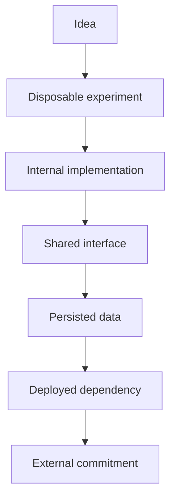
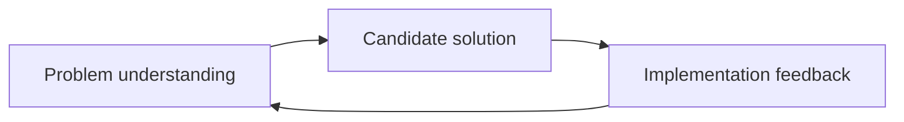
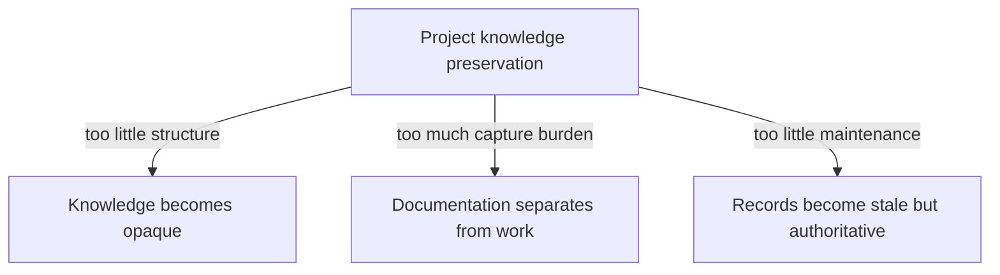

# Observations on Software Design and Development

> **Status:** preliminary assessment  
> **Purpose:** describe several characteristics of software development that
> shape how projects learn, decide, and evolve.  
> **Scope:** a focused set of observations, not a comprehensive review of
> software-engineering practices or of the software industry.

Software is not built in exactly the same way as a bridge, a house, or a car.
The difference is not that software has no construction cost, that planning is
unnecessary, or that failure is harmless. The important difference is that many
software artifacts can be copied, modified, executed, tested, and discarded at
comparatively low cost. This changes the relationship between design,
construction, observation, and decision.

The following observations provide a working assessment of that situation.
They are deliberately broad. Their purpose is to establish a context for later
investigation, not to prescribe one development method.

## 1. Experimentation is often cheaper than prediction

For many software-design questions, implementing a limited alternative is
cheaper and more reliable than attempting to resolve the question entirely in
advance.

A prototype, benchmark, branch, or minimal implementation can help determine
whether:

- a library is sufficiently expressive;
- an abstraction remains convenient in realistic cases;
- an architecture is difficult to extend;
- an anticipated performance problem actually exists;
- a data representation accommodates the important edge cases.

Implementation therefore has two roles. It constructs the software, but it can
also produce knowledge about the problem and the proposed solution. Design and
construction are not always separate phases: construction may be part of the
design investigation itself.

This advantage has a limit. Experimentation resolves questions that can be
translated into observable conditions within an affordable time. It can show
whether a library handles the cases currently available or whether a benchmark
meets a present threshold. It cannot directly establish that an abstraction
will remain appropriate after several years of requirements drift.

Experimentation is therefore systematically more informative about properties
visible to fast feedback than about properties whose consequences emerge
slowly. The questions that are easiest to test are not necessarily the
questions whose eventual consequences are largest. Section 6 returns to this
testability bias.

## 2. Failure costs are highly uneven

It is misleading to say that failure in software has almost no cost. A failed
experiment may be inexpensive and informative, while a failure in production,
a destructive data migration, a security defect, or a broken public interface
may be extremely costly.

The relevant distinction is between different levels of consequence:

At the beginning of this progression, abandoning an alternative may be easy.
Farther along it, other work, systems, users, and expectations depend on the
choice. The cost of failure depends not only on the failed implementation but
also on the commitments accumulated around it.

## 3. Reversibility is gradual and can be engineered

A software decision is rarely either completely reversible or completely
irreversible. Reversibility generally decreases as the decision propagates,
but that propagation is not entirely passive.

A choice becomes harder to revise when:

- data have been stored according to it;
- several components depend on it;
- users rely on its behavior;
- a public interface exposes it;
- operational processes assume it;
- documentation and tests encode it;
- a team has organized its work and understanding around it.

Information hiding, encapsulation, modularity, and adapters can contain a
choice behind a boundary. Other parts of the system then depend on the boundary
rather than on the internal choice itself. The implementation may remain
replaceable even after the interface has accumulated dependents.

Encapsulation does not eliminate commitment; it relocates it. The internal
choice becomes easier to revise while the shared interface becomes the harder
commitment. In this sense, modularity is partly the engineering of decision
reversibility.

Three aspects should therefore be distinguished:

- **intrinsic reversibility:** how difficult the choice itself is to change;
- **propagated commitment:** how many other elements depend on it;
- **engineered containment:** how effectively the design limits that
  propagation.

One important concern in software design is not merely whether a choice is
correct, but when a provisional choice is becoming an expensive commitment and
whether that commitment can be contained. Dependencies between decisions may
be as important as their chronological order.

## 4. Planning organizes learning and commitment

Because implementation can resolve uncertainty, software planning does not
always need to specify the final system in detail. It may instead organize how
the project will learn and when it will commit.

Planning can establish:

- the outcome being sought;
- the constraints that must be respected;
- the uncertainties that matter;
- the experiments that could reduce those uncertainties;
- the decisions that can safely be postponed;
- the decisions that constrain later work;
- the conditions under which a provisional choice should be reviewed or
  accepted.

This does not make planning less important. It changes its role. Planning is
less exclusively an attempt to predict the final construction and more a way
to direct exploration, manage risk, and order commitments.

## 5. The problem and the solution co-evolve

Software requirements are not always completely known before implementation
begins. Attempting to build a solution can change the understanding of the
problem itself.

An implementation may reveal:

- a requirement that was previously implicit;
- a missing distinction in the problem description;
- an incompatibility between desired properties;
- an unrealistic performance expectation;
- a user need that was expressed imprecisely;
- a problem that is not worth solving in its original form.

Iteration therefore does not affect only the solution. The current
understanding of the problem and the current form of the solution develop in
response to one another.

A plan or decision based on an earlier understanding may need to be revised
without having been unreasonable when it was made.

## 6. Feedback loops operate at different speeds

Software development contains several feedback loops with very different time
scales:

- compilation and type checking may provide feedback in seconds;
- automated tests and benchmarks may provide feedback in minutes;
- review and integration may provide feedback over hours or days;
- operational use may reveal behavior over weeks or months;
- maintainability and organizational costs may become visible much later.

A design can therefore appear successful under one kind of observation and
prove inadequate under another. The statement that a solution “works” is
always relative to particular conditions, observations, and criteria.

Fast feedback also has a structural advantage: it allows an error to be
detected while the relevant decision remains relatively easy to reverse.

However, fast feedback also directs attention. Properties that can be checked
quickly are repeatedly measured and discussed, while maintainability,
requirements drift, and organizational comprehension remain comparatively
invisible. Development effort can consequently follow what the fast loops can
see rather than what matters most over the lifetime of the system.

This is a testability bias. Slow-loop properties may be approached through
proxies, design principles, delayed observations, or periodic review, but a
proxy should not be confused with the property it is intended to anticipate.

## 7. Engineering decisions are situated

Technical knowledge rarely determines a unique solution. A decision is made
within a situation that includes:

- project goals and priorities;
- the information available at the time;
- technical and organizational constraints;
- expected scale and use;
- acceptable risks;
- available time and expertise;
- design principles and preferences;
- expectations about future change.

A later decision may replace an earlier one because this situation changed,
not because the earlier decision was irrational or factually mistaken.

Historical truth and current applicability must therefore be distinguished.
“The team decided to use a particular solution” may remain historically true
after that solution has been abandoned. What changes is the decision's current
status and relevance.

## 8. The current artifact does not explain its own history

Source code can show what the current system does. Version control can show how
its files changed. Neither necessarily explains:

- which problem motivated a change;
- which alternatives were seriously considered;
- what was known or uncertain at the time;
- which assumptions supported the reasoning;
- why one trade-off was preferred;
- whether an alternative was tested or only discussed;
- which later observation motivated reconsideration.

The current state of the software is therefore insufficient to reconstruct the
reasoning that produced it. A sequence of textual changes is not the same thing
as a history of problems, investigations, decisions, and consequences.

## 9. Architecture also emerges without explicit decisions

Not every consequential property of a software system results from an explicit
decision. Architecture also develops through:

- framework defaults and generated scaffolding;
- patterns copied from nearby code;
- choices made for a prototype and never revisited;
- dependencies introduced for temporary convenience;
- repeated local choices that gradually become a convention;
- questions that nobody recognized as questions.

In these cases, the problem is not that a rationale existed and was later lost.
No comparison of alternatives, identifiable moment of commitment, or explicit
rationale necessarily existed. The resulting structure emerges through
inheritance, default acceptance, repetition, or accretion.

This distinguishes several ways in which a system can acquire a consequential
choice:

- an explicit decision selects among recognized alternatives;
- an inherited choice comes from a framework, template, or earlier system;
- a default is accepted without being examined;
- a provisional choice persists because no review occurs;
- an emergent convention arises from repeated local actions.

A process that records only identifiable decision events will miss these
structures. They may become visible only through later inspection of the
system, its dependencies, and its recurring patterns.

## 10. Project knowledge is heterogeneous and distributed

Knowledge relevant to a software project may be distributed across source
code, tests, benchmarks, issues, pull requests, commit messages, design records,
documentation, conversations, meeting notes, external references, incident
reports, and people's memories.

This distributed record is already the favorable case, because it assumes that
the relevant knowledge has been externalized somewhere. Much of the knowledge
involved in development remains only in the mind of an individual agent: the
developer who introduced a mechanism, the reviewer who noticed a risk, or the
decision maker who understood why one compromise was acceptable. Other people
may never have access to it. It may also be altered by ordinary memory loss or
disappear when that person leaves the project.

Some of this knowledge is tacit and difficult to express completely. However,
even knowledge that could have been recorded is often left implicit because a
decision was quick, its context appeared obvious at the time, or recording it
seemed more costly than its immediate value.

These locations do not merely contain interchangeable fragments of
information. They contain things with different roles. For example:

- a requirement states something sought or required;
- an assumption is treated as true without yet being established;
- a benchmark provides an observation under specified conditions;
- a proposal presents a possible course of action;
- a decision selects or rejects an alternative;
- an implementation realizes a choice;
- an incident reveals consequences in operation.

The difficulty is consequently not only to centralize information. It is also
to preserve the distinctions and meaningful relationships among these forms of
knowledge.

## 11. Selective capture must rely on present signals

A project contains a small number of visible architectural decisions and a
large number of smaller choices: representations, dependencies, interfaces,
algorithms, error-handling strategies, function signatures, and naming
conventions.

Treating every choice as a formal decision would overwhelm the development
process. Recording only the most prominent architectural decisions would omit
much of the reasoning that shapes the resulting system. Selective capture is
therefore necessary, but it cannot rely primarily on predictions about which
choices will prove consequential or durable. Those properties are often known
only in retrospect.

More useful signals are observable when the choice is being made. Some reveal
**cognitive friction**:

- the agent hesitated or felt explicit uncertainty;
- more than one option was seriously considered;
- documentation, prior work, or external information had to be consulted;
- review exposed disagreement or a non-obvious trade-off;
- the choice departed from an established convention;
- an assumption produced the feeling that it might later prove false.

Other signals identify a **commitment boundary**:

- persisted data are introduced or changed;
- a public or shared interface is created or modified;
- a choice crosses a component or organizational boundary;
- an external dependency is introduced;
- several downstream elements will depend on the choice;
- the relevant property cannot be validated through a fast feedback loop.

Neither class of signal is sufficient alone. Experienced developers may make
high-consequence conventional choices without hesitation, while unfamiliar but
local choices may produce considerable uncertainty. A practical capture rule
therefore combines them:

> Preserve the reasoning when a choice produces observable cognitive friction
> or crosses an identifiable commitment boundary.

This rule does not guarantee that every important choice will be captured.
Section 9 establishes why later inspection is still required for inherited and
accreted structures.

## 12. Unsuccessful alternatives remain valuable knowledge

A rejected prototype or failed experiment may establish useful negative
knowledge:

- a library cannot express a required case;
- an optimization has no measurable effect;
- an abstraction makes extension harder;
- a migration loses information;
- a proposed solution violates an important constraint.

This knowledge is particularly vulnerable to disappearance. The accepted
implementation remains in the repository, while the experiments and reasoning
that eliminated other alternatives are often discarded.

Losing unsuccessful alternatives makes it possible to repeat earlier work or
reopen a question without knowing which evidence previously informed it. A
failed attempt can therefore be valuable even when none of its implementation
is retained.

## 13. Recorded knowledge can remain available while becoming stale

Project knowledge does not only disappear. It can remain available, retain an
authoritative appearance, and cease to apply.

A record may state accurately that a solution was selected because an
assumption was accepted at the time. If the assumption later becomes false,
the record remains historically accurate but may become unsafe as current
guidance. This can be worse than silence because the record appears explicit
and trustworthy.

Several questions must therefore be distinguished:

- Does the record still exist?
- Is it an accurate account of the earlier situation?
- Are its supporting assumptions still accepted?
- Does its conclusion remain applicable to the current situation?
- Has its current status been examined recently?

Refuting one supporting assumption does not automatically refute the decision:
other reasons may still support it. It does, however, create a reason to review
the decision and make its uncertain status visible.

Preservation consequently requires more than storage. Records need status,
links to the conditions on which they depend, and ways to become visibly
questionable, superseded, or no longer applicable.

## 14. Some assumptions can be challenged executably

Some parts of project reasoning can be expressed in forms that are evaluated
as the software changes:

- a type can exclude an invalid construction;
- an assertion can expose a violated condition;
- a property test can challenge a general behavioral expectation;
- a benchmark with a threshold can expose a performance regression;
- a continuous-integration check can detect that an accepted constraint no
  longer holds.

Executable knowledge is not immune to decay. A test may be disabled, a
benchmark may represent an obsolete workload, or a constraint may continue to
hold after it has ceased to matter. Its distinctive advantage is that it can
contain a mechanism for making some mismatches visible automatically.

Executable forms and prose therefore serve different roles. An executable
check can establish that a threshold has been crossed; it does not necessarily
explain why the threshold matters, which trade-off justified it, or what should
happen after failure.

Where an assumption has a checkable part, that part can be encoded as a type,
assertion, test, benchmark, or other executable constraint. Prose remains
necessary for meaning, context, and trade-offs. The connection between the two
allows an executable failure to challenge the reasoning and decisions that
depended on the assumption, rather than appearing only as an isolated technical
failure.

## 15. Preserving knowledge has a cost

Recording, structuring, and maintaining project knowledge require attention.
That effort is part of the development cost, not an activity outside it.

A system that demands exhaustive documentation is likely to be bypassed or
filled mechanically. A system that imposes almost no structure may preserve
text while leaving its meaning, status, and relationships difficult to recover.
A system that records knowledge without maintaining its current status may
accumulate confident but misleading guidance.

This produces three related failure modes:

The aim cannot be to preserve everything. Nor is it sufficient to retain only
the final state or to store records indefinitely. The practical problem is to
preserve enough context, reasoning, and history to support later understanding,
while keeping the records connected to the conditions that make them relevant
and avoiding a capture process that suppresses rapid, partly informal
iteration.

## Overall assessment

Software development combines several tensions.

Many alternatives can be tried, compared, revised, and discarded at low cost.
This makes short feedback loops, provisional decisions, and iterative discovery
effective, but it also directs attention toward properties that fast feedback
can observe. Meanwhile, decisions accumulate dependencies and become
commitments unless their propagation is deliberately contained.

Not all consequential structures originate in explicit decisions. Some are
inherited, accepted by default, or produced by accretion. The knowledge needed
to understand them may remain tacit, become scattered across heterogeneous
artifacts, disappear with people, or persist in records whose assumptions no
longer apply.

The resulting challenge is not simply to plan more or document more. It is to
distinguish exploration from commitment, engineer reversibility, recognize
consequential structures that were never explicitly chosen, preserve the
knowledge produced by iteration, and make recorded assumptions capable of
being challenged over time. This must be achieved without turning knowledge
capture and maintenance into obstacles to development.
