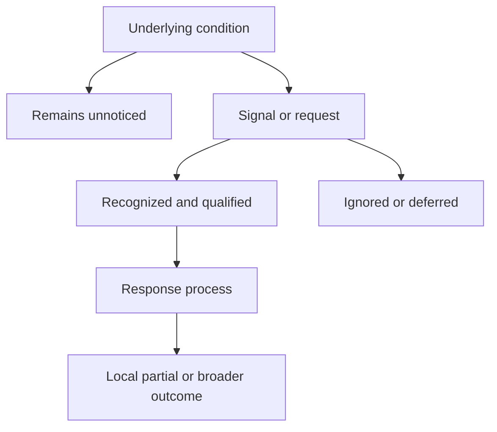
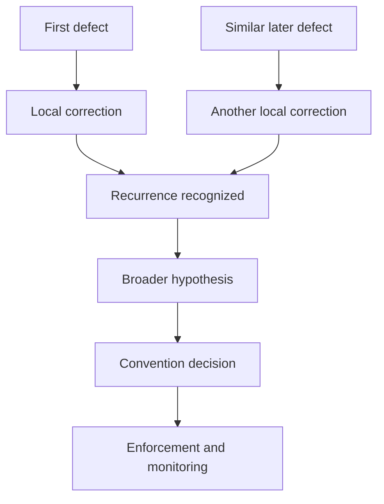
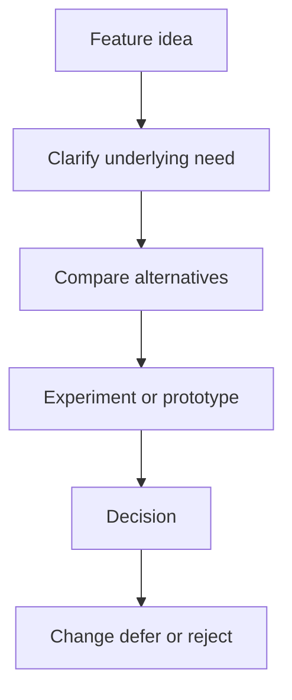
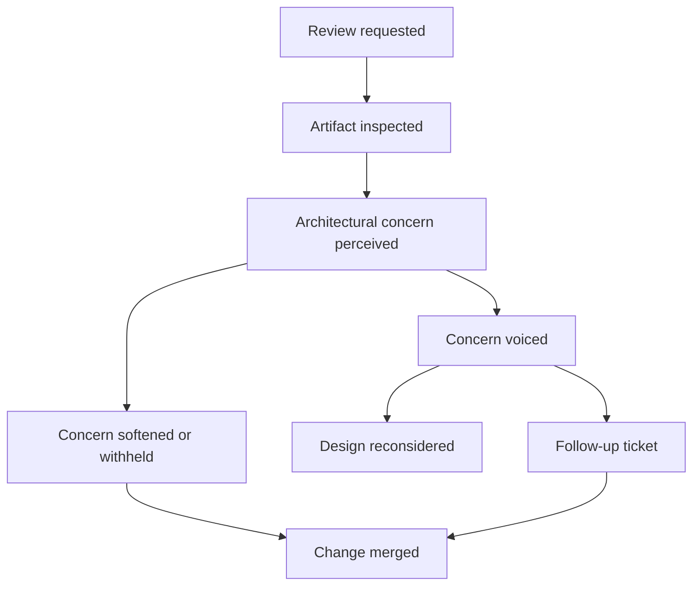
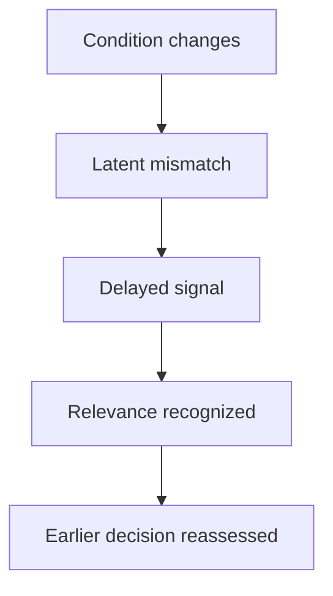
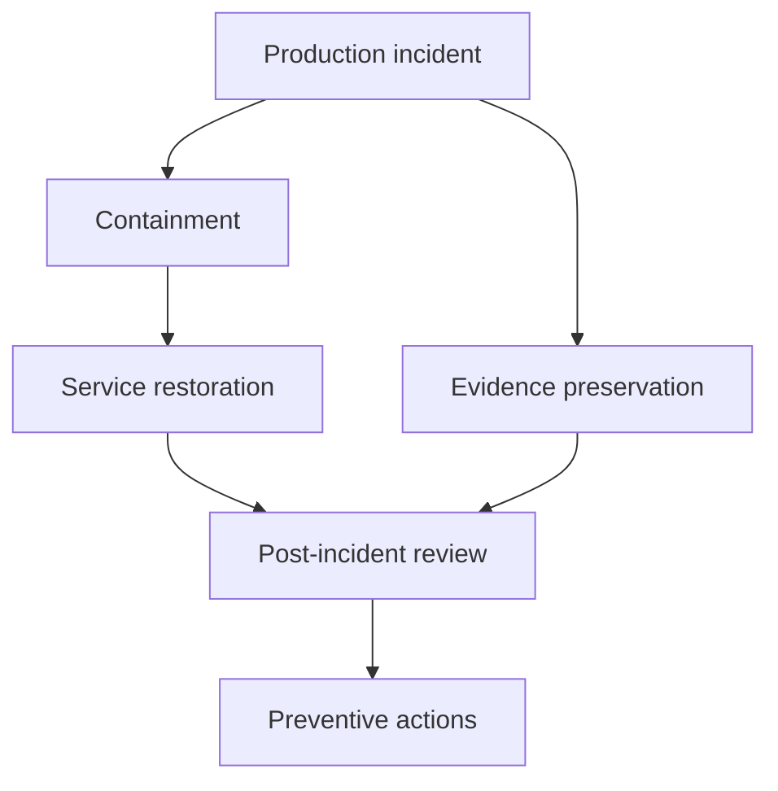
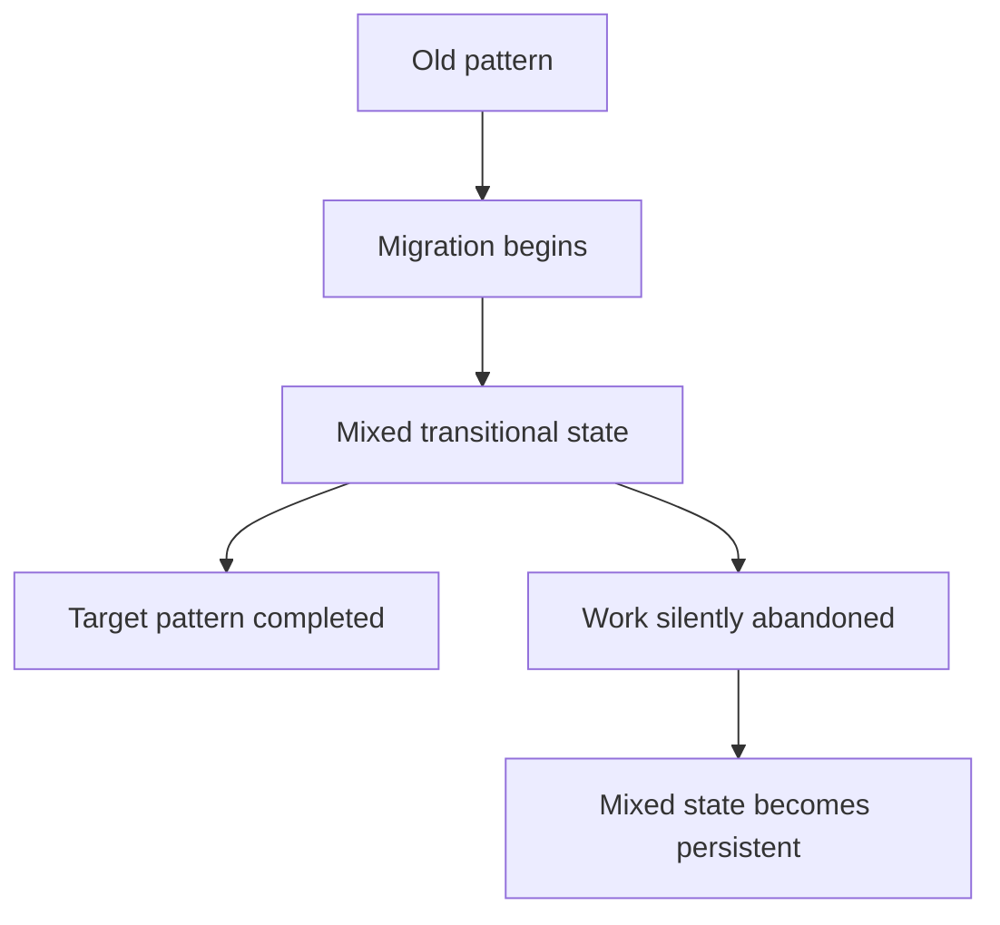
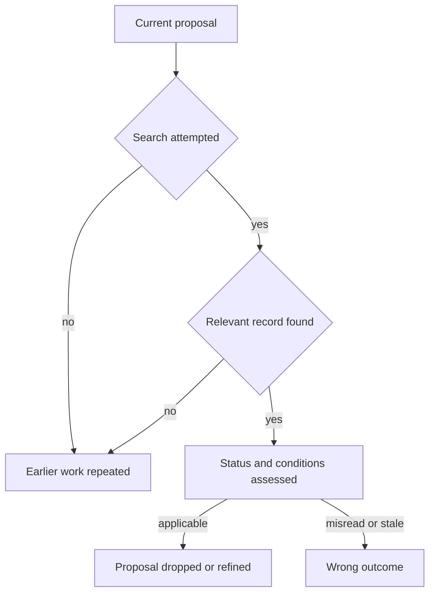
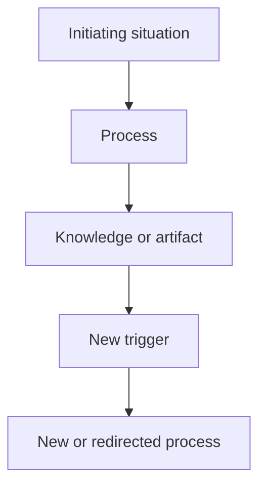

# Software Design Trigger Scenarios

> **Status:** preliminary scenario corpus  
> **Purpose:** describe representative situations that can initiate, redirect,
> suspend, branch, or reopen software-design activity.  
> **Scope:** a focused set of scenarios for later analysis, not an exhaustive
> taxonomy and not a prescribed development process.

Software work does not proceed through one fixed sequence from requirement to
implementation. A report, idea, request, observation, changed constraint, or
newly recognized pattern can give an agent a reason to act. The resulting
activity may remain local, but it may also create new questions, decisions,
changes, and processes.

The scenarios below preserve that variety without assuming that every signal
receives a competent or complete response. Each one describes an underlying
condition, how it may become visible, the processes it can produce, and the
places where attention, authority, memory, urgency, or accumulated commitment
can abbreviate the process.

Where useful, a scenario distinguishes a **deliberate trajectory**, in which
the initiating situation is investigated and its consequences are followed,
from an **abbreviated trajectory**, in which the response remains local,
delayed, partial, or absent. Neither trajectory is presented as universal.

Most scenarios describe the production, loss, or transformation of knowledge.
The corpus also includes the complementary read path: an agent retrieves prior
knowledge, evaluates whether it applies, and changes—or wrongly changes—a
current course of action.

The identifiers `S1` through `S15` provide stable names for referring to these
scenarios during later analysis.

## 1. Working distinctions

### Condition, signal, recognition, and uptake

An underlying condition does not initiate activity merely by existing. A
defect, obsolete dependency, or architectural inconsistency may remain latent
for months or years. It becomes actionable only when something makes it
perceptible and an agent treats it as deserving attention.

Four moments should therefore be distinguished:

- the **condition** exists in or around the project;
- a **signal** makes some aspect of it perceptible;
- an agent **recognizes** what the signal may indicate;
- the signal receives **uptake** as something worth acting on.

Recognition and uptake can be separated by substantial delay. A reviewer may
notice a concern but decide not to voice it. A dependency alert may be visible
but remain untriaged. A recurring failure may be fixed several times before
anyone recognizes that the occurrences belong to one class.

### Stimulus, request, and obligation

A **stimulus** makes a situation noticeable. A failed test, production
incident, performance regression, or recurring code pattern can act as a
stimulus.

A **request** asks one or more agents to contribute. A bug report, code-review
request, request for comments, or request for a feature can initiate different
kinds of response.

An **obligation** establishes that some response is required. A security
advisory, release criterion, compatibility commitment, or support deadline may
create an obligation even when no individual asks for action.

These roles can overlap. A bug report is a request for attention and also a
stimulus that makes unexpected behavior visible. A security alert is a stimulus
and may create an obligation.

A stimulus, request, or obligation constrains the possible response without
uniquely determining it. An obligation may exclude indefinite inaction while
leaving timing, scope, sequencing, and implementation open. Interpretation and
qualification mediate between the initiating situation and subsequent
activity.

### Process and lifecycle

A **process** is an actual coordinated course of activity. It may contain
investigation, discussion, experimentation, implementation, review, and
validation. A process may branch, wait, merge with another process, or end
without producing a change.

A **lifecycle** describes the meaningful states and transitions of something
that persists through one or more processes. A report, suspected defect,
proposed change, review request, test, decision, or coding convention can each
have its own lifecycle.

These lifecycles interact without becoming identical. Closing a report does
not establish that a fix has been released. Merging a change does not close
every preventive action discovered during its investigation.

## 2. Scenario map

| Identifier | Initiating situation | Principal pressure |
| --- | --- | --- |
| `S1` | A bug report describes unexpected behavior | Move from reported symptom to correction and prevention |
| `S2` | A feature idea proposes a future capability | Separate the underlying need from one suggested solution |
| `S3` | A code-review request exposes a deeper design problem | Redirect an implementation process into design deliberation |
| `S4` | A request for comments solicits open-ended input | Gather knowledge without presupposing approval or a decision |
| `S5` | A contextual change weakens an earlier assumption | Reconsider an existing decision without rewriting its history |
| `S6` | An executable check produces a failure signal | Connect a technical failure to the assumption it challenges |
| `S7` | Inspection reveals architecture produced by accretion | Address consequential structure that was never explicitly chosen |
| `S8` | A production incident requires action under stress | Restore service while preserving evidence for later learning |
| `S9` | A conversation settles a design question without a durable record | Recover a decision that appears only through subsequent code |
| `S10` | A migration is started and left incomplete | Interpret a system in which source and target patterns coexist |
| `S11` | An ecosystem change imposes a future deadline | Decide when and how to absorb a change nobody requested |
| `S12` | A current proposal prompts retrieval of earlier related work | Use prior knowledge without treating it as timeless authority |
| `S13` | Investigation shows that an earlier decision was unsound when made | Refute faulty rationale and trace what depended on it |
| `S14` | A contributor leaves or becomes unavailable | Respond to the loss of access to concentrated personal knowledge |
| `S15` | A project or subsystem begins | Manage a dense set of provisional choices before experience exists |

## 3. Scenarios

### S1 — A bug report expands from correction to prevention

A user reports that the software produces an incorrect result for a particular
edge case. The report describes an observation and an expectation. It does not
by itself establish that a defect exists or identify its cause.

The report is first qualified. The behavior may be reproducible, environmental,
already known, unsupported, or based on a misunderstanding. If the behavior is
confirmed as a defect, an investigation begins.

The investigation identifies hidden mutation in a domain function as the
immediate cause. In the abbreviated trajectory, the function is corrected, a
regression test may be added for the reported edge case, and the report is
closed. No broader conclusion follows.

A similar failure occurs later in another function. It is also corrected
locally. The two reports may use different words, belong to different
components, or be handled by different people. Recurrence alone does not
produce learning unless someone recognizes the occurrences as instances of the
same class.

Broader investigation is more likely when repeated occurrences are connected
or when one occurrence causes exceptional damage. A hypothesis is then formed
that mutation creates unacceptable risk in this domain. Related functions are
inspected, and a proposal is made to require functions in the domain to be
pure.

The proposal initiates a separate discussion and decision process. If accepted,
the resulting convention may be expressed through documentation, review rules,
types, assertions, tests, static checks, or continuous-integration checks.

Several lifecycles now coexist:

- the report may be submitted, triaged, confirmed, rejected, or closed;
- the defect may be suspected, reproduced, diagnosed, corrected, or observed
  again;
- the code change may be proposed, reviewed, merged, reverted, or released;
- the regression test may be introduced, passing, failing, disabled, or
  obsolete;
- the convention may be proposed, accepted, enforced, weakened, or
  superseded.

The report can be closed while architectural or preventive work remains open.
Conversely, introducing a convention does not establish that every similar
defect has been prevented.

The critical loss point lies between repeated correction and recognized
recurrence. If earlier cases cannot be found or compared, every occurrence can
continue to appear isolated.

#### Important non-implications

- A bug report does not establish that the software contains a defect.
- Reproducing a symptom does not identify its cause.
- Correcting the reported case does not eliminate the broader class of defect.
- Repetition does not produce generalization unless the occurrences are
  recognized as related.
- Adding a convention does not establish that the convention is enforced.
- Closing the report does not close every process it initiated.

### S2 — A feature idea compresses a need and a proposed solution

A user or contributor proposes: “Add CSV export.” The suggestion may compress
two different statements:

- users need to process results outside the application;
- CSV export is a suitable way to satisfy that need.

The first concerns a desired outcome. The second proposes a solution. Treating
them as identical can prevent consideration of alternatives such as an API,
another export format, direct integration, or improved in-application analysis.

The practical force of the request also depends on who made it and in which
relationship to the project. The same words may come from a paying customer, a
maintainer addressing their own recurring problem, an occasional user, or an
unknown issue-tracker contributor. Authority, economic importance, expertise,
trust, and proximity to the affected use can change whether the request
receives attention and whether its formulation is challenged.

In the abbreviated trajectory, CSV export appears inexpensive and is built as
requested. The implementation resolves the ticket without separating the need
from the suggested solution. This may be reasonable for a small change, but the
reason for the feature remains compressed into its requested form.

In the deliberate trajectory, the feature idea initiates several activities:

- clarify the users, situations, and constraints behind the request;
- determine whether the need is recurrent or exceptional;
- identify alternative solutions;
- prototype uncertain parts;
- estimate compatibility and maintenance consequences;
- accept, modify, reject, defer, or split the proposal.

A prototype may show that CSV export is technically easy without establishing
that it is the most appropriate response. Conversely, rejecting CSV does not
necessarily reject the underlying need.

#### Important non-implications

- A feature request does not establish a requirement.
- Identical request content does not imply identical practical force when the
  requesters occupy different relationships to the project.
- A requester's influence does not establish that the proposed solution is
  technically appropriate.
- A requested implementation does not uniquely determine the underlying need.
- A successful prototype does not establish long-term suitability.
- Rejecting one solution does not reject the problem it attempted to address.

### S3 — A code review redirects implementation into design deliberation

A contributor implements a change and asks another agent to review it. The
request presupposes a candidate artifact, but the expected evaluation may
remain partly implicit. The reviewer may inspect correctness, readability,
security, performance, architecture, tests, or conformity with existing
practices.

During review, the reviewer identifies a problem that cannot be resolved by a
small local modification. The patch exposes an unclear ownership boundary or a
representation that would constrain several future changes.

By this point, the implementation may represent several weeks of work. Raising
the concern can mean asking the contributor to discard or substantially rewrite
that work. The reviewer must therefore decide not only whether the concern is
valid, but whether to express it and how strongly to press it. Sunk cost and
social cost influence the review before any formal response is recorded.

In the deliberate trajectory, the implementation process is paused and a
design discussion begins. Alternatives are compared, and the original change
is revised, split, abandoned, or resumed after a new decision.

In abbreviated trajectories, the concern may be softened into a follow-up
ticket, mentioned as a non-blocking comment, or left unvoiced. The patch is
merged, and the ticket may never be picked up. The existence of a recorded
follow-up makes the concern visible without ensuring that any response process
will continue.

The review request, proposed change, design question, and resulting decision
have separate lifecycles. The review can reveal a new problem rather than
merely accept or reject the submitted solution.

Reviewing design before implementation can reduce sunk cost, but early review
has its own limitation: the proposal may remain too abstract for the structural
problem to be visible. Review timing therefore trades early influence against
concrete evidence.

#### Important non-implications

- Requesting review does not establish that the change is ready to merge.
- A review comment does not necessarily reject the change.
- Approval does not establish that every relevant property was evaluated.
- Recording a follow-up ticket does not establish that the concern will be
  addressed.
- Absence of an architectural objection does not establish that no reviewer
  perceived one.
- Closing the review does not necessarily close the design question it exposed.

### S4 — A request for comments gathers input without presupposing a decision

An agent publishes a question, problem description, or proposal and asks others
to comment. The request may seek missing information, alternatives, objections,
preferences, expert judgment, consensus, or simple awareness.

Attention is the scarce resource. A long and careful request may give a
committed reader better material while increasing the cost of becoming that
reader. The existence and quality of the request do not guarantee substantive
engagement.

In a common abbreviated trajectory, few agents read the proposal completely.
Two comments address naming or presentation, while the central trade-off
receives no response. The author must decide whether silence permits action,
requires further solicitation, or leaves the proposal unresolved.

In a more deliberate trajectory, participants contribute observations and
interpretations of different kinds. One person supplies evidence from an
earlier experiment. Another identifies an unconsidered constraint. A third
expresses a preference based on maintenance experience. These contributions do
not all have the same epistemic status or decision-making force.

The discussion may produce:

- a clarified problem;
- new alternatives;
- an explicit disagreement;
- a revised proposal;
- a request for an experiment;
- a decision by an authorized agent;
- no decision at all.

One important branch lies between consensus and failed communication. An
objection may be raised clearly, understood by the participants, and remain
neither answered nor withdrawn. The authorized decision maker may still choose
to proceed because the objection is judged non-blocking under the current
constraints.

The resulting state is not consensus. The decision and the unresolved
objection coexist. If the anticipated problem later occurs, the objection may
become important prior knowledge; its earlier presence does not by itself
establish that the decision was unreasonable.

A request for comments may end because sufficient input was received, because
participation stopped, or because the question lost relevance. None of these
endings necessarily implies consensus.

In a solo project, the same artifact performs another function. A request for
comments addressed to oneself is closer to externalized deliberation: it slows
down thought, preserves alternatives, and allows a future self to reconsider.
It does not initiate a social process unless another agent later participates.

#### Important non-implications

- Asking for comments is not the same as asking for approval.
- Participation does not imply agreement.
- Lack of objection does not establish consent.
- Comments on peripheral details do not establish that the central question
  was evaluated.
- Making a decision does not resolve an understood objection.
- Proceeding despite an objection does not establish that the objection was
  refuted or withdrawn.
- Recording an objection does not give it veto power unless the decision
  process grants it that force.
- An internally written request for comments does not establish that feedback
  was solicited from another agent.
- Ending the discussion does not establish that a decision was made.

### S5 — A contextual change reopens an earlier decision

A project previously selected a library because it satisfied the required
platforms, performance threshold, and support expectations. The decision was
reasonable under the conditions known at the time.

Later, one of those conditions changes. The library may lose support, a new
platform may become necessary, expected scale may increase, or a security
advisory may reveal an unacceptable risk.

The change does not necessarily act as an immediate stimulus. Nobody may be
monitoring the conditions that justified the decision. The mismatch can remain
latent while the earlier choice continues to guide new work and accumulate
dependents.

The changed condition may surface much later through an automated dependency
alert, an unrelated build failure, a production incident, a new requirement,
or an accidental observation. Recognition latency—the interval between the
condition changing and the project noticing its relevance—is the central
difficulty of this scenario.

In the abbreviated trajectory, the signal is ignored, misclassified, or
treated locally. The changed condition may become visible only after it causes
damage. In the deliberate trajectory, recognition makes the decision's current
applicability uncertain and initiates reassessment.

The reassessment may:

- confirm that other reasons still justify the existing choice;
- introduce a mitigation while retaining the library;
- initiate a migration;
- change the requirement that created the conflict;
- postpone action while monitoring the risk.

The earlier decision remains part of the history even if a new decision
supersedes it. The relationship between the changed condition and the decision
is important because it explains why reassessment occurred.

#### Important non-implications

- A changed assumption does not automatically refute the associated decision.
- A condition changing does not imply that the change has been noticed.
- An alert existing does not imply that its relevance has been recognized.
- Superseding a decision does not establish that the earlier decision was
  irrational.
- Preserving the earlier record does not make it current guidance.

### S6 — An executable check challenges an accepted assumption

A continuous-integration benchmark falls below an accepted performance
threshold. The failed check makes a mismatch visible, but it does not explain
the mismatch by itself.

The failure is qualified. The regression may be genuine, the benchmark may be
flaky, the environment may have changed, or the workload represented by the
benchmark may no longer be relevant.

If the regression is genuine, investigation may identify a recent code change,
a dependency update, or gradual accumulation as its cause. Possible responses
include correcting the implementation, adjusting an accepted trade-off,
changing the threshold, or revising the decision that depended on the
performance assumption.

In the deliberate trajectory, the project distinguishes a change in the
software from a change in the workload, threshold, or purpose of the check. The
response preserves an explicit reason for whichever element is revised.

In an abbreviated trajectory, loosening the threshold is locally cheaper than
correcting the regression. Each adjustment may be defensible in isolation,
while repeated adjustments gradually remove the gate's original force. This is
a threshold ratchet: the control erodes through a sequence of accepted local
exceptions rather than one explicit abandonment.

Intermittent failures create another degradation path. If a flaky check fails
often without demanding action, agents learn to ignore red status. The loss of
credibility can spread beyond the original check by weakening trust in the
whole suite. The check remains present and executable while its social ability
to trigger a response disappears.

If the benchmark has become obsolete, the check itself requires revision. An
executable assumption can expose some mismatches automatically, but it does not
guarantee its own continuing relevance.

The condition of the check cannot be described by one linear lifecycle. At
least three dimensions vary independently:

| Dimension | Example conditions |
| --- | --- |
| **Technical reliability** | deterministic, flaky, environment-sensitive, broken |
| **Social credibility** | trusted, questioned, routinely overridden, ignored |
| **Semantic relevance** | current, partially representative, misaligned, obsolete |

A check can be technically reliable, widely ignored, and semantically obsolete
at the same time. Changes along one dimension can affect another—flakiness
often damages credibility—but they should not be collapsed into mutually
exclusive states. Rehabilitation may consequently require correcting the
check, restoring trust, revising what it measures, or some combination of the
three.

#### Important non-implications

- A failed check does not uniquely identify its cause.
- A passing check does not establish that its underlying assumption remains
  relevant.
- Changing a threshold does not by itself establish that the resulting
  performance is acceptable.
- A failing check does not guarantee attention when the check has lost
  credibility.
- A sequence of individually justified threshold changes does not establish
  that the original constraint remains effective.
- An executable condition does not replace the prose explaining why it matters.

### S7 — Inspection reveals architecture produced by accretion

During maintenance, onboarding, or preparation for a new feature, an agent
notices that several components use the same representation and depend directly
on the same framework mechanism. No architectural decision record exists.

The observer cannot initially determine how the structure arose. At least
three explanations remain possible:

- the structure was deliberately selected, but its rationale was not recorded;
- it emerged through generated scaffolding, copied patterns, and repetition;
- it began as a deliberate choice under conditions that no longer apply.

The person most likely to notice the structure may be a newcomer who has not
yet normalized it. That perceptual advantage comes with limited historical
knowledge and often little authority to question or replace a load-bearing
choice. Long-term maintainers have greater standing and context but may no
longer perceive the pattern as questionable.

In one abbreviated trajectory, the newcomer assumes that the pattern must have
been chosen for a good reason and preserves accretion as though it were
intentional architecture. In the opposite trajectory, an apparently accidental
pattern is removed without understanding the undocumented constraint it was
serving. The danger runs in both directions.

In the deliberate trajectory, the initial classification remains unresolved
while evidence is gathered from history, dependencies, contributors, and
current behavior. Investigation may eventually show that the first use came
from generated scaffolding, later contributors copied the nearby pattern, and
a temporary prototype became a reference implementation.

Recognition of the accumulated structure becomes a stimulus. The project may:

- accept and document the structure deliberately;
- introduce an interface to contain it;
- migrate incrementally to another representation;
- tolerate it while recording the constraint it creates;
- postpone action until a concrete need justifies the cost.

When no rationale ever existed, the process cannot recover one. It can instead
establish how the structure arose, what currently depends on it, and whether it
should now become an explicit commitment.

#### Important non-implications

- A widespread pattern does not establish that it was deliberately selected.
- Absence of a decision record does not establish that a record was lost.
- Repetition does not establish that the pattern is desirable.
- A newcomer noticing a pattern does not establish that the pattern is
  accidental.
- A maintainer defending a pattern does not establish that its rationale is
  known or still applicable.
- Recognizing architectural structure does not require changing it immediately.

### S8 — A production incident compresses decision time

A deployed system becomes unavailable or produces serious user-visible damage.
An alert, customer report, or operational observation reaches whoever is on
call. Unlike the calm report in `S1`, the incident creates immediate pressure to
restore service.

Decisions are made in minutes by the agents who are available. Ordinary
authority and review arrangements may be suspended. A rollback, feature flag,
manual data correction, or temporary bypass may be accepted because it reduces
current harm, even when it would be rejected as a permanent design.

The immediate process prioritizes containment and restoration. At the same
time, logs, intermediate states, and reasoning may need to be preserved before
the mitigation destroys evidence. Much of the actual deliberation occurs in a
chat thread, call, or shared terminal and may never become part of the durable
project record.

In the deliberate trajectory, restoration is followed by causal analysis, a
post-incident review, and tracked preventive work. This rationale-capture
practice is sustained partly because the pain is recent, visible, and shared.

In the abbreviated trajectory, service is restored and attention moves to the
next priority. Temporary mitigation becomes permanent, reasoning remains in an
ephemeral conversation, and preventive actions are recorded without being
completed.

#### Important non-implications

- Restoring service does not establish that the underlying cause is known.
- Identifying a contributing factor does not establish a unique root cause.
- Writing a post-incident review does not establish that its preventive actions
  will be implemented.
- A decision made under incident authority does not automatically become an
  accepted permanent design.

### S9 — Deliberation produces a decision but no durable artifact

Two or more agents discuss a design question during a meeting, pair-programming
session, or informal conversation. Alternatives are raised, one is selected,
and an agent later implements the conclusion.

No issue, proposal, or decision record is created. The conversation may not be
recorded, or its trace may remain in an inaccessible and unstructured channel.
The committed code becomes the only durable evidence that a choice occurred.

In the abbreviated trajectory, later observers can see what was implemented
but cannot determine which alternatives were considered, whose judgment
carried authority, which assumptions mattered, or whether the choice was meant
to be provisional. Deliberate design becomes observationally similar to
accidental implementation.

In a more deliberate trajectory, a short record is created after the
conversation and connected to the resulting change. Such reconstruction is
still selective: the record may preserve the conclusion while smoothing over
uncertainty, disagreement, and the actual sequence of reasoning.

This scenario is difficult because no durable initiating artifact is available
to anchor capture. Detecting the missing record requires participation in the
conversation, a habit of retrospective capture, or later recognition that the
code embodies a consequential choice.

#### Important non-implications

- Committed code does not establish that its structure was accidental.
- Agreement in a conversation does not establish that all affected agents
  participated.
- A retrospective record does not necessarily reproduce the original
  deliberation faithfully.
- Absence of a durable decision artifact does not establish that no decision
  occurred.

### S10 — A migration begins and remains half finished

A project decides to replace an old representation, interface, framework, or
coding pattern. The target is explicit and the migration begins. Some
components adopt the new form while others continue to use the old one.

Priorities then change. The responsible agent moves to other work, the expected
benefit becomes less urgent, or the migration proves more expensive than
anticipated. No explicit decision is made to abandon it.

In the deliberate trajectory, the migration is completed or explicitly
suspended. The remaining scope, accepted exceptions, and conditions for
resumption are made visible.

In the abbreviated trajectory, an “in progress” state silently becomes an
abandoned state. Two patterns coexist. Adapters and duplicated mechanisms
remain. Later contributors cannot tell which form is preferred, whether the old
one is still supported, or whether the new one was an unsuccessful experiment.

This differs from `S7`. The structure did not arise without a decision: a
deliberate target existed, but the transition stopped before reaching it. The
loss concerns the state and intention of an unfinished process.

#### Important non-implications

- Coexisting patterns do not establish that both are intentionally supported.
- Partial adoption does not establish that the target pattern was rejected.
- An open migration ticket does not establish that migration work remains
  active.
- Lack of recent activity does not distinguish suspension from abandonment.

### S11 — An ecosystem change imposes a background deadline

A framework announces a major version, a language version approaches end of
support, or an external API is deprecated. Nobody in the project requested the
change. The ecosystem creates an obligation whose deadline may initially be far
away.

The principal choices concern when to respond, how much change to absorb,
whether to isolate new conventions behind existing boundaries, and which other
work to displace. Remaining temporarily on the old version may be rational, but
delay gradually reduces the available options.

In the deliberate trajectory, the obligation is recognized early, its impact
is investigated, and work is staged before the deadline becomes urgent.

In the abbreviated trajectory, repeated alerts are treated as background
noise. Each postponement is locally defensible and may not be recorded as a
decision. The accumulated non-decisions eventually convert schedule flexibility
into emergency work, unsupported operation, or a production failure.

This differs from `S5`. A contextual condition may change once and remain
unnoticed; ecosystem pressure is often announced repeatedly and increases over
time. The central difficulty is not only recognition latency but sustained
uptake of a known, externally imposed obligation.

#### Important non-implications

- A distant deadline does not establish that immediate migration is optimal.
- Repeated postponement does not establish that the obligation was deliberately
  rejected.
- Awareness of deprecation does not establish that resources have been
  allocated to respond.
- An ecosystem mandate does not uniquely determine the migration strategy.

### S12 — Retrieved knowledge changes a current proposal

An agent proposes an approach to a current problem. Before implementing it,
they search for earlier related work. The search is itself a process: the agent
must decide to look, choose terms and scope, identify candidate records, and
evaluate whether any result concerns a sufficiently similar situation.

In the successful trajectory, the search finds an experiment from two years
earlier. The experiment shows that a similar approach was abandoned after a
specific limitation was observed. The agent checks whether the earlier
conditions still apply. The proposal is then dropped, refined to avoid the
limitation, or redirected toward another alternative. Retrieved knowledge
changes the outcome and prevents uninformative repetition.

Several abbreviated trajectories are possible:

- nobody thinks to search;
- the search uses different vocabulary from the earlier record;
- the record exists but is not indexed or accessible;
- the record is found but ignored because its status or provenance is unclear;
- the earlier experiment is repeated without awareness of the duplication.

A dangerous trajectory is also possible. The record is found, trusted, and
applied without checking its conditions. The earlier approach failed because
of a limitation that has since disappeared, yet the current proposal is
rejected as though the historical conclusion were timeless.

Retrieval therefore includes more than locating an artifact. It requires
judging identity, similarity, provenance, status, and applicability. The same
record can provide useful evidence, be reasonably distrusted, or be misapplied.

#### Important non-implications

- A relevant record existing does not imply that an agent will think to search
  for it.
- An unsuccessful search does not establish that no relevant record exists.
- Finding a record does not establish that it is trustworthy or current.
- An earlier rejected approach does not establish that the current proposal
  should be rejected.
- Repeating an earlier experiment is not necessarily wasteful when relevant
  conditions have changed.

### S13 — Investigation refutes the rationale of an earlier decision

A project previously rejected a library because it was believed not to support
an operation the system required. Later, while reconsidering the same problem,
an agent discovers that the capability already existed and that the earlier
documentation had been misunderstood.

This differs from `S5`. The environment did not change after a sound decision.
A premise supporting the earlier decision was false or unsupported when the
decision was made.

Three notions should be distinguished:

- **supersession:** a later decision replaces one that was warranted under its
  original conditions;
- **refutation:** evidence or reasoning defeats part of the original rationale;
- **retraction:** an agent or project withdraws its endorsement of the earlier
  decision, possibly in response to refutation.

In the deliberate trajectory, the faulty premise is corrected without erasing
the historical fact that the decision was made. The investigation identifies
which conclusions depended on the premise, whether independent reasons still
support them, and which later decisions inherited the same misunderstanding.
The decision may be retracted, revised, or retained under a different
rationale.

In the abbreviated trajectory, the new solution is adopted and the earlier
record is silently replaced or ignored. The project loses evidence of how the
misunderstanding propagated and remains vulnerable to repeating it elsewhere.

#### Important non-implications

- Refuting one premise does not automatically refute every decision that cited
  it.
- Discovering an unsound rationale does not establish that the selected action
  caused harm.
- Retracting a decision does not erase the fact that it guided earlier work.
- Correcting the record does not by itself identify every dependent decision.

### S14 — A contributor leaves and concentrated knowledge becomes unavailable

A contributor announces their departure or becomes unexpectedly unavailable.
The event originates in the people participating in the project rather than in
the software or its ecosystem.

The departure does not create the concentration of knowledge. It makes an
existing dependence on one person urgent and observable. That person may hold
context about architectural compromises, operational procedures, unfinished
work, undocumented exceptions, and decisions that occurred only in
conversation.

In the deliberate trajectory, the project identifies areas of unique
knowledge, transfers ownership, records explanations and unresolved questions,
pairs the contributor with successors, and verifies that the resulting
artifacts can actually be retrieved and used by someone else.

In the abbreviated trajectory, the handover becomes a document dump and a few
rushed meetings. Broad warnings such as “the synchronization code is tricky”
survive without the situations that make them useful. Some missing knowledge
becomes visible only later, when a successor encounters a problem and can no
longer ask its original holder.

The departure and later retrieval attempts belong to different times. A
handover that appears complete when written may prove insufficient only after
the contributor has gone.

#### Important non-implications

- A contributor leaving does not imply that their knowledge was unique.
- Producing handover documents does not establish that the relevant knowledge
  was externalized.
- Storing a document does not establish that a successor can find or apply it.
- Transferring formal ownership does not establish transfer of understanding.

### S15 — Project or subsystem inception concentrates provisional choices

A new project or substantial subsystem begins. Implementation requires early
answers about language, framework, repository structure, data representation,
public interfaces, testing strategy, deployment, conventions, and ownership
boundaries.

These choices are made when experience with the new system is minimal. Many
must be provisional, yet they can quickly accumulate dependents. Framework
templates and generated scaffolding also introduce consequential defaults
without presenting them as explicit design questions.

In the deliberate trajectory, agents distinguish intentional choices from
inherited defaults, mark important uncertainties, retrieve relevant experience
from earlier projects, and engineer boundaries around choices expected to
change. Only a selective part of the reasoning is recorded because decision
density is high and the consequences remain difficult to forecast.

In the abbreviated trajectory, the project begins from a template and moves
directly into implementation. Defaults become conventions through repetition.
Temporary choices acquire persisted data, shared interfaces, and user
expectations before anyone recognizes them as commitments.

Inception therefore combines several earlier pressures: selective capture,
testability bias, artifactless deliberation, accretion, and the engineering of
reversibility.

#### Important non-implications

- Starting from a framework default does not establish deliberate acceptance
  of its architectural consequences.
- Marking a choice as provisional does not ensure that it will be revisited.
- Early agreement does not establish that the choice is supported by mature
  evidence.
- Recording every early choice would not guarantee useful future knowledge.

## 4. Cross-scenario observations

### One initiating situation can produce several processes

The bug report in `S1` initiates a local correction, a regression-test change,
and a possible convention change. These processes share an origin but have
different participants, states, and completion conditions.

Those processes need not receive equal attention. The local correction may be
completed while the preventive branch remains only a suggestion or forgotten
ticket.

### Conditions, signals, and responses have different times

The condition that eventually motivates work may precede its recognition by a
long interval. `S5` separates a contextual change from the later signal that
makes it relevant. `S11` shows the inverse problem: a signal can be repeated
for months without receiving sustained uptake.

Chronology alone is therefore insufficient. The important intervals include
time to detection, time to recognition, time to response, and time spent in a
partial or suspended state.

### Process outputs can become new triggers

An investigation produces a hypothesis. The hypothesis motivates a proposal.
The proposal produces a request for comments. A decision creates implementation
work. The implementation creates a review request. The review exposes another
problem. A later check reopens the question.

### Preserved knowledge matters only when it is retrieved and interpreted

The scenarios on the write path describe knowledge being produced, compressed,
deferred, or lost. `S12` adds the read path. A current question must create a
reason to search; the search must retrieve a relevant record; and an agent must
evaluate its identity, provenance, status, and conditions before applying it.

Retrieval can improve a decision by preventing uninformative repetition or
exposing an earlier limitation. It can also damage a decision when historical
knowledge is treated as timeless authority. Discoverability and applicability
are therefore separate properties: a record can be easy to find and unsafe to
use, or difficult to find and highly relevant.

`S14` extends the same point to handover. The adequacy of captured knowledge may
remain unknown until a successor attempts to retrieve and apply it after the
original contributor is unavailable.

### Closure does not propagate automatically

Closing one report, request, review, or change does not close every related
process. Each closure has a local meaning. A report can be resolved while a
preventive action remains open, and a discussion can end without resolving the
question that motivated it.

The converse also matters: an artifact can remain open without an active
process behind it. A ticket, migration, or proposal may appear pending while no
agent retains responsibility or intention to continue it.

### Attention, authority, and accumulated commitment shape uptake

The content of a signal does not determine its practical force. `S2` shows how
the requester changes the response to a feature idea. `S3` shows how sunk cost
and social cost affect whether a reviewer voices an architectural concern.
`S4` shows that a carefully written request can still receive almost no
substantive attention. `S7` shows that the agent most able to perceive an
accreted pattern may have the least authority to challenge it.

These pressures act before and during formal process steps. A record of the
request or review cannot by itself explain why one concern was pursued while
another was ignored.

### Processes can change their own working practices

A response does not only modify the software. It may modify how future software
is designed and evaluated by introducing conventions, tests, review criteria,
interfaces, or automated checks. The consequences of a process may therefore
alter the conditions under which later processes operate.

These controls also change over time. `S6` distinguishes their technical
reliability, social credibility, and semantic relevance. Thresholds can
ratchet, checks can become flaky, and repeated overrides can weaken the
credibility of an entire suite. A process may leave an enforcement artifact in
place after its ability to influence behavior has decayed.

### Incomplete processes can become durable system states

The half-finished migration in `S10` shows that an intermediate state need not
remain temporary. When execution stops without an explicit transition to
completion, suspension, or abandonment, the system can preserve both the source
and target patterns indefinitely.

The resulting ambiguity concerns intention as well as structure. Later agents
cannot infer the desired direction merely from the coexistence of the two
forms.

### Similar present structures can conceal different histories

`S7`, `S9`, and `S10` reach the same present predicament through different
paths: the intention behind current code cannot be recovered reliably.

| Scenario | Historical path |
| --- | --- |
| `S7` | No explicit decision occurred; structure emerged through accretion |
| `S9` | A decision occurred, but it left no durable artifact |
| `S10` | A decision and target existed, but execution stopped before completion |

Current code may contain mixed patterns and unclear direction in all three
cases. The appropriate response nevertheless depends on whether intention was
absent, lost, or interrupted. Structure alone cannot distinguish those
histories.

### Local actions and non-actions can accumulate without a global decision

`S7` describes the accretion of structure: repeated local implementations
compose into architecture that nobody selected globally. `S11` describes the
accretion of deferral: repeated local postponements compose into urgent
obligation without an explicit decision to accept that outcome.

`S6` exhibits a related pattern. Individually defensible threshold adjustments
can accumulate into the disappearance of an effective control. Across these
cases, project-level consequences emerge from local actions or non-actions
without a corresponding project-level decision event.

### Deliberate and abbreviated trajectories coexist

The deliberate trajectories show what sustained investigation and follow-up
can produce. The abbreviated trajectories show how ordinary constraints leave
local fixes, compressed requests, unvoiced objections, unanswered proposals,
late discoveries, weakened controls, incomplete migrations, and undocumented
decisions. They also include failures to search, distrust of unclear records,
and confident misuse of knowledge whose conditions have changed.

The abbreviated path is not always negligent. A local response, deferral, or
temporary compromise may be proportionate to the situation. The knowledge
problem arises when the abbreviation and its unresolved consequences become
invisible.

## 5. Compact assessment

Software-design activity is initiated not only by requirements or planned
tasks, but by observations, proposals, requests, obligations, changed
conditions, automated signals, production incidents, and recognition of
structures that emerged without deliberate choice. Project and subsystem
inception concentrate provisional choices, while the departure of a contributor
can make dependence on personal knowledge suddenly visible. Some decisions
occur in conversation without producing a durable initiating artifact.

The resulting work is not a collection of independent actions. It forms a
network of processes that can branch, interact, wait, redirect one another, and
reopen earlier questions. Reports, defects, changes, reviews, decisions, tests,
conventions, and assumptions retain distinct lifecycles within that network.

The network is not continuously visible. Conditions may remain unnoticed,
signals may receive no uptake, concerns may remain unvoiced, follow-up work may
lose ownership, and intermediate states may persist after their process has
stopped. Attention, authority, urgency, sunk cost, and control credibility
shape which paths are followed.

Understanding a project therefore requires more than its current artifacts or
a chronological list of completed tasks. It requires the ability to follow how
a condition became perceptible and actionable, which processes it initiated,
where those processes were abbreviated, what knowledge and artifacts they
produced or failed to produce, and how their partial or completed outputs
changed the conditions for later work.

Preservation alone does not complete this cycle. Prior knowledge changes an
outcome only when an agent thinks to search, finds a relevant record, trusts it
appropriately, and evaluates whether its original conditions still apply.
Retrieval can prevent repeated work, refine a proposal, or expose an unsound
premise. It can also reproduce an earlier error when a stale or misclassified
record is treated as authority.

The full problem therefore includes both write and read paths. Knowledge can be
produced, left tacit, compressed, scattered, lost, preserved, retrieved,
distrusted, misapplied, refuted, or used to redirect later action. A useful
account of software-design practice must represent that entire movement without
assuming that every process is visible, completed, or competent.
