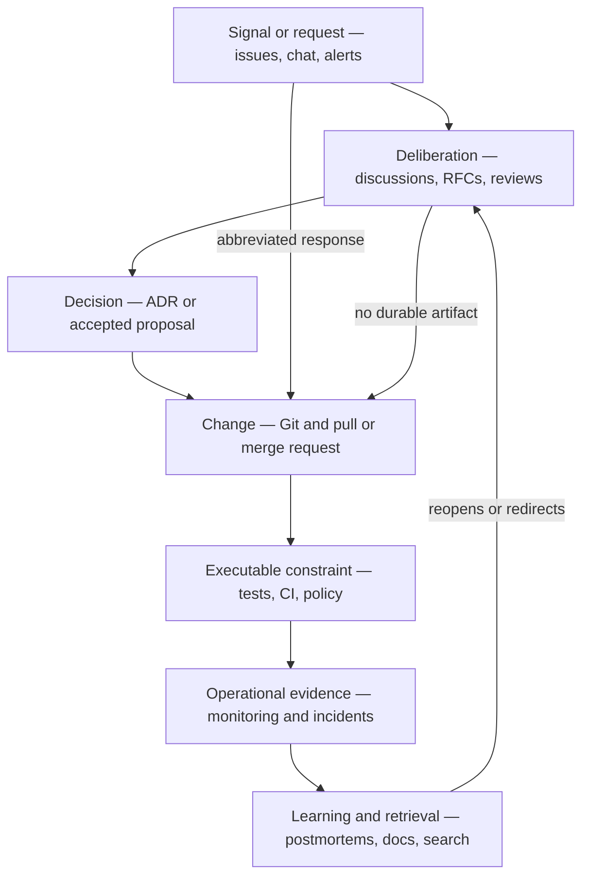
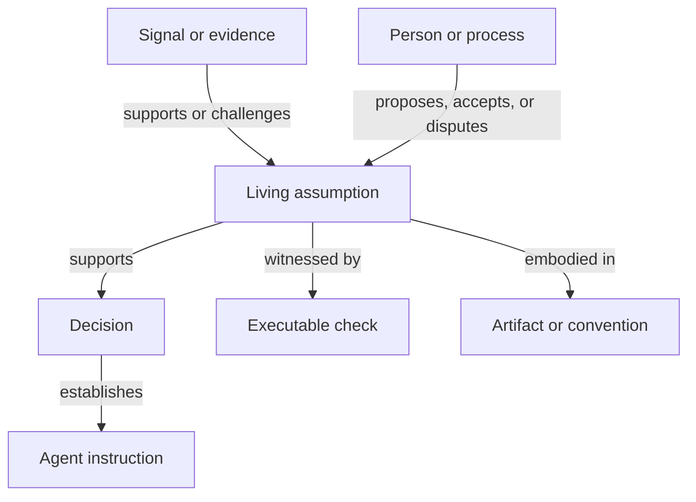

# Software-Project Knowledge Tools

## Capabilities, boundaries, and the remaining connective gap

> **Status:** deep-research report  
> **Date:** 4 September 2026  
> **Scope:** representative tools and practices used to produce, preserve,
> retrieve, validate, and connect knowledge during software work. This is a
> scenario-driven assessment, not a product ranking or an exhaustive market
> survey.

## Executive assessment

The industry does not lack knowledge tools. It has strong tools for different
parts of the problem:

- Git preserves code states and their ancestry.
- Issue trackers preserve reports, requests, work status, and discussion.
- Pull and merge requests connect a proposed code change to review and
  automated checks.
- RFCs and design documents support deliberation before commitment.
- Architecture Decision Records preserve a selected decision and its rationale.
- Design-rationale systems structure issues, alternatives, criteria, arguments,
  and their history.
- CAE and GSN assurance cases structure why a claim should be accepted from
  stated arguments, contexts, and evidence.
- Wikis and documentation systems explain the current system to human readers.
- Personal engineering journals preserve low-friction chronological thought.
- Agent instruction files and reusable skills prepare project-specific guidance
  for repeated machine use.
- Tests, types, linters, schemas, benchmarks, and policy-as-code make selected
  expectations executable.
- Incident systems and postmortems preserve operational evidence and learning.
- Dependency automation makes some ecosystem changes visible.
- Software catalogs expose current ownership and structural relationships.
- Knowledge-concentration analysis estimates departure risk from repository
  history.
- Search and code-intelligence systems help agents retrieve candidate knowledge.
- Coding agents and live context protocols can retrieve and act on project
  knowledge during the work itself.
- Requirements and application-lifecycle-management systems can maintain typed
  traceability across requirements, changes, tests, and configurations.

Each family is effective because it chooses a **native anchor**: a commit, work
item, proposed change, decision, page, check, incident, component, or
requirement. The same specialization establishes its boundary. Information
that is not naturally about the native anchor becomes optional text, a manual
link, a convention, or a separate object in another system.

There is also an older, less visible branch of the landscape. gIBIS, QOC, DRL,
and Compendium made design reasoning itself their primary object. They showed
that structured rationale can improve real work, but they did not make its
capture self-sustaining. Compendium's successful deployments relied heavily on
trained practitioners performing live dialogue mapping. This history changes
the diagnosis: the difficulty is not only representational adequacy, but the
human economics and timing of formalization.

Grudin's work-benefit disparity supplies the clearest economic explanation:
the person paying the capture cost now is often not the person receiving the
later, uncertain benefit. Agent-mediated work can partly collapse that
disparity. When project knowledge is retrieved during the current task, a small
record can improve the next agent action within minutes. The rapid adoption of
`AGENTS.md`-style instruction files is a strong existence proof for this
immediate-value loop. It demonstrates sustained capture of operational
guidance and conventions more directly than it demonstrates capture of rich
rationale or qualified assumptions.

The central unmet need is therefore not another universal authoring tool. It is
**time-aware, typed continuity across the existing objects**:

- from a stimulus or request to the processes it starts;
- from deliberation to decisions, including objections and authority;
- from decisions to code changes and conventions;
- from claims to their supporting arguments, evidence, scope, and assumptions;
- from assumptions to executable checks and operational evidence;
- from changed conditions to the decisions that may need reconsideration;
- from stored knowledge to retrieval, applicability assessment, and changed
  action;
- across several lifecycles whose local states do not close one another.

This conclusion is a structural inference from the documented capabilities of
the tools, reinforced by research showing that explicit links improve
traceability and that architectural knowledge remains distributed across
heterogeneous artifacts. It is not a claim that Git, issues, ADRs, or other
tools *cannot* hold rationale. All of them can be stretched with disciplined
writing and conventions. The point is that they do not jointly provide this
continuity as their default model.

For Cairn, the most promising candidate anchor is the **living project
assumption**: a proposition currently relied upon for action under incomplete
support and within a stated scope. Decisions depend on assumptions; evidence
supports or challenges them; checks witness or falsify them; changed conditions
reopen them; and artifacts embody choices that rest on them. Cairn would be an
assumption-centered connective memory over the toolchain, not a replacement for
the tools that own the source artifacts. In an agent-mediated workflow, that
memory should be **agent-actionable and human-auditable by construction**. Its
agent-facing projection must improve work without silently rewriting uncertain
beliefs into confident instructions. This remains a hypothesis to test, not a
settled ontology.

## 1. Research frame

### 1.1 Sources and method

The assessment uses the companion *Observations on Software Design and
Development* and *Software Design Trigger Scenarios* as its analytic baseline.
The fifteen scenarios are treated as tests of tool coverage rather than as a
prescribed process. The seven agent-mediated scenarios (`A1`–`A7`) in *LLMs and
Coding Agents in Software-Project Knowledge* provide an additional stress set
for machine-readable guidance, retrieval, review, and run provenance.

Current capabilities were checked primarily against official documentation,
standards, and original practice descriptions as available on 4 September
2026. Empirical research was used selectively to test claims about
traceability, rationale capture, and fragmentation. Vendor documentation is
good evidence for what a tool *supports*, but not for how consistently teams
use that capability or what organizational outcome it produces.

The research evaluates each tool family along eight dimensions:

| Dimension | Question |
| --- | --- |
| Native object | What persistent thing does the tool organize work around? |
| Historical fidelity | What changes and prior states can be recovered? |
| Lifecycle | Which states and transitions are explicit? |
| Relationships | Which links are typed, enforced, inferred, or only textual? |
| Social context | Are roles, authority, objections, and requester weight represented? |
| Retrieval | What can an agent search for, and what must they already know? |
| Validation | Can knowledge fail loudly when it ceases to hold? |
| Capture burden | What must a person remember to externalize or connect? |

### 1.2 The lifecycle traversed by software knowledge

No project follows one fixed pipeline, but the tool landscape can be located
around a recurring topology:

The deliberate path is only one possibility. A report may lead directly to a
small patch. A conversation may settle a question and leave only code behind.
A dependency alert may remain unread. The scenario corpus is particularly
concerned with these abbreviated paths and with activity that branches after
the apparent local task has closed.

### 1.3 The historical lens: representation is not adoption

A comparison limited to current successful products would have a survivorship
bias. Design-rationale research built systems whose explicit goal was to
capture the reasoning around design choices. Requirements-traceability research
likewise attempted to preserve the path from stakeholder sources and early
deliberation to later artifacts. Their representational contributions remain
valuable, but their adoption difficulties are evidence about the problem, not
irrelevant history.

The report therefore distinguishes three questions:

1. Can a notation represent the required reasoning or relationship?
2. Can people produce that representation while real work is unfolding?
3. Can the resulting corpus remain connected, trusted, and useful later?

A positive answer to the first does not imply the other two. This distinction
is central to the assessment of Cairn's sweet spot.

Grudin's analysis of groupware adds the adoption mechanism behind the second
question: collaborative records commonly impose work on one person while their
benefit arrives later for someone else. Pre-specification traceability and
facilitated rationale capture exhibit the same disparity. Coding agents can
alter, but not abolish, it. If the record is retrieved on the same task, capture
can have an immediate private benefit as well as a later collective one. That
changes the acceptance test from “might this corpus help eventually?” to “does
this small, faithful record improve a run today?”

## 2. Landscape at a glance

| Tool or practice family | Native anchor | What it does especially well | Principal structural limitation | Strongest scenario fit |
| --- | --- | --- | --- | --- |
| Git and version control | Repository snapshot and commit ancestry | Exact code history, comparison, attribution, branching, recovery | Rationale is optional prose; decision and process roles are not modeled | `S7`, `S9`, `S10` as evidence of what changed |
| Issues and work trackers | Report, request, or task | Intake, triage, ownership, status, discussion, prioritization | One work-item lifecycle compresses several processes; closure is local | `S1`, `S2`, `S11` |
| Pull and merge requests | Proposed code change | Diff-centered review, comments, approvals, checks, merge evidence | Deliberation arrives after sunk cost; unvoiced or accepted objections are weakly represented | `S3`, `S6` |
| Commit conventions and trailers | Commit-message fields | Very low-cost typed relations embedded in an existing ritual | Small, convention-dependent vocabulary; preserves only what contributors add | `S1`, `S3`, `S8` |
| Discussions, chat, and meeting transcripts | Conversation or transcript | Low-friction coordination and increasingly durable raw deliberation | Weak conclusion, authority, applicability, and decision semantics | `S4`, `S8`, `S9` |
| RFCs and design documents | Proposed design | Motivation, alternatives, dissent, governance, pre-implementation review | Attention and process cost; acceptance does not imply implementation | `S4`, `S15` |
| ADRs and decision logs | Significant decision | Context, decision, consequences, status, supersession | Requires a recognized decision event; base forms do not maintain assumption validity | `S5`, `S12`, `S13` |
| gIBIS, QOC, DRL, and Compendium | Issue, design space, or rationale graph | Makes alternatives, criteria, arguments, and deliberation structure explicit | Formalization disrupts fluid thought; successful live capture often requires trained facilitation | `S3`, `S4`, `S9`, `S12` |
| CAE and GSN assurance cases | Assurance claim and its justification graph | Makes claims, strategies or arguments, context, evidence, and scope explicit | Does not by itself preserve the originating deliberation or evidence freshness; substantial maintenance cost | `S5`, `S6`, `S12`, `S13` |
| Wikis and docs-as-code | Explanatory page or current documentation set | Human-readable synthesis, onboarding, broad topic coverage | A page version records editing, not necessarily changing truth; staleness is often silent | `S12`, `S14`, `S15` |
| Personal engineering journals | Chronological note or work session | Immediate capture of uncertainty, investigations, local decisions, and abandoned paths | Personal vocabulary, weak status and typing, uneven retrieval, difficult promotion to shared knowledge | All scenarios as a private capture surface |
| Agent instruction files and reusable skills | Repository-, directory-, or task-scoped guidance | Immediate reuse of conventions, commands, constraints, and workflows during agent runs | Operational guidance can be mistaken for project belief; applicability and delivered context may be unclear | `S2`, `S3`, `S6`, `S12` and agent scenarios `A1`–`A7` |
| Tests, static checks, schemas, and policy-as-code | Executable assertion or rule | Fast feedback and enforceable expectations that fail visibly | Covers only expressible claims; reliability, credibility, and relevance can diverge | `S6` and preventive branch of `S1` |
| Architecture fitness functions and architecture tests | Architectural characteristic or rule | Turns selected architectural intentions into continuously evaluated constraints | The protected rationale and scope can remain implicit; not every quality is machine-observable | `S5`, `S6` |
| Incident systems and postmortems | Operational event | Timeline, impact, mitigation, causes, action items, institutional learning | Exceptional-event ritual; weak coverage of routine design decisions | `S8`, sometimes `S1` |
| Dependency and security automation | Detected ecosystem change | Timely signals, affected files, upgrade proposals, ownership | Detects known machine-readable changes, not their local architectural meaning | `S5`, `S11` |
| Catalogs and ownership maps | Current software entity | Discoverability, ownership, APIs, dependencies, attached docs | Current responsibility is not historical knowledge or personal expertise | `S14`, retrieval parts of `S12` |
| Knowledge-concentration and bus-factor analysis | Contribution history mapped to code | Detects code areas exposed to contributor departure and supports off-boarding simulation | Infers familiarity from repository activity; cannot recover rationale or non-code expertise | `S14` |
| Search and code intelligence | Indexed text, symbol, or document | Finding candidate code and records across large corpora | A match is not an applicability or trust judgment | `S12` |
| Coding agents and MCP integrations | Agent run, context request, and tool call | Retrieves current scoped knowledge inside the action loop; can record what was requested and returned | Not a source of truth; returned context does not prove attention or reliance, and run identity must be explicit | `S3`, `S6`, `S12` and agent scenarios `A1`–`A7` |
| Requirements and ALM systems | Versioned lifecycle artifact and trace link | Typed, auditable links across requirements, changes, tests, and configurations | High modeling discipline; still depends on captured objects and links | Formal variants of `S2`, `S5`, `S6`, `S11` |

The table should not be read as exclusive ownership. An issue can contain an
ADR-like decision; a commit message can explain rationale; a postmortem can
initiate an RFC; a test can link to a ticket. The comparison concerns the
information each tool makes natural and queryable without project-specific
reinvention.

## 3. Code history and change coordination

### 3.1 Git: authoritative artifact history, optional intent

Git's core model is a stream of repository snapshots connected by commit
ancestry. Its local history supports exact comparison and recovery, while
`git log` traverses commit history and `git blame` associates current lines
with their last modifying revisions. This makes Git an unusually strong witness
for **what repository state existed, what changed, when, and through which
commit**. [The Pro Git description of snapshots](https://git-scm.com/book/en/v2/Getting-Started-What-is-Git%3F),
[the `git log` reference](https://git-scm.com/docs/git-log), and
[the `git blame` reference](https://git-scm.com/docs/git-blame) define those
capabilities directly.

Git can preserve reasons. Commit messages can be excellent explanations, files
in the repository can hold ADRs and design documents, and `git notes` can
attach supplementary information to an object without changing the object
itself. [`git notes` is explicitly designed to supplement commits and other
objects](https://git-scm.com/docs/git-notes).

Structured commit conventions show that useful typing does not always require
a separate tool or a large form. The Linux kernel uses trailers such as
`Fixes:`, `Closes:`, `Link:`, `Reported-by:`, `Suggested-by:`, `Tested-by:`, and
`Reviewed-by:`. These fields connect a change to an originating defect,
discussion, earlier commit, contributor role, or validation act, and some have
operational consequences for bots and stable releases. [The kernel's patch
guidance](https://github.com/torvalds/linux/blob/master/Documentation/process/submitting-patches.rst)
defines both their meanings and their limits. [Conventional
Commits](https://www.conventionalcommits.org/en/v1.0.0/) offers an even smaller
grammar for identifying fixes, features, scopes, and breaking changes in
machine-readable commit history.

These practices are an important existence proof for graduated capture. Their
cost stays low because contributors add a small amount of structure inside a
ritual that already happens. Their semantics are intentionally narrow: they can
say that a commit fixes another commit or follows a report, but not which
assumption failed, why an alternative was rejected, or whether the linked
reasoning still applies. `git notes` complements the pattern by allowing a
mutable annotation to refer to immutable history, although sharing and
maintaining those annotations still require explicit conventions.

The limitation is therefore not that Git stores only code. It is that its
semantic model does not distinguish a stimulus, hypothesis, objection,
assumption, decision, or preventive action. Those distinctions must be encoded
in prose, filenames, commit conventions, or links understood outside Git.
`git blame` also identifies the last modifying revision, not the author of an
architectural choice, the participants in a conversation, or the person who
possessed the relevant authority.

Git is strongest as a **witness layer**. It can establish that two patterns
coexist (`S10`), that a convention appeared after a defect (`S1`), or that code
predates the current team (`S7`, `S14`). It cannot by itself distinguish
accretion (`S7`), an artifactless decision (`S9`), and an interrupted migration
(`S10`), even though those histories can produce similar code.

### 3.2 Issues: strong intake, weak process multiplication

GitHub and GitLab issues explicitly support bug reports, feature proposals,
tasks, support requests, assignees, comments, labels, and workflows. GitLab's
documentation describes issues as objects for planning, tracking, delivery,
discussion, and custom workflows; GitHub similarly provides assignment,
templates, linking, and conversion between issues and discussions.
[GitLab Issues](https://docs.gitlab.com/user/project/issues/) and
[GitHub Issues](https://docs.github.com/en/issues/tracking-your-work-with-issues/learning-about-issues/about-issues)
show how broad the work-item role has become.

This breadth is useful for `S1`, `S2`, and `S11`: a signal becomes durable, can
be triaged, assigned, discussed, closed, or reopened, and can link to later
implementation. The issue is also a practical place to record requester
identity, severity, business importance, or reproduction evidence.

But one issue commonly stands in for several lifecycles. A bug report may lead
to a local fix, a regression test, a broader architectural investigation, and
a new convention. Closing the original issue says little about which of those
branches remain active. Conversely, leaving the issue open to represent all of
them makes the issue's status ambiguous. Labels and child tasks can approximate
the structure, but their semantics are project conventions.

Requester weight in `S2` is another example. The author account is recorded,
but the force of the request—paying customer, domain expert, maintainer, or
drive-by contributor—is rarely a first-class relation to the decision process.
Likewise, an issue comment may contain a decision, but a later reader must infer
whether it was a proposal, an authoritative resolution, an unresolved concern,
or casual discussion.

### 3.3 Pull and merge requests: a rich change envelope

Pull and merge requests improve substantially on bare commits. GitHub describes
a pull request as a proposed change with conversation, commit history, checks,
diffs, automated findings, merge requirements, and review state. GitLab keeps
comments and pipeline records even when a merge request is closed without
merging. [GitHub's pull-request model](https://docs.github.com/en/pull-requests/reference/pull-requests)
and [GitLab's merge-request workflow](https://docs.gitlab.com/user/project/merge_requests/)
make the change proposal a collaboration envelope rather than just a diff.

Platforms also provide explicit but narrow cross-object semantics. A pull
request can be linked to an issue and automatically close it when merged.
[GitHub's linking rules](https://docs.github.com/en/issues/tracking-your-work-with-issues/using-issues/linking-a-pull-request-to-an-issue)
encode relations such as `fixes` or `closes` rather than leaving every link as
plain text.

This materially improves traceability. A study of issue, pull-request, and
commit data found that incorporating pull-request links significantly improved
recovery of bug-fixing commits over commit-message parsing alone; it also found
that link quality varied by project and integration, and that many tickets
still had no mapped fix. The evidence supports two conclusions at once:
integration helps, and it does not eliminate the capture problem.
[Bludau and Pretschner's PR-SZZ study](https://arxiv.org/pdf/2206.09967)
is especially relevant here.

For `S3`, review tools support comments, requested changes, approvals, resolved
threads, and re-review after updates. Branch protection can require approvals,
passing status checks, and resolved conversations before merge.
[GitHub protected branches](https://docs.github.com/en/repositories/configuring-branches-and-merges-in-your-repository/managing-protected-branches/about-protected-branches)
show that some review outcomes can be made executable.

The harder parts of `S3` remain social and temporal. By review time the
implementation may already embody weeks of effort. A reviewer can leave a
non-blocking comment, accept a compromise, decline to voice a structural
concern, or allow a TODO to carry the risk forward. The platform records what
was said and which formal action was selected; it cannot record an unvoiced
objection, and it does not normally distinguish “concern understood and
accepted as risk” from “thread marked resolved.”

## 4. Deliberation and decision records

### 4.1 Design-rationale systems: the closest prior lineage

The design-rationale lineage treated reasoning itself as a persistent object,
not merely as prose attached to an artifact. Its systems explored several
complementary representations:

- IBIS and gIBIS organized deliberation around issues, positions, and arguments,
  preserving the conversational development of a design problem. [Conklin and
  Begeman's gIBIS paper](https://dl.acm.org/doi/10.1145/62266.62278) describes a
  collaborative typed hypertext network for early design deliberation.
- QOC represented a design space through questions, possible options, and the
  criteria that support or oppose them. It emphasized alternatives and redesign
  rather than only the chronology of discussion. [MacLean and colleagues'
  account of QOC](https://doi.org/10.1080/07370024.1991.9667168) also made clear
  that constructing the representation was an investment whose payoff was a
  research goal, not an established outcome.
- DRL expanded the vocabulary for goals, alternatives, claims, and their
  relationships in order to support a wider range of reasoning tasks. [Lee and
  Lai's analysis](https://doi.org/10.1080/07370024.1991.9667169) is especially
  relevant to evaluating a representation by what later work it can support.

The lineage encountered the capture problem early. gIBIS users found it
unnatural to segment vague or shifting thoughts into a small fixed set of nodes
while the problem was still emerging. Shipman and Marshall generalized this
finding across interactive systems: users may resist explicit structure because
it forces commitments that are premature, costly, or mismatched to their task.
They recommend incremental and system-assisted formalization, recognition of
undeclared structure, and matching the required formality to the user's current
situation. [*Formality Considered
Harmful*](https://link.springer.com/article/10.1023/A:1008716330212) is therefore
a direct design constraint, not merely an adoption footnote.

Compendium demonstrated both the value and the unresolved cost. It combined
IBIS-derived dialogue maps, reusable hypertext objects, shared displays, and
live facilitation. A published account reports use on more than sixty projects
across organizational planning, work analysis, campaigns, contingency planning,
and software requirements. The same account makes a skilled practitioner
central to the method: expert fluency could take months, and the facilitator
translated live conversation into the formal map. [The industrial Compendium
account](https://kmi.open.ac.uk/publications/pdf/kmi-01-15.pdf) explicitly
describes this retreat from the expectation that teams would naturally author
structured rationale themselves.

The correct conclusion is not that design-rationale representation failed.
The representations repeatedly proved useful. What failed to become routine was
**self-sustaining capture at ordinary project cost**. Compendium displaced much
of the burden from meeting participants onto trained practitioners; it did not
make the burden disappear. This distinction is the most important historical
constraint on Cairn.

### 4.2 Discussions, chat, and transcripts: production before distillation

Discussion forums and chat are where much design knowledge is actually
produced. They support rapid questions, partial ideas, corrections, and
coordination without requiring a formal document. GitHub Discussions can mark
an answer, organize categories, and convert early-stage issues into
discussions. [GitHub's moderation model](https://docs.github.com/en/discussions/managing-discussions-for-your-community/moderating-discussions)
therefore provides more lifecycle than an undifferentiated comment stream.

Slack explicitly presents the workspace as a searchable archive of
conversations and decisions, with filters for phrase, author, channel, date,
thread, and other properties. [Slack search](https://slack.com/help/articles/202528808-Search-in-Slack)
is valuable evidence that conversational knowledge is not necessarily
ephemeral or irretrievable.

Yet retrieval depends strongly on already knowing the likely vocabulary,
participant, channel, or period. The search result is a message in its original
conversation, not a typed decision with applicability conditions. A thread may
end through silence, a change of topic, or an offline agreement. Participation
does not imply agreement, and lack of reply does not imply consent. These are
the core risks of `S4` and `S9`.

The premise of `S9` has nevertheless weakened. Recorded online meetings can now
produce transcripts, speaker timelines, topics, summaries, and suggested tasks.
Microsoft Teams, for example, exposes AI-generated meeting notes and recommended
tasks when transcription and the relevant policies are enabled. [The current
Teams recap documentation](https://learn.microsoft.com/en-us/microsoftteams/intelligent-recap-calls-meetings)
shows that conversational evidence can become a durable source artifact with
little deliberate note-taking.

This changes rather than removes the problem. A transcript records utterances;
it does not establish which statement was authoritative, whether an objection
remained unresolved, whether a proposal became a decision, or whether the
summary omitted a qualification. Recording may also be unavailable or
inappropriate because of consent, privacy, access, or retention policy. `S9`
therefore has two important branches: no durable witness exists, or a raw
conversational witness exists but its design meaning has not been extracted and
confirmed.

Chat is therefore excellent as a **production medium** and weak as an
authoritative current-state or decision medium unless its conclusions are
distilled elsewhere. Automated summaries reduce reading effort but do not by
themselves establish authority, completeness, or enduring validity.

### 4.3 RFCs and design documents: deliberation before sunk cost

RFC and enhancement-proposal processes deliberately move some design review
before implementation. The Rust RFC process requires substantial changes to
present motivation, impact, drawbacks, and alternatives, then undergo public
review, revision, team disposition, and a final-comment period. It also records
an important non-implication: an accepted RFC does not mean the feature is
implemented, prioritized, or even certain to reach the product.
[The Rust RFC process](https://github.com/rust-lang/rfcs#rust-rfcs) documents
both the benefits and the lifecycle boundaries.

Python's PEP process similarly treats a PEP as a design document with a
technical specification and rationale, uses it to collect community input and
document decisions, records dissent, keeps status metadata, and preserves
revision history in Git. [PEP 1](https://peps.python.org/pep-0001/) is a strong
example of proposal, governance, history, and ownership being combined in one
practice.

These processes fit `S4`, `S13`, and `S15` better than code review does. They
can preserve alternatives, objections, authority, and a decision before most
implementation cost is sunk. They can also connect an accepted design to a
separate implementation issue.

Their main constraint is attention. A substantial proposal requires authors,
sponsors or decision makers, reviewers, synthesis, and follow-through. Rust's
own process notes that proposals with broad support make more progress than
those receiving no comments and that significant work is often needed before
submission. In small or solo projects, the governance machinery may cost more
than the coordination problem it solves.

An RFC is consequently a selective instrument for consequential, contestable
choices. Treating every local choice as an RFC would suppress the very
iteration that makes software work effective.

### 4.4 ADRs: a compact decision log with a sharp event boundary

Michael Nygard's original ADR format records one significant decision through
status, context, decision, and consequences. Its explicit audience is the
future developer, and it anticipates that one decision's consequences become
the context for later decisions.
[Nygard's original ADR description](https://www.cognitect.com/blog/2011/11/15/documenting-architecture-decisions)
is a direct answer to Git's weak rationale semantics.

The practice has matured into a family of lightweight tools:

- [MADR](https://adr.github.io/madr/) adds a structured Markdown template with
  decision makers and statuses such as proposed, rejected, deprecated, and
  superseded.
- [`adr-tools`](https://github.com/npryce/adr-tools) creates numbered records
  and can supersede an earlier ADR while updating both ends of the link.
- [Log4brains](https://github.com/thomvaill/log4brains) publishes repository
  ADRs as a searchable chronological knowledge base.
- [Backstage's own ADR practice](https://backstage.io/docs/architecture-decisions/)
  keeps records and marks them deprecated or superseded instead of deleting
  them.

These features make ADRs the strongest lightweight answer to `S5`, `S12`, and
`S13`. A current proposal can discover an abandoned alternative, a changed
decision can supersede an older one without rewriting history, and a faulty
decision can be marked rejected or deprecated with a corrective record.

There are four important boundaries.

First, an ADR presupposes that somebody recognizes a decision worth recording.
It does not naturally capture architecture by accretion (`S7`), an unrecorded
conversation (`S9`), or an unfinished migration (`S10`). Retrospective ADRs can
describe those situations only after someone notices and interprets them.

Second, the base lifecycle is the **decision's administrative status**, not the
truth status of each premise. “Accepted” and “superseded” do not by themselves
distinguish a formerly sound decision invalidated by new conditions (`S5`) from
a decision whose premise was false when made (`S13`). A project can add that
distinction, but common templates do not require it.

Third, a decision record is prose unless it is linked to code, tests, policy,
or operational evidence. Its consequences can become stale while the document
continues to look authoritative.

Fourth, an ADR is optimized for one decision. The stimulus, investigation,
review, implementation, enforcement, and later retrieval retain separate
lifecycles. Links can connect them, but the ADR format does not coordinate them.

### 4.5 CAE and GSN assurance cases: explicit justification of claims

The Claims–Arguments–Evidence (CAE) framework addresses a different question
from an ADR. An ADR asks what was decided in a given context. A CAE case asks
why a particular claim about an object should be accepted. In the framework, a
claim is a true-or-false statement about a property of an object, an argument
provides the rule connecting what is known or assumed to that claim, and
evidence is an artifact that supports or rebuts it. [The CAE concepts
definition](https://claimsargumentsevidence.org/notations/claims-arguments-evidence-cae/)
describes the framework as a notation for safety, security, and assurance
cases.

This makes CAE unusually explicit about the **epistemic structure** that most
project tools leave in prose. Its guidance asks authors to identify the
decision and audience the case supports; state claims atomically; make the
system, scope, operating context, environment, and assumptions clear; explain
the argumentative bridge; and examine whether evidence is trustworthy and
primary or derived. [The official concise CAE
guidance](https://claimsargumentsevidence.org/notations/concise-guidance/)
therefore goes beyond attaching a benchmark or report to a conclusion: it asks
why that artifact warrants the claim under stated conditions.

CAE is a strong fit for several scenario-derived needs:

- in `S5`, a changed condition can challenge the scope or assumptions under
  which a claim held;
- in `S6`, a test, analysis report, or benchmark can be identified as evidence
  for a specific claim rather than as an unexplained gate;
- in `S12`, a reader can inspect not only a conclusion but its support and
  applicability conditions;
- in `S13`, a false premise or invalid argumentative step can be located and
  distinguished from a conclusion merely superseded by new circumstances.

Its boundary is equally important. CAE represents a case *for a claim*; it is
not, by itself, a history of how the claim emerged. Requester weight, rejected
alternatives, unresolved objections, decision authority, implementation work,
and abandoned migrations require other records or explicit extensions. The
notation makes dependencies on context and evidence visible, but it does not
automatically detect that the context changed, rerun the evidence, or update
the case. A carefully authored case can therefore become confidently stale
unless it is versioned and connected to live signals and executable checks.

The authoring burden also makes CAE selective. A structured assurance argument
is justified for important safety, security, compliance, or architectural
claims; requiring one for every local implementation choice would be
disproportionate. CAE should consequently be treated as a specialized and
valuable knowledge source, not as a universal project workflow.

Goal Structuring Notation (GSN) belongs beside CAE. GSN represents claims or
goals, strategies, contexts, assumptions or justifications, and solutions that
refer to evidence. Its community standard also includes modular constructs for
separating argument modules and expressing dependencies across their
boundaries. [The GSN Community Standard](https://scsc.uk/gsn-standard) and the
[modular GSN extension](https://www.adelard.com/asce/gsn/modular-gsn-extension/)
make it a stronger answer than a flat decision record when assurance arguments
must be composed across components, teams, or suppliers.

GSN shares CAE's principal boundary. A structured assurance case depicts the
current justification offered for a claim; it is not automatically the history
of how that claim, its scope, or its evidence came to exist. Modularity manages
argument composition, but it does not eliminate capture cost or guarantee that
changed evidence is propagated into every dependent module.

## 5. Current knowledge, ownership, and retrieval

### 5.1 Wikis and docs-as-code: synthesis around a topic

Wikis and documentation sites are better than issue threads for explaining the
current system coherently. They support topic organization, editing, linking,
access control, and search. Confluence, for example, creates a new page version
when content changes and supports comparison and restoration. That is useful
historical evidence, but it is the history of the *page*, not automatically the
history of the system fact the page describes.
[Confluence page history](https://confluence.atlassian.com/doc/page-history-and-page-comparison-views-139379.html)
illustrates this distinction.

Docs-as-code reduces distance between technical documentation and code review.
Backstage TechDocs keeps Markdown near code and exposes it from the catalog,
combining repository workflow with a browsable reading experience.
[Backstage TechDocs](https://backstage.io/docs/features/techdocs/) is a useful
representative of this approach.

These tools support onboarding and `S14` because they turn personal explanation
into a shareable artifact. They also help `S12` if readers know where to look.
Their characteristic failure is **confident staleness**. Versioning proves that
a document changed; it does not prove that a relevant condition changed and
the page was reviewed. Generated reference documentation narrows this gap for
facts derivable from code, but prose rationale and environmental assumptions
can still decay silently.

Research on code-comment inconsistency confirms that even documentation close
to code does not stay synchronized automatically. A large-scale study mined
code/comment co-evolution across a very large corpus and produced a replication
package specifically for inconsistency analysis.
[Wen and colleagues' study and replication package](https://github.com/USI-INF-Software/ICPC2019-code-comment-inconsistencies)
support treating freshness as a separate problem from storage.

### 5.2 Software catalogs and ownership files: finding the responsible surface

`CODEOWNERS` maps paths to responsible people or teams and can automatically
request or require their review. It is a strong routing mechanism around a
change, not merely documentation.
[GitHub's CODEOWNERS documentation](https://docs.github.com/en/repositories/managing-your-repositorys-settings-and-features/customizing-your-repository/about-code-owners)
defines both the ownership map and its enforcement role.

Developer portals extend the idea beyond file paths. The Backstage Software
Catalog stores metadata for services, websites, libraries, pipelines, APIs,
resources, systems, and domains. It models owner, part-of, API, and dependency
relations and attaches documentation to software entities.
[The Backstage catalog](https://backstage.io/docs/features/software-catalog/)
and [its entity relationship model](https://backstage.io/docs/features/software-catalog/descriptor-format/)
make current structure and responsibility queryable.

This is valuable for `S12` and `S14`: an agent can find the service, its owner,
its dependencies, and its documentation. But **ownership is not knowledge**.
A team can own a component without knowing the rationale of an old choice; a
departing contributor can leave while the ownership record remains formally
valid; and a path owner does not identify who made, opposed, or can explain a
particular decision.

Catalogs mostly model the current software estate. They can carry custom
metadata, but their core semantics are not the historical process by which the
estate arose.

### 5.3 Search and code intelligence: candidate retrieval, not applicability

Search is indispensable to the read path. Repository search, issue search,
Slack search, ADR search, developer-portal search, and cross-repository code
search can all reveal prior work that would otherwise be repeated. Backstage's
search architecture can index content from the catalog, TechDocs, and other
collators, showing how a shared retrieval surface can span several sources.
[Backstage Search](https://backstage.io/docs/features/search/) is representative.

Search directly improves `S12`, but it has three distinct failure modes:

1. **No search occurs.** The agent does not suspect relevant prior knowledge.
2. **The record is not found.** Vocabulary, scope, permissions, indexing, or
   query formulation differ.
3. **The record is found but misapplied.** Status, assumptions, or context are
   unclear or have changed.

Conventional search mainly addresses the second failure. Ranking, semantic
search, and AI answers can reduce vocabulary mismatch, but the third failure is
not only an information-retrieval problem. It requires a model of why the
record held, what it applied to, and whether those conditions remain true.

The payoff case remains real: the Rust and Python proposal processes both
encourage checking prior discussion before investing in a proposal, and ADR
knowledge bases make chronological decisions searchable. Retrieval can prevent
duplicated work. The caution is that **found** and **applicable** must remain
separate states.

### 5.4 Personal engineering journals: low-friction private memory

A personal engineering journal is structurally different from a project wiki.
Its native anchor is chronological work: today's question, experiment,
hesitation, lookup, failed attempt, small decision, or next step. It permits
incomplete and contradictory notes because its first purpose is to extend the
working memory of one practitioner. This makes it the closest existing practice
to the observable capture-time signals identified in the companion context
document.

The practice is particularly relevant to a solo project or to Cairn's first
user. A developer can record a problem and what was tried without first deciding
whether the entry is an issue, decision, assumption, argument, or durable
reference. [A representative account of the developer-journal
practice](https://stackoverflow.blog/2024/12/24/you-should-keep-a-developer-s-journal/)
describes it as a place to define the current problem and record attempted and
successful approaches.

The journal's strengths are almost the inverse of a formal rationale system's:
capture is cheap and tolerant of ambiguity, while later queryability is weak.
Entries use personal vocabulary; status is implicit; conclusions may be mixed
with exploration; retrieval depends on memory or full-text search; and useful
knowledge may never be promoted into the shared project record. A promising
input model can therefore treat the journal as a **capture surface**, then
support selective, reversible promotion into typed shared knowledge without
destroying the original chronological witness.

## 6. Executable and operational knowledge

### 6.1 Tests, checks, schemas, and policy-as-code

Executable knowledge has a decisive advantage over prose: it can fail when an
observed state violates the encoded expectation. CI platforms can make those
failures merge blockers. GitHub branch protection, for example, can require
status checks, reviews, and resolved conversations before a change enters a
protected branch.
[GitHub's branch-protection rules](https://docs.github.com/en/repositories/configuring-branches-and-merges-in-your-repository/managing-protected-branches/about-protected-branches)
show the transition from advisory evidence to enforced gate.

Policy-as-code broadens the class beyond unit tests. Open Policy Agent can
validate configuration, supply-chain rules, repository governance, coverage
thresholds, benchmark results, and other structured data in CI.
[OPA's CI/CD guidance](https://www.openpolicyagent.org/docs/cicd) demonstrates
that organizational rules can be encoded as executable decisions.

Architecture fitness functions make the architectural case explicit. They use
tests, metrics, monitoring, or other evaluation mechanisms to protect a chosen
architectural characteristic as the system evolves. [Ford, Parsons, and Kua's
fitness-function account](https://nealford.com/books/buildingevolutionaryarchitectures.html)
frames them as protection against undesirable breakage along selected
architectural dimensions. [ArchUnit's official user
guide](https://www.archunit.org/userguide/html/000_Index.html) provides a
concrete implementation: Java tests can check package and class dependencies,
layers, slices, and cycles as part of an ordinary test suite.

These are the closest established practice to an architectural assumption that
fails loudly. They still do not explain themselves. A rule such as “domain code
must not depend on infrastructure” can be enforced, while the reason, scope,
accepted exceptions, owner, and condition under which the rule should be
retired remain elsewhere.

This is the strongest existing mechanism for `S6` and for the preventive branch
of `S1`. It is also where documentation can become genuinely resistant to
silent rot: a type, assertion, contract, property test, or benchmark threshold
can contradict the current code loudly.

The mechanism has limits:

- Only machine-observable claims can be encoded.
- A passing check establishes its predicate under its test conditions, not the
  full rationale for the decision.
- The meaning of a threshold may remain in prose or in someone's memory.
- A test may validate an obsolete workload or encode a premise that was wrong
  from the start.
- The same check simultaneously has technical reliability, social credibility,
  and current relevance; those dimensions do not form one simple lifecycle.

Flakiness is not a minor inconvenience. Google's published experience reported
that intermittent failures create substantial investigation work and teach
people to discount legitimate failures. The mitigation can itself hide real
problems. [Google's account of flaky tests](https://testing.googleblog.com/2016/05/flaky-tests-at-google-and-how-we-mitigate-them.html)
supports the `S6` concern that a gate's credibility can decay independently of
the assumption it was meant to protect.

Executable and explanatory knowledge should therefore be linked rather than
treated as substitutes. The check supplies a witness and an alarm; the related
record explains the protected assumption, decision, scope, owner, and expected
response. CAE and GSN supply strong notations for the explanatory side of this
relationship, but the connection between the evidence artifact and the live
check still has to be maintained.

### 6.2 Dependency and security automation

Dependency bots provide a good industry answer to the recognition latency in
`S5` and the background pressure in `S11`. Dependabot can detect outdated or
vulnerable dependencies and open update pull requests containing the affected
manifest and release information. It turns a changed external condition into a
concrete signal and proposed change.
[Dependabot version updates](https://docs.github.com/en/code-security/concepts/supply-chain-security/dependabot-version-updates)
and [Dependabot alerts](https://docs.github.com/en/code-security/concepts/supply-chain-security/dependabot-alerts)
document that path.

The automation is deliberately bounded. GitHub notes that alerts depend on
supported ecosystems, an advisory database, detectable dependency graphs, and
other conditions. More fundamentally, the bot knows that version or
vulnerability information changed; it does not know why the project selected
the dependency, which alternatives were rejected, which compatibility promise
depends on it, or whether the update reopens an architectural decision.

Dependency automation is thus a strong **signal producer** and a weak local
rationale model. Its full value appears when the signal can traverse existing
decision, implementation, validation, and release relationships.

### 6.3 Incident systems and postmortems

Postmortems are the most complete sustained rationale-capture ritual in common
software practice. Google's model records the incident, impact, mitigation,
causes, and preventive actions; it defines objective triggers, review,
publication, a repository of prior incidents, and practices for later reuse.
It also warns that untracked action items are often forgotten.
[Google's SRE postmortem chapter](https://sre.google/sre-book/postmortem-culture/)
and [its worked postmortem guidance](https://sre.google/workbook/postmortem-culture/)
cover both the successful process and its failure modes.

This tool family is a close fit for `S8` and a partial fit for the recurrence
problem in `S1`. It preserves decisions made under pressure without pretending
they were permanent architecture, then creates a later process in which
evidence, causes, and prevention can be examined.

Postmortems work partly because the triggering pain is recent, shared, and
organizationally visible. That same attention is absent from many routine
design choices. The process also needs explicit links to action items and
checks; otherwise the document can close while prevention remains undone.

The lesson is not to turn every design choice into a postmortem. It is that a
valuable knowledge object combines:

- a clear trigger;
- evidence and chronology;
- participants and roles;
- an explanation of conditions and causes;
- follow-up actions with ownership;
- review and publication;
- later retrieval and recurrence analysis.

### 6.4 Knowledge-concentration analysis: detecting departure risk

Repository-mining tools can make one part of `S14` observable before or during
a departure. CodeScene, for example, derives code familiarity and knowledge
loss indicators from contribution history and supports simulations of what
happens when a contributor leaves or moves projects. [Its knowledge-distribution
documentation](https://codescene.io/docs/guides/social/knowledge-distribution.html)
describes this explicitly as proactive off-boarding and bus-factor analysis.

This is a detection mechanism, not a knowledge-recovery mechanism. Contribution
history is evidence of familiarity with code, but it does not reveal who
understands an unrecorded architectural assumption, operational workaround,
customer constraint, or rejected alternative. It can identify where a handover
is likely to matter and who should be asked while still available; it cannot
produce the missing explanation itself.

## 7. Integrated traceability and recovery

### 7.1 Integrated suites, lifecycle tools, and OSLC

The strongest pushback against a “connective gap” is the existence of
integrated development platforms and application-lifecycle-management systems.
GitHub and GitLab already combine repositories, issues, proposals, reviews,
checks, releases, and some security signals. Atlassian combines work items and
wiki documentation. Requirements platforms can link requirements to designs,
changes, test cases, and configurations.

The Open Services for Lifecycle Collaboration standards make the ambition
explicit. OSLC defines linked-data interfaces and vocabularies for requirements,
change, quality, architecture, configuration, automation, and related domains.
Its change-management model includes relationships to requirements, tests, and
architectural resources.
[The OSLC specification catalog](https://open-services.net/specifications/) and
[OSLC Change Management](https://docs.oasis-open-projects.org/oslc-op/cm/v3.0/change-mgt-spec.html)
demonstrate that cross-tool, typed lifecycle integration is an established
industrial concern rather than a novel idea.

This changes the conclusion in an important way: **typed cross-artifact
traceability already exists**, especially where compliance, safety, or complex
product development justifies the cost. Any new approach must learn from it
and should not claim that hyperlinks are the industry's ceiling.

It does not close every scenario-derived gap:

- Formal traceability still begins with recognized and captured artifacts. It
  cannot link a decision that was never made, an objection that was never
  voiced, or knowledge that remained only in a contributor's head.
- A typed link such as “implements requirement” or “validated by test” does not
  necessarily preserve the full deliberation, alternative, or assumption.
- The state machines remain domain-specific. A resolved change request, passed
  test, accepted decision, and released implementation are distinct facts.
- Integration schemas impose vocabulary, governance, and maintenance cost.
- The OSLC specifications themselves are intentionally integration-oriented,
  not comprehensive representations of every native tool model.
- Formal systems are strongest on planned work and explicit obligations. They
  are less natural for accretion, abbreviated trajectories, uncertain signals,
  and ad hoc human reasoning.

### 7.2 Pre-specification traceability: the difficult origin side

Requirements traceability research distinguishes between links after a stable
requirements specification exists and the more difficult path that precedes
it. Gotel and Finkelstein call the latter **pre-requirements-specification
traceability**: tracing a requirement back through its production and revision
to originating statements, stakeholders, decisions, and environmental sources.
Their study found that most problems attributed to poor traceability arose on
this pre-specification side. [Their 1994 analysis](https://www0.cs.ucl.ac.uk/staff/A.Finkelstein/papers/rtprob.pdf)
also identified a structural conflict: the people asked to create and maintain
the trace are often not the people who later receive its benefit.

This is the traceability form most closely related to `S2`, `S7`, `S9`, and
`S10`. Once a requirement, decision, or implementation artifact exists, links
can be attached to it. Before that point, relevant knowledge is distributed
across conversation, observation, private notes, stakeholder memory, and
partially formed alternatives. Rigid categories are especially damaging here
because the information is still changing shape.

A 2024 systematic review found that pre-specification traceability still has to
handle heterogeneous and initially unstructured sources such as interviews,
meeting records, notes, images, and recordings. It identifies perceived effort,
poor maintenance, people-related problems, and unclear benefit distribution as
recurring barriers. [Mucha, Kaufmann, and
Riehle](https://doi.org/10.1007/s00766-023-00412-z) therefore corroborate rather
than retire the older diagnosis.

### 7.3 Candidate-link recovery: inference followed by confirmation

Manual trace creation and maintenance are labor-intensive, so absent or decayed
links are normal rather than exceptional. Automated trace-link recovery uses
information retrieval, semantic models, dependency structure, and increasingly
language models to propose relationships among artifacts. The important word is
**propose**. Current approaches still lack the accuracy needed to turn every
candidate directly into project truth, and many require project-specific
training data or existing links. [A recent RAG-based trace-recovery
study](https://publikationen.bibliothek.kit.edu/1000178589/156854596) summarizes
these limitations while evaluating newer language-model approaches.

The realistic operational pattern is therefore:

1. detect or retrieve candidate relationships from existing witnesses;
2. show the supporting passages, code history, or structural evidence;
3. ask a person to confirm, reject, qualify, or leave the relation uncertain;
4. preserve both the proposal and the judgment with provenance;
5. revisit the relation when its source artifacts or assumptions change.

This reduces authoring without pretending that similarity establishes meaning.
It also supports retrospective classification of `S7`, `S9`, and `S10`: the
system can suggest that artifacts are related while leaving “same decision,”
“incomplete migration,” and “coincidental similarity” as distinct human
judgments.

### 7.4 Continuing evidence of the gap

The empirical record is consistent with this mixed assessment. A practitioner
survey found that architects regarded design rationale as important but
reported barriers to documenting it; the authors identified inadequate
traceability and retrieval support in the tools then commonly used. The study
is old and geographically limited, so it should not be treated as a current
adoption measurement, but its distinction between perceived value and capture
cost remains relevant.
[Tang and colleagues' survey](https://www.researchgate.net/publication/220864989_A_Survey_of_the_Use_and_Documentation_of_Architecture_Design_Rationale)
provides the primary evidence and states its limitations.

More recent research still frames architectural knowledge as scattered across
requirements, diagrams, code, comments, documentation, meetings, and people's
heads, with consistency and retrieval as open problems. One 2026 research
vision proposes extraction, typed consolidation, consistency checking, and
question answering across those artifacts.
[Keim and Kaplan's ICSE Companion vision](https://arxiv.org/html/2601.19548v1)
is not evidence that the proposed pipeline works, but it is evidence that the
fragmentation problem remains an active research target.

### 7.5 Agent-mediated retrieval and MCP

Coding agents create a new integration surface across the landscape. They can
read repository instructions, search source and documentation, call issue and
CI APIs, run checks, and produce changes in one work loop. This does not make
them a new authoritative record system. It makes them a potentially valuable
**reader and connector** of records owned elsewhere.

The open `AGENTS.md` convention is evidence that immediate machine use can
sustain a capture practice without a facilitator or compliance mandate. Its
maintainers report use in more than 60,000 open-source projects. The relevant
lesson is narrower than “agents solved design rationale”: contributors will
voluntarily maintain project-specific commands, conventions, and instructions
when doing so improves near-term agent behavior.
[The `AGENTS.md` specification and adoption statement](https://agents.md/)
document that format and scope.

The Model Context Protocol supplies a standard boundary for live retrieval.
An MCP server can expose current assumptions as resources or return scoped
records through tools, while the client remains responsible for deciding when
to query and how to present the result to a model. MCP is a context-exchange
protocol rather than a knowledge model, so it does not determine assumption
semantics, truth, or applicability. The current architecture is stateless at
the protocol level; a project-specific `run_id` or equivalent handle is needed
to correlate several requests with one agent activity.
[The MCP architecture](https://modelcontextprotocol.io/docs/2026-07-28/learn/architecture)
and [server-tools specification](https://modelcontextprotocol.io/specification/2026-07-28/server/tools)
define those boundaries.

This integration can make part of the read path observable: which record
versions were available, which were requested, and which were returned. It
cannot establish that the model attended to a returned record or that the
record materially caused its action. A generated rationale saying “I relied on
assumption A” remains an assertion unless corroborated by trace-backed behavior
or an explicit citation.

## 8. Cross-tool gaps exposed by the scenarios

### 8.1 Transition loss is more important than object loss

Most individual objects can be recorded somewhere. The recurrent failures are
at transitions:

- bug occurrence → related previous occurrences → defect class (`S1`);
- request → underlying need → evaluated solution (`S2`);
- review concern → accepted risk or new design process (`S3`);
- RFC disagreement → authoritative decision → implementation (`S4`);
- conversation or transcript → confirmed claim or decision (`S9`);
- changed condition → affected assumptions → reopened decisions (`S5`);
- failed check → challenged assumption → response (`S6`);
- incident action → postmortem conclusion → preventive work (`S8`);
- prior record → applicability judgment → changed proposal (`S12`);
- contributor departure → exposed knowledge risk → recovery action (`S14`).

Hyperlinks help but do not define all of these semantics. A link from issue to
PR may mean fixes, relates to, duplicates, was inspired by, or merely mentions.
Typed links reduce ambiguity, while time and status determine whether the link
is currently actionable.

### 8.2 Local lifecycle closure does not propagate

Each tool manages its own object well. An issue can be closed; a PR merged; an
RFC accepted; an ADR superseded; a test passing; an incident resolved; a page
published. None of those states logically entails the others.

This is why a mature integrated suite can still produce false closure. The
problem is not a missing global status. It is that several lifecycles interact
without becoming one lifecycle. A useful connective model must preserve that
plurality and represent the transitions among them.

### 8.3 Administrative status, truth, and applicability are different

Tool states usually answer operational questions: open or closed, draft or
accepted, approved or changes requested, passing or failing. The scenario
corpus needs additional distinctions:

- Was a premise true when the decision was made?
- Is it still true now?
- Was the decision superseded because circumstances changed or refuted because
  its rationale was unsound?
- Does a retrieved record apply to the current context?
- Is a check reliable, socially credible, and still relevant?

These are not cosmetic statuses. They determine whether preserved knowledge is
safe to reuse. CAE and GSN offer strong explicit vocabularies for claims, scope,
argument, assumptions, and evidential support. They do not remove the temporal
problem: current truth and applicability still depend on noticing and
propagating changes in context or evidence. Treating the assumption as a living
object makes that distinction operational because the project's reliance on a
proposition can change independently of the proposition's wording.

### 8.4 The hardest cases have no initiating artifact

`S7`, `S9`, and `S10` converge on code whose intention cannot be recovered, but
for different reasons: no explicit decision occurred, a decision left no
record, or an accepted change was never completed. `S7` and `S11` also show
accretion through repeated local action or repeated deferral.

No capture tool can directly preserve knowledge that never became explicit.
The feasible response is later detection, classification, and uncertainty—not
invented rationale. Repository history, static analysis, issues, and interviews
can provide evidence, but the reconstructed explanation should remain marked
as an inference.

For `S9`, meeting transcription increasingly supplies a raw artifact where none
previously existed. That narrows the absence problem but introduces an
interpretation problem: a transcript must still be searched, segmented, and
classified, and the proposed decision or relationship must be confirmed by
someone with standing. A transcript is evidence that words were exchanged, not
proof that a durable decision was made.

### 8.5 Social force is recorded as activity, not meaning

Author, assignee, reviewer, approver, and code owner are common platform roles.
The scenarios also require economic importance, domain authority, dissent,
decision authority, confidence, hesitation, and knowledge concentration.

Those facts are sometimes in prose and sometimes deliberately omitted. A
useful model should not turn personal judgment into surveillance. It should
support explicit, task-relevant statements such as “decision made by,”
“objection remains,” “accepted risk,” “domain owner,” or “knowledge handover
needed,” with clear provenance and access control.

### 8.6 Retrieval needs an applicability step

Search tools return candidate evidence. Decision quality depends on what
happens next: whether the record is trusted, whether its status is understood,
whether its conditions still hold, and whether it bears on the current choice.

The read path should therefore be modeled as an activity, not assumed as a
successful lookup. A record can be not sought, not found, found but distrusted,
found and correctly applied, or found and wrongly applied.

### 8.7 Executable and prose knowledge need explicit correspondence

Executable checks cannot explain every tradeoff, and prose cannot fail
automatically. The productive composition is a bidirectional relation:

- the decision or assumption identifies the check that witnesses it;
- the check identifies the rationale and expected response to failure;
- a failure can reopen the relevant process;
- superseding the decision prompts review of the check;
- disabling or weakening the check is itself a decision with history.

Architecture fitness functions and tools such as ArchUnit provide an existing
answer for the executable half. They can continuously test that selected
architectural characteristics or dependency rules still hold. CAE and GSN can
represent why evidence supports a claim on the explanatory half.

No examined lightweight practice supplies the whole correspondence by default:
which assumption the architecture rule witnesses, why that assumption matters,
what scope and exceptions apply, and what process should reopen when the rule
fails. Repository links, test metadata, CI APIs, and policy-as-code provide the
integration points, but freshness detection and lifecycle synchronization still
have to be modeled.

### 8.8 Capture cost is part of the system, not an adoption footnote

Heavy structure improves queryability only if people continue to produce and
maintain it. Lightweight conversation captures more but leaves interpretation
hard. The tool landscape repeatedly trades semantic precision for capture
friction.

The design-rationale lineage makes the cost concrete. gIBIS exposed the danger
of forcing vague thought into premature segments. Compendium succeeded by
putting a trained facilitator in the capture loop, thereby concentrating rather
than eliminating the work. *Formality Considered Harmful* explains why the
resistance is rational: early structure can demand commitments that the user is
not yet able or willing to make.

Grudin's disparity between who performs the work and who receives the benefit
explains why this cost repeatedly defeats otherwise useful collaborative
systems. The author of a trace or rationale pays immediately; its payoff is
normally delayed, uncertain, and received by another person. Agent-mediated
retrieval can change that incentive when the same contributor receives better
output on the task in front of them. `AGENTS.md` demonstrates this mechanism
for instructions and conventions. The open question is whether a similarly
small assumption record can produce an immediate benefit without demanding
premature certainty.

The landscape also supplies positive existence proofs. Linux commit trailers
and Conventional Commits sustain small typed statements because they are added
inside an existing commit ritual. Personal journals sustain capture by allowing
unstructured and private entries. Together they suggest a graduated path:

1. **Capture a witness cheaply.** Preserve the note, transcript, commit,
   discussion, check result, or external artifact.
2. **Offer minimal structure near the action.** A small type or trailer may be
   enough when the relation is obvious.
3. **Infer candidate structure later.** Use retrieval and analysis to suggest
   links or classifications.
4. **Request confirmation only where it changes a consequential query.** Do not
   force full formalization of every entry.
5. **Retain the original witness and uncertainty.** Classification must be
   reversible and must not erase what was actually observed.

Selective capture must use signals available at decision time rather than
forecasting future importance. The companion context document identifies
hesitation, a considered alternative, an external lookup, uncertainty, and
mechanically detectable hardening points such as stored data or public
interfaces as promising signals. Tool integration can also trigger capture at
observable events: a requested-change review, bypassed gate, incident, repeated
issue, dependency alert, inferred relationship, or contributor departure.

### 8.9 Immediate utility creates epistemic steering pressure

Immediate agent use reduces the capture disparity but introduces a mirror
failure. A record read on every run becomes an instrument of control. Authors
may simplify nuance because it confuses the model, suppress uncertainty because
it produces hedging, or state a weakly supported proposition confidently because
confident language improves compliance. The corpus can then drift from a
description of what the project believes toward a prompt for what it wants the
agent to do.

This makes two objects necessary even when they share wording:

- an **assumption** is descriptive and epistemic: what the project currently
  relies upon, with scope, support, challenges, and uncertainty;
- an **agent instruction** is normative and operational: what an agent should
  do in a stated context.

A decision may establish an instruction because it relies on an assumption.
The instruction must not become the canonical version of the assumption, and
an agent-facing projection must preserve relevant qualifications rather than
optimizing only for behavioral effect.

Two adjacent failures follow. First, the context boundary may be unknown. A
post-hoc investigation must distinguish records that were available to the
client, requested, returned, cited, and allegedly relied upon. Only the first
three are normally established by delivery traces; citation and reliance need
separate evidence. Second, agents tend toward common patterns in their training
distribution. Repeated generation can erode an unusual local convention even
when no one explicitly decided to change it. This is a recurrent form of
accretion rather than proof of a hidden rationale.

## 9. Implications for Cairn's sweet spot

### 9.1 Candidate native anchor: the living assumption

The landscape has established owners for many project objects: issues own work
items, Git owns repository history, pull requests own proposed changes, ADRs own
decisions, assurance cases own arguments, tests own predicates, and incident
systems own operational events. Research has also produced frameworks and tools
for architectural-assumption management, so assumptions are not an unknown
concept. They are nevertheless rarely the native anchor of a mainstream,
lightweight project workflow.

Industrial research strengthens this distinction. Architects make assumptions
frequently, but the term is understood inconsistently; assumptions are
context-dependent, change over time, and connect to requirements, decisions,
and other artifacts. [Yang and colleagues' industry
study](https://research.rug.nl/en/publications/architectural-assumptions-and-their-management-in-industry-an-exp/)
shows both the relevance of the concept and the lack of settled ordinary
practice around it.

For the present hypothesis, an **assumption** is not a separate kind of sentence.
It is a contextual role of a proposition:

> **A living project assumption is a proposition that the project currently
> relies upon for action, within a stated scope, without treating its support as
> final or unconditional.**

The same proposition may begin as a hypothesis, become sufficiently supported
to guide a decision, later be challenged, and eventually be reinforced,
refuted, or retired. Those are changes in the project's relation to the
proposition, not silent edits to the original statement.

The assumption and the instruction must remain distinct. The first describes a
qualified project belief; the second directs behavior after a decision. Cairn
may derive or render agent-facing guidance from the graph, but improving model
compliance must not silently change the assumption's scope, support, standing,
or uncertainty.

This anchor gives the surrounding relations an operational purpose. A changed
condition asks which assumptions it challenges. A failing check asks what
assumption it witnesses. A proposal asks what assumptions it relies on. A
retrieved decision asks whether its assumptions still apply. A departure asks
which relied-upon assumptions were understood or maintained primarily by the
person leaving.

The candidate boundary can therefore be stated more narrowly:

> **Cairn should preserve and query the lifecycle of living project assumptions
> and their typed, historical relationships to situations, people, processes,
> decisions, evidence, executable checks, and source artifacts—while leaving
> those source artifacts in the tools best suited to them.**

For agent-mediated use, a second constraint belongs inside the boundary rather
than in a later interface layer: the assumption base must be
**agent-actionable and human-auditable by construction**. Machine retrieval and
human inspection should operate over the same versioned claims and provenance,
even when their presentations differ.

Making an assumption the native anchor does not make every other concept a
subtype of assumption, and it does not imply that every useful project relation
passes through one. It identifies the smallest promising center for this use
case. The scenario queries must now test whether that center is sufficient.

### 9.2 Candidate responsibilities

The research suggests ten responsibilities worth testing:

1. **Capture before classification.** Accept journal entries, transcript
   excerpts, links, commit references, and short statements without requiring a
   complete type structure at creation time.
2. **Formalize progressively and reversibly.** Add types and relations only when
   they support a real query or action. Preserve the original witness and allow
   classifications to be corrected.
3. **Model assumption reliance and lifecycle.** Record who or what relies on an
   assumption, its scope, current standing, challenges, and changes without
   rewriting its history.
4. **Reference, do not duplicate.** Preserve stable references and selected
   metadata for source artifacts, with enough provenance to inspect the
   original witness. Existing ADRs, assurance cases, issues, and checks remain
   authoritative in their own systems.
5. **Infer, then ask for confirmation.** Use search, repository history,
   transcripts, and structural analysis to propose links. Keep suggestions
   distinct from confirmed project knowledge.
6. **Model interacting lifecycles.** Keep reports, processes, decisions,
   implementations, checks, conventions, and assumptions distinct, then connect
   their transitions without inventing a single global status.
7. **Join prose to execution.** Link assumptions to tests, policies, fitness
   functions, benchmarks, alerts, and operational evidence; let relevant
   failures reopen attention.
8. **Support the read path and uncertainty.** Make scope, provenance, current
   standing, contradictory evidence, and applicability visible. Allow
   “rationale unknown,” “candidate relation,” and “migration incomplete.”
9. **Separate belief from instruction.** Keep descriptive assumptions distinct
   from normative agent guidance. Derive operational projections without
   deleting qualifications merely to improve compliance.
10. **Expose live, traceable retrieval.** Let agents query applicable current
    assumptions through a narrow interface such as MCP. Record the versions
    available, requested, and returned for an explicit run; do not infer
    attention or reliance from delivery alone.

### 9.3 Explicit non-goals

To keep the boundary useful, Cairn should not initially attempt to become:

- a source-control system;
- a general issue tracker or project board;
- a code-review interface;
- a chat or meeting platform;
- a document editor or wiki;
- an assurance-case authoring environment;
- a complete live design-rationale mapping environment or meeting facilitator;
- a CI runner, test framework, or observability backend;
- a universal enterprise requirements-management replacement;
- a prompt-optimization store that rewrites project belief solely to steer
  model behavior;
- an automatic oracle that reconstructs unrecorded human intent.

Integrations with these systems are central; reproducing their mature primary
functions is not.

### 9.4 Scenario-derived acceptance questions

A first model and implementation should be judged by concrete queries rather
than by how many entity types it contains:

| Scenario test | Query the system should make answerable |
| --- | --- |
| Assumption dependency | What currently relies on this assumption, directly or through confirmed relations? |
| Assumption challenge | What evidence would weaken or falsify this assumption, and what should reopen if that happens? |
| Recurrence (`S1`) | Which earlier reports may be instances of this defect class, and what previous responses followed? |
| Request and authority (`S2`, `S4`) | Who originated, supported, disputed, and had authority over the relevant assumption or decision? |
| Changed condition (`S5`) | Which active decisions and conventions depend on this assumption, and what evidence supported it? |
| Executable challenge (`S6`) | What assumption does this failing check witness, why was it introduced, and who owns the response? |
| Ambiguous intention (`S7`, `S9`, `S10`) | Is the coexistence of these patterns classified as accretion, unrecorded decision, incomplete migration, or still unknown? Is that classification inferred or confirmed, and from what evidence? |
| Retrieval (`S12`) | Was this approach tried before, why did it stop, and do those conditions apply now? |
| Refutation (`S13`) | Which later choices depended on the premise now shown to have been false? |
| Departure (`S14`) | Which active processes, decisions, assumptions, and components relied on knowledge concentrated in this contributor? |
| Inception (`S15`) | Which provisional choices have hardened through public interfaces, stored data, or accumulating dependents without explicit reconsideration? |
| Agent guidance (`A1`, `A2`) | Which current assumptions and decisions justify this instruction, and were their qualifications preserved in the agent-facing form? |
| Context boundary (`A1`–`A7`) | Which assumption versions were available, requested, returned, cited, and allegedly relied upon during this run? Which of those facts are trace-backed? |
| Agent review (`A7`) | What evidence, context, configuration, or model difference makes this review epistemically independent rather than a repetition of the author's blind spots? |
| Immediate utility | For the same task and project state, does retrieving a small qualified assumption record improve the validity of the agent's result today? |

These tests collectively exercise history, query, provenance, relationship
semantics, uncertainty, and integration. They are a better guide to the sweet
spot than an attempt to document every kind of software knowledge.

Immediate operational effect and epistemic fidelity are independent acceptance
dimensions:

|  | High epistemic fidelity | Low epistemic fidelity |
| --- | --- | --- |
| **High operational effect** | Useful, faithful project knowledge | Effective steering with a corrupted account |
| **Low operational effect** | Faithful but operationally inert | Noise |

The smallest useful experiment is a paired agent task that can be run in an
afternoon: hold the repository, task, tools, and model configuration constant;
vary whether a compact applicable assumption record is retrieved; compare the
validity of the result; and then inspect whether the record and its agent-facing
projection preserved scope, evidence, and uncertainty. Behavioral improvement
without fidelity is a failed knowledge experiment, even if it is a successful
prompting experiment.

### 9.5 Risk order: capture before staleness

Staleness is serious, but it is not the first risk. It is a problem a system
encounters only after people or integrations are producing records. The
historical evidence suggests the following order:

1. **No capture.** The observation, uncertainty, rationale, or relationship
   never leaves a person's head or an inaccessible conversation.
2. **Premature formalization.** The input model demands distinctions the person
   cannot yet make, so they avoid the system or state false certainty.
3. **Epistemic-to-instruction drift.** A record is made more confident or less
   nuanced to steer an agent, ceasing to be a faithful account of project
   belief.
4. **Incorrect inference.** A person or automated process assigns a relation or
   meaning that the evidence does not justify.
5. **Opaque context and retrieval failure.** Applicable knowledge is not
   requested or returned, while an incomplete run later appears to have had the
   project's guidance.
6. **Relationship decay.** Source artifacts evolve while manually maintained
   links and classifications do not.
7. **Staleness and misapplication.** A preserved record remains confident after
   its assumptions, evidence, or scope have changed.

Capture is therefore the historically demonstrated adoption risk. Cairn should
optimize first for a useful witness being retained, second for structure being
added at the right time, and only then for increasingly precise automation and
maintenance.

Immediate agent utility is the strongest available lever against the first
risk, but it also creates the third. Adoption and fidelity must therefore be
measured together rather than optimized in sequence.

The provenance part should reuse rather than reinvent the W3C PROV-O model.
PROV-O supplies `Entity`, `Activity`, and `Agent`, with relations including
`wasGeneratedBy`, `used`, `wasDerivedFrom`, `wasAssociatedWith`, and
`wasAttributedTo`. [The W3C recommendation](https://www.w3.org/TR/prov-o/)
therefore provides a strong substrate for expressing that an interpretation was
derived from a transcript, an imported witness was generated elsewhere, or an
inference activity produced a candidate link.

PROV-O does not itself distinguish observation from interpretation, refutation
from supersession, or a detected inconsistency from its resolution. Those are
domain semantics layered over provenance. A human confirmation can likewise be
modeled as a later activity associated with an agent, without erasing the
earlier automatic proposal.

Where source systems expose APIs or repository artifacts, synchronization and
consistency checks should be preferred over copying prose. Where interpretation
is uncertain, the system should ask a targeted question or retain the
ambiguity.

### 9.6 First integration hypothesis: an MCP assumption service

The smallest implementation suggested by this landscape is not a new authoring
suite. It is a versioned assumption store with a narrow MCP boundary that an
agent can query during ordinary work. A first server could expose operations
such as:

- `begin_run`: create an explicit activity handle with project, task, actor,
  and toolchain metadata;
- `find_applicable_assumptions`: return candidates for a component, artifact,
  change, or question;
- `get_assumption`: retrieve the current standing, scope, support, challenges,
  dependents, and source witnesses for one versioned assumption;
- `get_dependents`: identify decisions, instructions, checks, and artifacts
  that rely on it;
- `report_challenge`: attach a failing check, contradictory observation, or
  changed condition without immediately refuting the assumption;
- `propose_assumption`: retain a low-friction statement or inferred candidate
  for later confirmation.

The service should log the explicit run handle, requested operation, assumption
version, and returned result. It should not claim that a model used or believed
what it received. If the client cites a record or reports reliance, those are
additional events with their own provenance and evidential strength.

This prototype directly tests the proposed economic break. A contributor can
add one small qualified assumption, rerun the current task, and observe whether
retrieval improves the result. At the same time, a human can inspect whether
the retrieved projection remained faithful. If neither effect appears, the
model is too costly or too weak; if behavior improves only after qualifications
are removed, the interface is optimizing a prompt rather than preserving
project knowledge.

## 10. Conclusions

The existing toolchain is not a collection of failed attempts at one problem.
It is a set of successful answers to different problems. Git, issues, pull
requests, RFCs, ADRs, assurance cases, documentation, journals, executable
checks, incident practices, catalogs, search, and lifecycle suites should
remain distinct because their native objects, users, and operational
requirements differ.

The design-rationale and traceability lineages matter because they attempted
more of the connective problem than today's common toolchain. They show that
rich representations are possible and can be useful. They also expose the
central adoption constraint: manually producing a complete rationale graph is
specialized work, and formalizing a thought before it is ready can destroy the
very ambiguity the process needs to preserve. The lesson is not that rationale
is unrepresentable, but that representation must follow capture and demonstrated
need. Grudin's work-benefit disparity identifies the adoption mechanism behind
that history: capture is difficult to sustain when its cost is immediate and
its benefit is delayed, uncertain, and received by someone else.

Agent-mediated work creates a credible break in those economics. Repository
instruction files already receive voluntary maintenance because they improve
near-term agent behavior. That evidence is strongest for commands,
conventions, and operational guidance; it does not by itself prove that teams
will maintain qualified rationale. The next question is therefore empirical:
can a small faithful assumption record improve the current agent run quickly
enough to pay for its capture?

The remaining vacancy is therefore narrower than a universal project-memory
system. No mainstream, lightweight workflow makes the **living project
assumption** its native anchor: what the project currently relies upon, in what
scope, what rests on it, what supports or challenges it, and how its standing
changes. Issues own tasks, ADRs own decision events, tests own executable
predicates, and incident systems own operational events; the assumption can
connect those objects without replacing them.

That is the credible sweet spot for Cairn: **an assumption-centered connective
memory that preserves source witnesses, proposes trace links, records human
confirmation and disagreement, and makes applicability visible at retrieval
time**. In the agent era, it must also keep descriptive assumptions separate
from derived instructions and be agent-actionable and human-auditable by
construction.

This boundary should now be tested with the scenario-derived queries in §9.4
and with thin integrations to Git, issues or pull requests, ADRs, transcripts,
and CI. The first prototype should be the MCP assumption service described in
§9.6, evaluated through same-day paired agent runs for both operational effect
and epistemic fidelity. It should optimize for retaining useful witnesses at
near-zero cost, then add reversible structure and inferred links only where a
query requires them. If the queries demand duplicated source systems, a trained
facilitator, or continuous manual graph maintenance, the boundary remains too
broad. If a small assumption-centered model answers them through references,
events, executable witnesses, and confirmed candidate relations—and improves a
current task without corrupting its account—the project has found a defensible
center.

## Source ledger

### Primary tool and practice sources

- [Pro Git: What is Git?](https://git-scm.com/book/en/v2/Getting-Started-What-is-Git%3F) — snapshot and local-history model.
- [`git log`](https://git-scm.com/docs/git-log), [`git blame`](https://git-scm.com/docs/git-blame), and [`git notes`](https://git-scm.com/docs/git-notes) — history traversal, line attribution, and attached annotations.
- [GitHub Issues](https://docs.github.com/en/issues/tracking-your-work-with-issues/learning-about-issues/about-issues) and [GitLab Issues](https://docs.gitlab.com/user/project/issues/) — intake, work-item, discussion, assignment, and workflow capabilities.
- [GitHub pull requests](https://docs.github.com/en/pull-requests/reference/pull-requests), [GitHub issue/PR linking](https://docs.github.com/en/issues/tracking-your-work-with-issues/using-issues/linking-a-pull-request-to-an-issue), and [GitLab merge requests](https://docs.gitlab.com/user/project/merge_requests/) — proposed-change envelopes and cross-object links.
- [GitHub protected branches](https://docs.github.com/en/repositories/configuring-branches-and-merges-in-your-repository/managing-protected-branches/about-protected-branches) and [CODEOWNERS](https://docs.github.com/en/repositories/managing-your-repositorys-settings-and-features/customizing-your-repository/about-code-owners) — enforceable reviews, checks, conversation resolution, and ownership routing.
- [GitHub Discussions](https://docs.github.com/en/discussions/managing-discussions-for-your-community/moderating-discussions) and [Slack search](https://slack.com/help/articles/202528808-Search-in-Slack) — conversational organization and retrieval.
- [Microsoft Teams intelligent recap and transcripts](https://learn.microsoft.com/en-us/microsoftteams/intelligent-recap-calls-meetings) — contemporary production of searchable meeting witnesses and generated summaries.
- [Rust RFC process](https://github.com/rust-lang/rfcs#rust-rfcs) and [Python PEP 1](https://peps.python.org/pep-0001/) — proposal, governance, dissent, status, and implementation separation.
- [Michael Nygard's ADR description](https://www.cognitect.com/blog/2011/11/15/documenting-architecture-decisions), [MADR](https://adr.github.io/madr/), [`adr-tools`](https://github.com/npryce/adr-tools), and [Log4brains](https://github.com/thomvaill/log4brains) — decision-record structure, lifecycle, linking, and publication.
- [CAE concepts](https://claimsargumentsevidence.org/notations/claims-arguments-evidence-cae/) and [concise CAE guidance](https://claimsargumentsevidence.org/notations/concise-guidance/) — assurance claims, argumentative bridges, evidence, scope, and evidence trustworthiness.
- [GSN Community Standard](https://scsc.uk/gsn-standard) and [Modular GSN extension](https://www.adelard.com/asce/gsn/modular-gsn-extension/) — goal-structured assurance arguments, contexts, solutions, and composition across system boundaries.
- [Confluence page history](https://confluence.atlassian.com/doc/page-history-and-page-comparison-views-139379.html) and [Backstage TechDocs](https://backstage.io/docs/features/techdocs/) — page/document history and docs-as-code.
- [Backstage Software Catalog](https://backstage.io/docs/features/software-catalog/), [catalog entity format](https://backstage.io/docs/features/software-catalog/descriptor-format/), and [Backstage Search](https://backstage.io/docs/features/search/) — ownership, software relationships, attached documentation, and federated retrieval.
- [Open Policy Agent in CI/CD](https://www.openpolicyagent.org/docs/cicd) and [Google's flaky-test account](https://testing.googleblog.com/2016/05/flaky-tests-at-google-and-how-we-mitigate-them.html) — executable rules and credibility failure modes.
- [Building Evolutionary Architectures](https://nealford.com/books/buildingevolutionaryarchitectures.html) and the [ArchUnit user guide](https://www.archunit.org/userguide/html/000_Index.html) — architecture fitness functions and executable structural constraints.
- [Dependabot version updates](https://docs.github.com/en/code-security/concepts/supply-chain-security/dependabot-version-updates) and [Dependabot alerts](https://docs.github.com/en/code-security/concepts/supply-chain-security/dependabot-alerts) — ecosystem-change and vulnerability signals.
- [Google SRE postmortem culture](https://sre.google/sre-book/postmortem-culture/) and [worked postmortem guidance](https://sre.google/workbook/postmortem-culture/) — incident capture, review, action tracking, reuse, and failure modes.
- [Linux kernel patch guidance](https://github.com/torvalds/linux/blob/master/Documentation/process/submitting-patches.rst) and [Conventional Commits](https://www.conventionalcommits.org/en/v1.0.0/) — low-cost typed trailers and messages embedded in an existing commit ritual.
- [CodeScene knowledge-distribution analysis](https://codescene.io/docs/guides/social/knowledge-distribution.html) — repository-history analysis of knowledge concentration and departure exposure.
- [“You should keep a developer's journal”](https://stackoverflow.blog/2024/12/24/you-should-keep-a-developer-s-journal/) — representative guidance for a low-friction personal engineering memory practice.
- [`AGENTS.md`](https://agents.md/) and [Codex `AGENTS.md` guidance](https://learn.chatgpt.com/docs/agent-configuration/agents-md) — repository-scoped operational instructions prepared for repeated agent use.
- [Codex skills](https://learn.chatgpt.com/docs/build-skills) — reusable agent workflows and task-specific procedural knowledge.
- [MCP architecture](https://modelcontextprotocol.io/docs/2026-07-28/learn/architecture) and [server tools](https://modelcontextprotocol.io/specification/2026-07-28/server/tools) — standard live context exchange, tool discovery and invocation, and protocol boundaries.
- [W3C PROV-O](https://www.w3.org/TR/prov-o/) — a standard provenance substrate for entities, activities, agents, derivation, generation, use, and attribution.
- [OSLC specifications](https://open-services.net/specifications/) and [OSLC Change Management](https://docs.oasis-open-projects.org/oslc-op/cm/v3.0/change-mgt-spec.html) — typed cross-domain lifecycle integration.

### Research sources

- [Grudin, “Groupware and Social Dynamics: Eight Challenges for Developers”](https://www.microsoft.com/en-us/research/wp-content/uploads/2017/01/groupware-and-social-dynamics.pdf) — the disparity between who performs collaborative work and who receives its benefit.
- [Tang et al., “A Survey of the Use and Documentation of Architecture Design Rationale”](https://www.researchgate.net/publication/220864989_A_Survey_of_the_Use_and_Documentation_of_Architecture_Design_Rationale) — practitioner perceptions, capture barriers, and tool-support limitations; exploratory 2005 survey with stated generalizability limits.
- [Conklin and Begeman, “gIBIS: A Hypertext Tool for Exploratory Policy Discussion”](https://dl.acm.org/doi/10.1145/62266.62278) — a graphical issue-based representation of questions, positions, and arguments.
- [MacLean et al., “Questions, Options, and Criteria”](https://doi.org/10.1080/07370024.1991.9667168) and [Lee, “What's in Design Rationale?”](https://doi.org/10.1080/07370024.1991.9667169) — two foundational design-rationale representations, including QOC and DRL.
- [Buckingham Shum et al., “Facilitated Hypertext for Collective Sensemaking”](https://kmi.open.ac.uk/publications/pdf/kmi-01-15.pdf) — Compendium experience across real projects and the central role, learning curve, and cost of the dialogue-mapping facilitator.
- [Shipman and Marshall, “Formality Considered Harmful”](https://link.springer.com/article/10.1023/A:1008716330212) — analysis of why premature formalization conflicts with incomplete, ambiguous, and evolving work.
- [Gotel and Finkelstein, “An Analysis of the Requirements Traceability Problem”](https://www0.cs.ucl.ac.uk/staff/A.Finkelstein/papers/rtprob.pdf) — empirical distinction between pre- and post-specification traceability and the difficulty of recovering origins and rationale.
- [Mucha et al., systematic review of pre-requirements-specification traceability](https://doi.org/10.1007/s00766-023-00412-z) — later synthesis of source-side traceability problems and approaches.
- [Guo et al., “Natural Language Processing for Requirements Traceability”](https://arxiv.org/abs/2405.10845) and [Hey et al., retrieval-augmented trace-link recovery](https://publikationen.bibliothek.kit.edu/1000178589/156854596) — automated candidate recovery, maintenance concerns, evaluation, and the continuing role of humans.
- [Yang et al., “Architectural Assumptions and Their Management in Industry”](https://research.rug.nl/en/publications/architectural-assumptions-and-their-management-in-industry-an-exp/) — industrial evidence on the frequency, context dependence, evolution, and inconsistent understanding of architectural assumptions.
- [Bludau and Pretschner, “PR-SZZ”](https://arxiv.org/pdf/2206.09967) — empirical evidence that pull-request links improve issue-to-commit traceability while leaving coverage gaps.
- [Wen et al., code-comment inconsistency replication package](https://github.com/USI-INF-Software/ICPC2019-code-comment-inconsistencies) — large-scale evidence base for code/documentation co-evolution and inconsistency.
- [Keim and Kaplan, “From Scattered to Structured”](https://arxiv.org/html/2601.19548v1) — 2026 research vision for cross-artifact extraction, linking, consistency checking, and question answering; cited as direction, not validated solution.

## Research limitations

- The product landscape is representative, not exhaustive. Jira, Azure DevOps,
  Linear, Notion, SharePoint, ServiceNow, dedicated requirements platforms,
  incident vendors, and many specialist tools offer overlapping capabilities.
- Official documentation establishes supported features, not adoption quality,
  maintenance discipline, or return on investment.
- Tool behavior changes over time; the report deliberately avoids pricing and
  plan-level comparisons.
- The empirical rationale survey is historically important but old and limited
  in sample geography. It is used as corroboration, not as a 2026 industry
  census.
- The design-rationale lineage is represented by selected foundational systems
  and studies. The report does not claim that the lineage disappeared or that
  its representations failed; it distinguishes demonstrated utility from broad,
  self-sustaining adoption without specialist facilitation.
- Meeting transcripts weaken, but do not eliminate, the no-artifact case.
  Availability depends on platform configuration, access, retention, consent,
  and whether the consequential conversation occurred in a recorded channel.
- The report evaluates structural affordances against a particular scenario
  corpus. A regulated, safety-critical, very large, or fully solo project may
  weight capture cost, auditability, and governance differently.
- Automated trace-link recovery produces candidates whose quality varies by
  artifact type, corpus, and method. The report proposes inference plus human
  confirmation as a design direction, not as a solved reconstruction problem.
- The `AGENTS.md` adoption figure is reported by the format's own site. More
  importantly, the practice directly demonstrates maintained operational
  guidance, not yet a sustained corpus of rich rationale or qualified
  assumptions.
- MCP delivery traces can establish what a client requested and what a server
  returned. They do not prove model attention, causal reliance, or agreement;
  correlating calls with one activity also requires an explicit run handle in
  the proposed design.
- Several conclusions—especially the living assumption as Cairn's native
  anchor—are hypotheses inferred from the sources and scenarios. They require
  validation against the scenario queries, capture behavior, and actual use.
